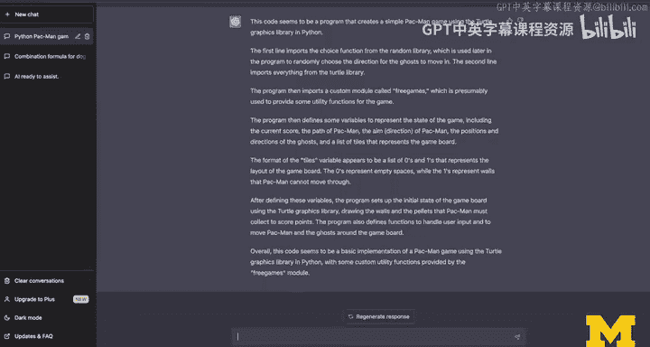

# ChatGPT 示教：选修：ChatGPT 示例 - 编程实践（上）

在本节课中，我们将学习如何利用 ChatGPT 来辅助理解编程代码。我们将通过一个具体的例子，展示如何向 ChatGPT 提问，并解读它给出的代码分析。

## 代码分析入门

上一节我们介绍了 ChatGPT 在文本处理方面的能力，本节中我们来看看它在编程领域的应用。对于编程初学者而言，理解一段陌生的代码可能颇具挑战。ChatGPT 可以作为一个强大的辅助工具，帮助我们快速解读代码的功能和结构。

以下是一个向 ChatGPT 提问以理解代码的示例流程：

1.  **发起问候与提问**：首先，向 ChatGPT 礼貌地打招呼并提出明确的问题。例如：“Hi ChatGPT. What does this code do?”
2.  **提供代码**：紧接着，将你需要分析的代码粘贴或输入给 ChatGPT。
3.  **获取分析结果**：ChatGPT 会分析代码，并生成一份详细的解释。

## 实践案例：Pac-Man 游戏代码分析

让我们通过一个实际案例来演示这个过程。我们向 ChatGPT 提交了一段用于创建简单 Pac-Man 游戏的 Python 代码。

ChatGPT 给出了如下分析：

> “这段代码似乎是一个使用 Python 的 Turtle Graphics 库创建简单吃豆人游戏的程序。
>
> 第一行从 random 库导入了 choice 函数，该函数在程序后续部分用于随机选择幽灵的移动方向。
> 第二行从 Turtle 库导入所有内容。
> 程序随后导入了一个名为 `Free Game` 的自定义模块，推测其用于为游戏提供一些实用功能。
> 程序接着定义了一些变量来表示游戏状态，包括当前分数、吃豆人的路径、吃豆人的目标方向、幽灵的位置和方向，以及一个表示游戏板的图块列表。
> `tiles` 变量的格式似乎是一个由 0 和 1 组成的列表，代表了游戏板的布局。**0 代表空地，1 代表吃豆人无法穿过的墙。**
> 定义这些变量后，程序使用 Turtle Graphics 库设置了游戏板的初始状态，绘制了墙和吃豆人必须收集以得分的豆子。
> 程序还定义了处理用户输入以及移动吃豆人和幽灵的函数。
> 总体而言，这段代码似乎是使用 Python 的 Turtle Graphics 库以及由 `free games` 模块提供的一些自定义实用函数，对吃豆人游戏的基本实现。”

## 分析解读与价值

正如我们在这里看到的，ChatGPT 提供了一份关于代码功能的清晰摘要，并对特定代码行的作用给出了见解。这对于编程初学者来说，可能是一个非常宝贵的工具，能帮助他们快速理解代码逻辑和结构。

本节课中我们一起学习了如何利用 ChatGPT 分析编程代码。通过一个具体的 Pac-Man 游戏代码示例，我们看到了 ChatGPT 如何解读代码功能、解释关键变量和函数，并总结程序整体结构。这为初学者提供了一种高效理解代码的新途径。