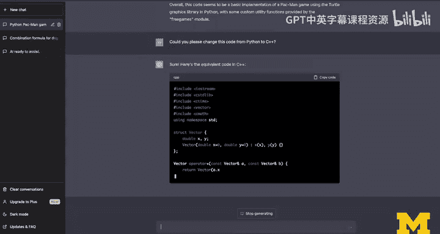

# ChatGPT 示教｜ChatGPT Teach-Out：P11：选修：ChatGPT示例-编程实践(下) 🧑‍💻

在本节课中，我们将继续探索ChatGPT在编程领域的应用，特别是如何利用它进行代码转换。我们将学习如何向ChatGPT发出指令，将一种编程语言编写的代码转换为另一种语言，并观察其生成过程。

## 代码转换实践 🔄

上一节我们介绍了ChatGPT在代码生成方面的基础能力。本节中，我们来看看如何利用ChatGPT进行跨编程语言的代码转换。这是一个非常实用的功能，能帮助开发者快速理解不同语言的语法差异或迁移项目。

### 发出转换指令

以下是向ChatGPT请求代码转换的典型方式。我们以一个具体的Python代码转换为C++的请求为例。

> So for our next prompt。We will ask Cha G B T。Could you please change this code。From Python to C plus plus。

这段描述告诉我们，用户的下一个提示是请求ChatGPT将一段代码从Python语言转换为C++语言。

### 接收并观察生成结果

ChatGPT在接收到转换请求后，会开始生成目标语言的代码。以下是其响应过程的描述。

> Sure， here's the equivalent code and C+ plus。And then Chat EPT creates a code block for us， converting our Python code to C++。

ChatGPT首先确认请求，然后会创建一个代码块，其中包含了转换后的C++等效代码。

### 理解生成过程的特点

代码生成有时需要一些时间，这与ChatGPT的工作原理有关。了解这一点有助于我们更合理地使用它。

> Now sometimes with these coding examples， it can take quite a while for chatt GPT to generate code。 that's because it's doing it in real time。And so we get to see it going line by line。Generating the code。

对于复杂的代码示例，ChatGPT的生成过程可能需要一段时间。这是因为它在实时地、逐行地生成代码，我们可以观察到这个动态过程。

---

本节课中我们一起学习了如何使用ChatGPT进行跨编程语言的代码转换。我们了解了从发出转换请求到接收结果的完整流程，并认识到其实时生成代码的特点。这展示了ChatGPT作为编程辅助工具的又一强大应用。