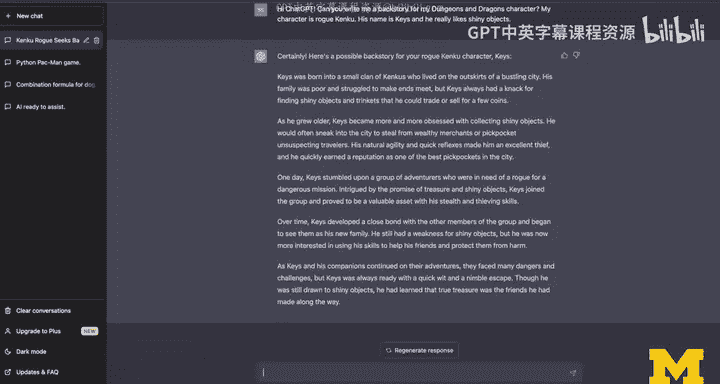

# ChatGPT 示教｜ChatGPT Teach-Out：P12：选修：ChatGPT示例-龙与地下城角色背景

在本节课中，我们将学习如何利用 ChatGPT 为《龙与地下城》游戏角色创作背景故事。我们将通过一个具体的示例，展示如何向 ChatGPT 提供简单的角色设定，并获取一个完整、有趣的角色背景故事。

## 示例：为鸦人盗贼“钥匙”创作背景故事

上一节我们介绍了 ChatGPT 的基本应用，本节中我们来看看它在创意写作，特别是游戏角色设定中的实际应用。

我向 ChatGPT 提供了一个简单的角色设定。我的角色是一名盗贼职业的鸦人。鸦人是一种类似乌鸦的人形生物。角色名叫“钥匙”，他像乌鸦一样，非常喜欢闪亮的物品。

以下是 ChatGPT 根据这个简短提示生成的完整背景故事：

> 钥匙出生在一个居住于繁华城市郊外的小型鸦人族群中。他的家庭贫困，艰难度日。但钥匙一直擅长寻找闪亮的物品和小饰品，他可以将其交易或出售以换取几个硬币。
>
> 随着年龄增长，钥匙对收集闪亮物品越来越着迷。他经常潜入城市，从富商那里偷窃，或扒窃毫无戒心的旅行者。他天生的敏捷和快速反应使他成为一名出色的小偷，他很快赢得了城市最佳扒手之一的声誉。
>
> 一天，钥匙偶然遇到一群冒险者，他们正为一个危险的任务寻找一名盗贼。出于对宝藏和闪亮物品的承诺感到好奇，他加入了队伍，并凭借其潜行和盗窃技能证明了自己是宝贵的资产。
>
> 随着时间的推移，钥匙与队伍其他成员建立了紧密的联系，并开始将他们视为新的家人。他仍然对闪亮物品有偏爱，但现在他更感兴趣的是运用自己的技能帮助朋友并保护他们免受伤害。
>
> 当钥匙和他的同伴继续冒险时，他们面对许多危险和挑战，但钥匙总是能以机智和敏捷的逃脱做好准备。尽管他仍被闪亮物品吸引，但他已明白真正的财富是沿途结交的朋友。

正如我们所见，仅凭我提供给 ChatGPT 的简短提示，它就为“钥匙”这个角色充实出了一个相当引人入胜且有趣的背景故事。

本节课中我们一起学习了如何利用 ChatGPT 为《龙与地下城》游戏角色快速生成详细的背景故事。通过提供一个包含**种族**（如鸦人）、**职业**（如盗贼）和**核心特征**（如喜爱闪亮物品）的简单设定，AI 能够扩展出一个包含出身、成长、动机和人物弧光的完整叙事。这种方法可以极大地帮助玩家和游戏主持人丰富游戏世界的细节。