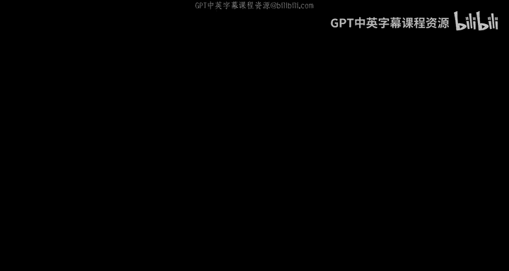

# ChatGPT 示教：13：剽窃与引用规范 📚

## 概述
在本节课中，我们将探讨使用 ChatGPT 等人工智能工具时可能涉及的学术剽窃问题，以及如何建立相应的引用规范。我们将明确剽窃的定义，分析 AI 生成内容是否构成剽窃，并讨论在学术工作中如何负责任地使用这些新兴技术。

---

我是杰克·伯纳德，我是密歇根大学总法律顾问办公室的一名律师。我同时也在我们的法学院、教育学院、公共政策学院和信息学院任教。自从我大约八个月前首次听说 ChatGPT 以来，我一直在思考它。我回应了我们社区中许多人关于其工作原理及其带来的影响的疑问。

我认为，在使用 ChatGPT 或任何其他类型的人工智能时，你并非必须进行剽窃。这类技术为我们带来的机遇是惊人的。人们可以利用这些 AI 技术做大量事情，而完全不涉及任何形式的学术不端或虚假陈述。

也就是说，我们在工作中一直在使用技术。这类 AI 技术带来的挑战在于，它们能为我们完成大量工作。正因如此，人们可能会倾向于在不给予其认可或未声明工作非本人完成的情况下使用它们。当然，在学术界，认可与信誉是核心价值。我们可能会与这项新技术产生摩擦，因为目前的界限尚不清晰。

例如，学生可能会去找朋友说：“嘿，你能帮我读一下这段文字，告诉我它是否讲得通吗？”我们通常不会特别感谢这种帮助。现在许多学生使用诸如文字处理软件中的建议或 Grammarly 这类技术，我认为这些通常也未被特别致谢。当然，那些工具还**不具备撰写整篇论文或完整回答一个问题的能力**。因此，人们担心像 ChatGPT 这样的产品可能会取代学生甚至教师自己的思考。

我确实认为有很多方法可以使用 ChatGPT 和其他 AI 技术，而无需进行任何形式的剽窃。但我认为，滑入可能构成剽窃的境地并不困难。当你时间紧迫时，依赖另一个来源是很容易的，因为我们都知道学生已经会这样做了：他们去维基百科或别人的文章，直接截取部分内容放入自己的作品而不注明出处。

---

## 什么是剽窃？
接下来，我们有必要谈谈什么是剽窃。剽窃并非法律违规，而是对学术规范的违反。当某人剽窃时，他/她未承认特定语言甚至其思想的来源，或者将其归因于他人（例如在论文中添加他人姓名以吸引更多读者）。

我认为在使用像 ChatGPT 这样的技术时，没有必要隐藏这些事实。事实上，我期望学生会说：“我撰写了这篇论文，并使用了 ChatGPT 来帮助我。”这是一种可能性。教师将如何回应则是另一个全新的问题。

我认为，仅仅因为 ChatGPT 通过扫描大量信息库，利用其阅读众多其他材料的“经验”，来生成针对查询的个性化、独立的回答，这并不使其构成剽窃。这就像我现在所说的所有话语，也是基于我一生的经验组织而成的，但这并不构成剽窃。因此，我认为 ChatGPT 本质上在做人类所做的事情——也许方式不完全相同，但非常相似——即它**模拟知识并根据其 AI 模型整合出一个观点**。它可能尚未具备意识，但这很像去向另一个做同样事情的人获取信息。

所以，我不认为 ChatGPT 在接触大量信息后创造新的表达本身是剽窃。当然，可以设想 ChatGPT 可能在用户不知情的情况下引用了第三方内容。在这种情况下，它可能构成剽窃。但据我所知，这种情况不太可能发生，因为存在一些安全防护措施。这些防护措施或许能以某种方式被绕过，我们尚未可知。但总的来说，仅仅整合其接触过的信息并创造原创表达，这本身并非剽窃。这只是来自一项技术的沟通。

---

## 建立引用规范
我认为，很难知道我们将围绕这些智能技术、这些 AI 技术创造什么样的引用文化。目前，我们不知道该如何做。学生、教师、出版商可能都会对如何承认其材料是否部分通过与某种 AI 协作创建感到有些困惑。我认为我们目前还不知道这个问题的答案。

如果是我，我会倾向于让人们知道我使用了这项技术，因为我认为这关乎诚信。特别是在学术界，我们希望确保我们引用了来源。因此，我认为学生和教师应尽最大努力创建规范标准，明确人们可以使用和不可以使用的内容。当然，在一些课堂中，教师会将使用 ChatGPT 作为教学模式的一部分。因此，也许这会被纳入其中，学生无需特别提及，因为它是原始作业要求的一部分。

但我认为，如果学生或教师（例如在发表作品时）使用了 ChatGPT，承认它是一个好主意，尤其是在早期阶段。因为我认为这会引发讨论，使我们能够思考围绕引用 AI 的文化将是什么样子。

---

## 总结
本节课中，我们一起学习了使用 ChatGPT 等 AI 工具时涉及的学术诚信问题。我们明确了剽窃是对学术规范的违反，而非法律问题。我们分析了 AI 生成内容的性质，认识到其整合信息并创造新表达的过程本身不构成剽窃，但隐瞒使用或导致第三方内容被未署名引用则可能存在问题。最后，我们探讨了建立 AI 引用规范的必要性，并强调在当前阶段，出于诚信和推动对话的目的，公开承认对 AI 工具的使用是审慎的做法。