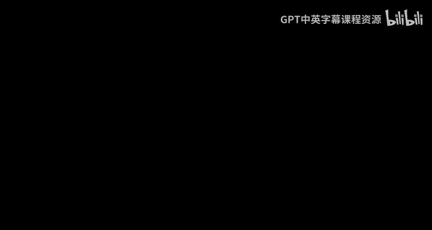
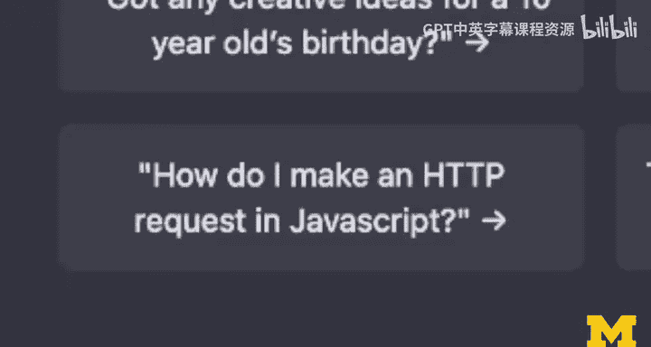

# ChatGPT 示教｜ChatGPT Teach-Out：P16：道德与非道德应用场景

在本节课中，我们将探讨ChatGPT在哪些情境下可被视为符合道德，哪些情境下则可能存在问题。我们将分析具体的应用案例，并思考如何负责任地使用这项技术。

## 概述

ChatGPT的应用场景存在道德与非道德的区分，目前仍需大量工作来界定这些情境的边界。理解这些区别对于负责任地使用人工智能至关重要。

## 被视为非道德的应用场景

根据经验，ChatGPT在以下情况下的使用可能被视为不符合道德规范。

以下是几种典型的非道德应用场景：

1.  **用于评估个人能力的场景**：当他人期望收到由个人亲自撰写的消息，或将写作内容作为衡量作者能力的标准时。例如，学生作业或大学申请文书。招生官阅读这些内容是为了判断申请人是否具备形成连贯思想、组织信息结构以及进行专业沟通的能力。这在求职申请中同样适用。试想，如果某人只是将提示词输入ChatGPT，然后复制粘贴其生成的内容，那么阅读这些回复的人将无法判断发送者是否真正拥有所声称的沟通能力。

2.  **用于撰写私人消息的场景**：例如，当你给朋友或家人撰写私人电子邮件或消息时。你通常不会希望这些充满个人情感的信息是由AI代笔的。因此，如果事后发现对方发送的消息并非出自其本人之手，可能会引发问题或造成伤害。

3.  **未经审阅即发送生成内容的场景**：人们在使用ChatGPT生成消息后，不加以审阅就直接发送，这可能带来问题。可以想象，经过一段时间，如果你习惯了工具所生成内容的质量，你可能会只是输入提示词，让它生成一整份报告，然后看都不看就发送出去。这很可能在未来导致大量的沟通误解和错误。

## 被视为可接受的应用场景

当然，我们也可以设想未来可能存在某些可接受使用ChatGPT的场景。

以下是一些可能被视为合适的应用方向：

1.  **处理重复性任务**：例如，总结冗长的工作讨论。这类任务通常没人会在意具体由谁执笔。

2.  **执行简易搜索查询**：例如，寻求“如何操作”类的指导说明。ChatGPT自身也提供了一些建议，如“如何做某事”、“能否告诉我更多关于量子物理学的知识”等。

3.  **作为学习工具**：将其用作某种学习辅助工具，这些用途通常是可行的。

不过，必须始终牢记，所有的答案都基于从某处获取的信息，因此**答案可能存在偏见**，使用者必须考虑到这一点。

## 迈向负责任的用法

如果我们预见未来会常规化使用ChatGPT，那么可能需要要求使用者必须阅读并理解他们即将发送的内容，即使内容并非全部由他们亲自撰写。这类似于在发送前要求他们完成一个审核签发的流程。

因此，我们可以看到现在存在许多这样的情境：你可能会从ChatGPT生成的内容开始，然后对其进行编辑，使其更准确，或听起来更像你自己写的，加入你的个人风格。但核心是，必须始终确保你理解并认可你即将发送的、与ChatGPT共同创作的内容。

## 总结

本节课中，我们一起学习了ChatGPT的道德与非道德应用场景。我们了解到，在评估个人能力或涉及私人情感的沟通中使用ChatGPT代笔可能是不道德的，而将其用于处理重复性工作或作为学习工具则相对可接受。关键在于，无论何种场景，使用者都必须对生成内容进行审阅、理解并最终负责，确保沟通的真实性与准确性。