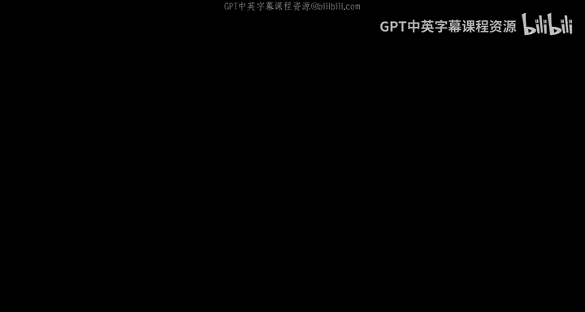
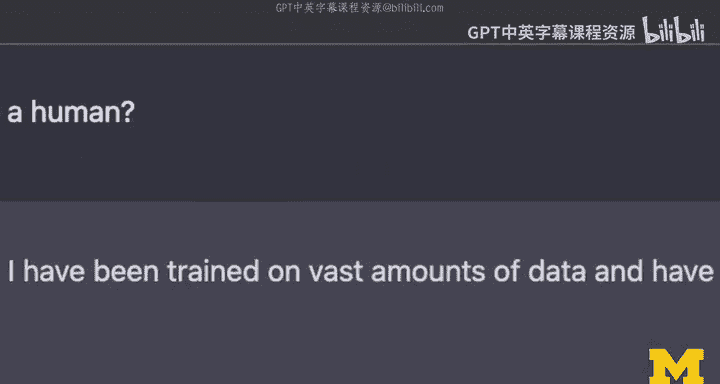

# ChatGPT 示教：P18：应对ChatGPT的负面影响

在本节课中，我们将探讨如何应对以ChatGPT为代表的生成式人工智能技术所带来的潜在负面影响。我们将从监管、责任归属、技术记录以及社会影响等多个角度进行分析，旨在为理解和引导这项强大技术的发展提供思路。

---

## 🛡️ 监管的必要性与紧迫性

我认为，当前社会面临的最具挑战性的问题之一是如何监管人工智能。我们无法很快完成这项工作，因为技术已经面世，一些潜在的负面影响已被预见。

因此，首要任务是我们确实需要对人工智能进行非常完善的监管。我将这一代人工智能的潜在力量和危害可能性，比作核能。正如核能受到极其严格的监管一样，我们也需要以类似的方式思考对人工智能的监管。

## ⚖️ 明确责任归属

我认为，有几项措施可以立即改善现状。例如，目前存在一些模糊地带：如果一个实体发布的人工智能系统做出了某些“失控”行为（如前文所述），但该个人或组织并非有意造成此后果，他们应承担多少责任？

我们需要堵上这个漏洞。发布失控人工智能系统的个人或组织，必须为此承担全部责任。当然，这会立即减缓个人或公司急于推出这项技术的热情。事实上，我们已经看到了一些相关案例。

我们必须确保这些系统不会进行可能严重伤害他人自尊的对话，或者意外地从你的电子邮件中获取敏感信息并公之于众。理论上，即使以今天的技术，这些事情也可能发生。

因此，我认为，系统做出非预期且有害行为的后果必须是重大的，并且必须明确地与发布该技术的个人或组织挂钩。这是第一点。

## 📝 建立对话记录机制

对于像ChatGPT这样的技术，另一点是我们可能建议任何此类系统都详细记录每一次对话和生成的每一段文本。这有多重原因。

这样，如果出现问题，我们实际上可以回溯并检查哪里出了错。作为一名教师，我也可以说，这将非常有帮助，例如，能够检测我的学生提交的作业是否由ChatGPT撰写。

我认为，能够检查系统输出了什么的能力至关重要。

## 🤔 应对更广泛的社会影响

还有其他一系列问题。但总体而言，我认为重要的是监管要偏向保守一些，即将责任置于技术创造者身上，让他们感受并承担技术出问题时的法律责任。

我认为，对于即将到来的人工智能技术，更难控制或监管的事情之一是：我们是否准备好让它取代工作岗位？如果是，围绕这一点需要什么样的政策？

这些事情的发生将是不可避免的。我们并未试图阻止制造业机器人取代某些岗位，尽管它们已经在某些领域减少了工作机会。到目前为止，我们也没有讨论过，或许我们不想要自动驾驶卡车，因为这仅在美国就可能消除300万卡车司机的工作。但这些是值得进行的、有意义的讨论。

我认为，一些更难监管和调整的事情，因为它们会悄然渗透进我们的社会，是当我们开始使用这些技术并对其习以为常后，甚至意识不到它们对我们产生的影响。我认为，我们已经在社交媒体等技术上看到了类似的情况，我们某种程度上感觉到它在侵蚀我们的民主，但尚未尝试监管，因为我们甚至不确定要监管什么。

但我认为，对于人工智能，我们越早进行这些对话越好。我怀疑这类问题只会越来越严重，我们将越来越多地面临与技术互动方式转变带来的挑战，当然也包括人与人之间互动方式的转变。我们是否希望这些转变发生？我认为，作为一个社会，我们只需要进行更多讨论，并对此保持清醒的认识。

## 🚀 正视技术奇点

我认为ChatGPT代表某种阈值已经达到。人们谈论“奇点”，即人工智能与人类智能相等的时刻。从那一刻起，它会变得越来越聪明。我们尚未完全到达那里，但我认为我们已经惊人地接近。

如果你仔细想想，这是人类从未经历过的事情：一种非人类的事物可能比我们更聪明。因此，我认为这再次表明，它蕴含着巨大的力量——技术力量。任何时候，当存在巨大的技术力量时，它都能帮助我们实现想要达成的目标，但也可能带来巨大的危险。

因此，在这种情况下，我确实相信，我们必须对人工智能技术格外小心，以确保我们的文明能够真正远离它可能带来的一些最黑暗的潜在影响。

---

**总结**：本节课中，我们一起学习了应对ChatGPT等AI技术负面影响的几个关键方面。我们探讨了建立严格监管框架的紧迫性，明确了技术发布者应承担的责任，提出了保留系统对话记录的重要性，并深入讨论了AI可能引发的广泛社会影响，如就业替代和人际互动方式的改变。最后，我们正视了技术接近“奇点”所带来的根本性挑战，强调了在享受AI强大能力的同时，必须对其潜在风险保持高度警惕和审慎态度。