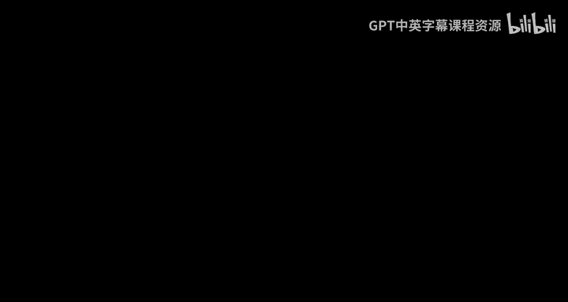

# ChatGPT 示教：P19：输出内容所有权与货币化 💰

在本节课中，我们将探讨由ChatGPT等生成式AI工具所产生内容的**所有权归属**与**货币化潜力**。这是一个法律与伦理交织的新兴领域，对创作者、用户和整个社会都至关重要。

---

## 概述

我们将首先分析当前法律框架下AI生成内容的版权状态，接着探讨其商业化的可能性，最后审视其中涉及的伦理问题。理解这些概念有助于我们负责任地使用AI工具。

---

## 版权归属：一个开放性问题

从版权视角看，AI生成内容的所有权是一个有趣且尚未完全明确的问题。

根据当前美国版权法，任何非由人类创作的作品都无法获得版权保护。因此，ChatGPT等工具产出的内容是否拥有版权，目前并不明确。

当然，ChatGPT软件本身的版权由OpenAI持有，其他AI软件（如生成艺术、音乐的AI）的代码版权也归其开发者所有。但AI的**输出内容**则不同，版权局不会认可由非人类作者创作的作品具有可版权性。

我们面临的一个核心挑战是：如何区分一部作品中哪些部分由AI生成，哪些部分由人类创作？这目前非常困难。例如，如果一只猫在画布上抓挠出图案，由于猫不是人类，该作品将没有版权。但如果创作者隐瞒了猫的参与并声称是自己所作，版权局很难核实真相。这对我们而言是一个现实的挑战。

---

## 内容的货币化潜力

关于将ChatGPT生成的内容进行货币化，目前我并未意识到存在明确的禁止性规定。

不过，查阅服务条款至关重要，因为其中可能包含相关限制。OpenAI绝对会找到方法将此技术货币化。他们拥有投资者，微软已向其投入了数十亿美元。因此，毫无疑问，他们将开辟市场以实现盈利。

至于用户能否将自己从ChatGPT获得的输出进行货币化，这很难断言。在我体验各种AI技术时，它们能创造出独特而有趣的内容。例如，我曾让ChatGPT以托尔金的风格，为《霍比特人》最后一章之后、甘道夫多年后回访之前的岁月创作一个额外章节。它完成了一段精彩的叙事。这很有趣。

---

## 货币化涉及的伦理问题

我认为，在一般情况下，我们需要**引用来源**，**承认出处**。

因此，存在有人不这么做的风险：他们使用ChatGPT生成内容，却假装自己是该作品的作者，然后公开发布。目前，这样做不一定违法，法律在此领域将如何发展还有待观察。我预计围绕这些问题将出现大量法律进展和潜在争议。

但这里确实存在关于作品**完整性**和**真实性**的伦理问题，我们一直对此有所担忧。在某些方面，使用ChatGPT很像咨询他人：它能以类似人类的方式产生信息，其产出看起来也与人类所言（或艺术AI的人类创作）极为相似。

因此，如果人们将AI生成的作品归功于自己，并借此获得赞誉、名声、机会或资源，我认为这会给社会带来一些值得关注的忧虑，是我们应当思考的问题。

---

## 总结与反思

本节课中，我们一起学习了AI生成内容的版权现状、商业化可能性及其相关的伦理挑战。

但我不确定天是否会塌下来。现实中早已存在代笔作家、代画画手，灵感也常来自与他人的交谈，我们甚至未必记得某个好点子的确切来源。ChatGPT有趣之处在于，它本身确实不会自主产生想法——但或许，我们人类有时也是如此。

---

**核心概念回顾：**
*   **版权判定公式：** `可版权性 ≈ 人类作者身份`
*   **伦理准则：** 使用AI产出时，应保持透明，**注明来源**。