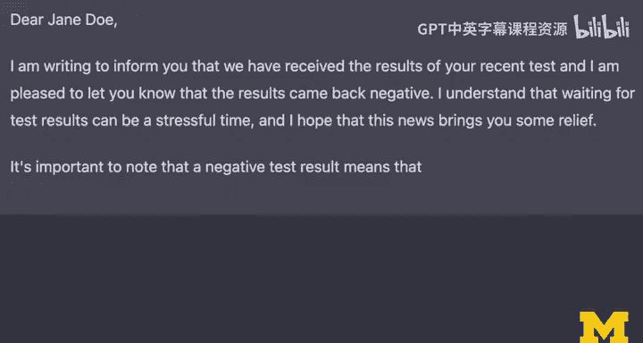

# ChatGPT 示教：P21：数据隐私保护 🔒

在本节课中，我们将探讨使用以 ChatGPT 为代表的人工智能技术时，可能涉及的数据隐私问题。我们将了解潜在的风险，并学习如何在利用这些强大工具的同时，保护个人及他人的敏感信息。

---

我认为，这类人工智能技术会带来多种隐私相关的问题。人们可能会为了省事，在向 ChatGPT 这类工具提问时，引入一些信息。这些信息可能包含他们通常认为是私密的内容。

他们没有意识到，当你将这些信息输入软件时，可能正在泄露你不应该泄露的信息。例如，一位医生为了让 ChatGPT 撰写一封信件或记录描述他与某位患者的经历，他可能不想在描述中使用患者的真实姓名和医疗信息。

然而，随着我们习惯使用这些技术，人们可能不会去思考，也可能不会想起我们在分享信息时所采取的预防措施。仅仅因为当你独自在家与一台机器互动时，感觉非常私密，这并不一定意味着这些信息不会传播。

因此，我认为人们应该对他们提供的信息保持谨慎，即使他们希望获得像 ChatGPT 或其他 AI 机器人的帮助。使用这些技术非常有帮助，但你可能不希望包含那些通常属于隐私的信息。

是的，我认为询问敏感问题是安全的。但重要的是，要省略那些会被你所用技术数据库吸收的信息。如果你提供了大量关于一个可识别个体的信息，这些信息可能会被融入 AI 提取信息的背景数据中。

这可能包括一张照片、他人创作的音乐，或是对某个人的描述。因此，我认为你需要谨慎分享这类信息，因为你不知道它将如何被使用，以及这些信息是否会被泄露。

所以，我认为在使用这些技术时，必须意识到你可能会暴露通常不愿暴露的信息。同时，我认为你可以在不暴露信息的情况下讨论非常敏感的话题。

如果你需要谈论一个具体的人，可以为其创建化名。如果你想，可以将其置于虚构的背景下。你可以以一种谨慎的方式进行互动，同时仍然讨论那些有争议、困难的话题。

实际上，我认为人工智能技术可以让某些类型的对话对人们来说变得更容易，特别是敏感对话。因为有些人如果是在与一项技术互动，而不是另一个人，可能会感到更舒适、更诚实。

我认为世界上有很多内向的人可能会觉得这样更舒服，也许不只是内向的人。任何可能更习惯于与技术互动的人，就像他们可能对狗、婴儿或植物说话一样。

我不确定像 OpenAI 这样的公司能做什么来防止私人信息通过 AI 被泄露。我不确定会有一个简单的方法来区分事实与虚构。

也就是说，我不确定他们是否能够判断，当某人试图让 AI 续写一本书的章节时输入的名字，是否会被视为可识别的个体。如果有人这样说：“好的，ChatGPT，我想让你写一篇小说”，那么“小说”这个概念可能会永远与后续的角色绑定。

我不确定这是否可能，也许可能。我也不确定他们将如何做到这一点。他们已经做到的事情已经非常了不起。

我的意思是，人们与这些技术互动时的体验，是产生一个人能产生的东西，或是产生一段看似对话的内容。这些都是了不起的成就。

因此，我不想说能够从虚构中筛选出事实是不可能的。但我认为这会很困难。所以，我不确定他们能做到什么程度。

---

**本节课总结**

本节课中，我们一起学习了在使用 ChatGPT 等 AI 工具时保护数据隐私的重要性。核心要点包括：

1.  **风险意识**：在查询中输入信息时，可能无意中泄露个人或他人的私密信息。
2.  **谨慎输入**：即使寻求 AI 帮助，也应避免输入可识别个人身份的具体信息（如真实姓名、医疗记录、照片等），因为这些信息可能被吸收进模型的训练数据。
3.  **安全讨论敏感话题的方法**：可以通过使用**化名**或将场景设定为**虚构故事**来讨论敏感议题，从而在不暴露真实信息的前提下获得 AI 的协助。
4.  **技术局限性**：目前 AI 提供商在技术上难以完全区分用户输入的是“事实”还是“虚构”，因此主动保护隐私的责任很大程度上在于用户自身。
5.  **AI 的积极面**：AI 也为某些敏感对话提供了更安全、舒适的出口，尤其适合那些更愿意与技术而非真人倾诉的用户。

记住一个基本原则：**对待 AI 如同对待一个可能公开的场合，不要分享你不愿被公开的信息。**