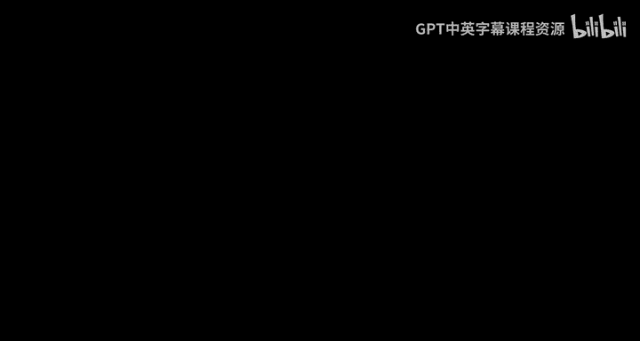

# ChatGPT 示教：22：政府监管机制 🏛️

在本节课中，我们将探讨关于政府应如何监管智能AI技术（如ChatGPT）的思考。我们将分析监管的必要性、潜在挑战以及未来可能面临的复杂性。

---

我不确定我们应如何思考政府监管智能AI等技术的议题。

我确信未来将出现相关讨论。

我担心当前我们可能过于仓促。许多此类技术目前仅表现为言论与交流形式，我们应始终警惕赋予政府过多权力去压制言论——即使是我们不喜欢的言论。因此，我认为在早期阶段授予此类控制权需谨慎。

可能存在某些情况，当我们发现这些技术带来特定问题时，确实需要建立监管机制。但我目前尚不清楚具体问题所在及其出现时机。

当前智能AI面临诸多挑战，例如生成深度伪造内容——即伪造不存在人物的图像，或篡改真实人物的图像。

例如将人物头像移植到不同身体上，或伪造人物所处地点。这类复杂技术极易被滥用，而ChatGPT目前尚未达到同等风险水平，因此我们需要对此类技术保持警惕。

预计我们将看到智能AI被操纵以引发不良行为的案例。若出现相关监管法规，我不会感到意外。但我认为尚未到危机时刻，我们应避免操之过急。

我不确定这类智能AI技术能否被有效监管。目前仍为时过早，难以断言。

人类行为可以被监管，未来或许会建立机制让我们更清楚地了解谁在使用技术、作何用途。例如OpenAI这类公司可能告知我们：“是的，是这位用户使用了该语言模型，是这位用户引导ChatGPT生成了特定段落。”这在现阶段或许可行。

但当智能AI技术无处不在、人们能自主生成内容时，一旦我们对其使用更加习以为常，且失去早期使用者所具有的可追责性或可识别性，我不确定我们能否继续保持有效管控。我们将难以确定责任归属——就像我们无法判断一篇论文是借助Grammarly完成，还是经邻居修改而成。

Grammarly或许知晓，但存在诸多我们无法查明责任方的情况，因而难以追责。监管的目的常在于鼓励某些行为、抑制其他行为，但若超出可识别范围，监管效果可能受限。

此外，当AI开始自主生成下一代AI时，我们将更难追踪具体行为主体。

---

**总结**  
本节课中，我们一起探讨了政府监管智能AI技术的潜在路径与挑战。我们认识到监管需平衡言论自由与风险防控，早期监管应谨慎推进。随着技术普及和AI自主进化，责任追溯将愈发复杂，这对未来监管机制的设计提出了更高要求。