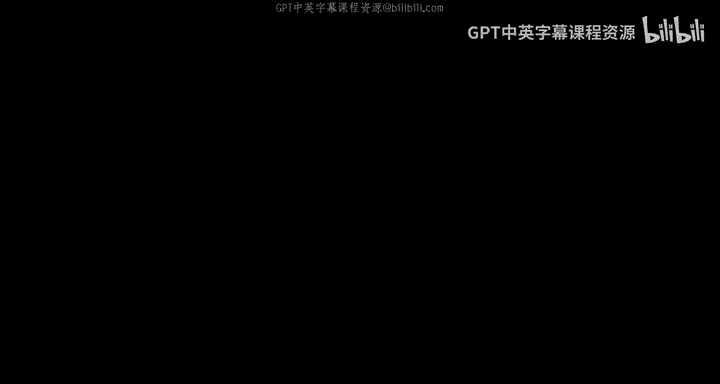

# ChatGPT 示教：P23：社会对新技术应对

## 概述
在本节课中，我们将探讨以ChatGPT为代表的人工智能技术如何在社会中扩散，以及社会结构将如何围绕这些新技术进行重组。我们将分析技术采纳的经典模式，并思考当前AI浪潮的独特之处及其潜在的社会影响。

---

## 技术扩散的S型曲线 📈

上一节我们讨论了AI与人类能力的互补性。本节中，我们来看看新技术被社会采纳的普遍规律。

经济学家、社会学家和商学院教授研究技术突破如何在社会中传播，其历史已超过一百年，最早的研究甚至可以追溯到杂交玉米种子的推广。研究发现，技术采纳过程几乎总是遵循一条**S型曲线**。

以下是S型曲线发展的典型阶段：
*   **初期**：由一批“先行者”或推广者率先使用。
*   **快速上升期**：其他人看到先行者提高了生产力，于是纷纷效仿，技术采纳速度急剧加快。
*   **平台期**：当市场接近饱和时，采纳速度逐渐放缓，曲线趋于平缓。

一个有趣的现象是，在曲线开始快速上升的第一个“拐点”处，往往存在**过度乐观**的情绪。然而，人们对于其**长期影响**却又可能**过于悲观**。

---

## AI技术采纳的三阶段 🚀

理解了技术扩散的基本模型后，我们具体分析AI技术的采纳过程。

技术的影响通常分三个阶段展开：
1.  **替代与增效**：人们最初使用新技术来更好地完成现有工作。例如，用ChatGPT来协助写作或编程，核心感受是“我可以更快地完成这件事了”。
2.  **功能拓展**：随后，人们意识到新技术能实现以前无法做到的事情。例如，用AI综合所有笔记，或使用能记录、搜索过往会议内容的软件。
3.  **社会重组**：最终，社会将围绕这项新技术进行结构性重组。就像汽车取代马匹后，催生了度假村、汽车旅馆等全新行业。AI将可能引发社会（尤其是信息世界和工作领域）的根本性重构，我们已经看到领英等平台涌现出“提示词工程师”这类新职位。

---

## 当前AI浪潮的独特性 🌊

我们已经了解了技术扩散的普遍阶段。但当前的AI浪潮与过去的技术革命有一个关键的不同点。

这次AI技术扩散的**初始速度远超以往任何技术**。ChatGPT在**5天内**就获得了百万用户，而Netflix用了两年半，Facebook也用了约12个月才达到同等规模。

更重要的是，其独特之处在于**低门槛与可及性**。与此前如汽车、电灯泡等高成本、高门槛的技术创新不同，当前的AI技术（如基础版本的ChatGPT）对许多人而言是**免费**的。

这好比政府给每户人家门口放了一个装满各种工具和无限木材的“制造舱”，并告诉大家：“去创造吧，做任何你想做的东西。”我们由此创造了一个巨大的“创客空间”，人们可以在其中进行艺术、音乐、诗歌等各类创作，可谓“百花齐放”。虽然成果质量参差不齐，但可能性是无限的。

---

## 确保广泛接入与面向未来 🧩

面对这样一个快速普及且潜力巨大的工具，我们必须思考如何让更多人受益。

由于接入成本极低，当前的核心议题之一是**确保所有人都有机会接触和使用这项技术**。这一点在教育领域尤为重要。

我们可以把AI工具想象成一套**没有说明书的虚拟乐高积木**，还配有一位智能助手。当年轻人获得一片新天地和一套乐高积木时，他们能创造出令人惊叹的东西。因此，将这项技术推广给年轻人至关重要，因为他们将用它做出惊人的成就。我们有责任推动其普及，并期待看到它将如何发展。

---

## 总结
本节课中，我们一起学习了技术在社会中扩散的S型曲线模型，分析了AI技术从增效工具到引发社会重组的三阶段发展路径。我们认识到，当前AI浪潮以其前所未有的普及速度和低门槛特性，正在创造一个全民可参与的“创客空间”。最后，我们强调了确保技术广泛可及、特别是赋能年轻一代的重要性，因为未来的可能性正掌握在他们手中。