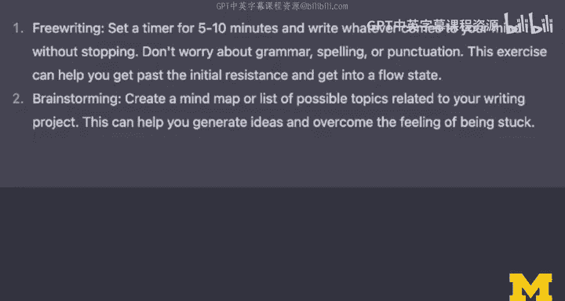

# ChatGPT 示教：29：利用ChatGPT培养技能 📚

在本节课中，我们将探讨一个核心议题：如何将ChatGPT这类生成式AI工具，从潜在的“作弊”风险，转化为辅助我们学习和技能发展的有效伙伴。我们将重点分析其在写作技能培养方面的潜力与挑战。

---

很多人将ChatGPT与计算器这类工具进行比较。当计算器首次出现时，许多数学老师担心学生将不再学习数学。他们认为学生只会学习如何输入算式，然后由计算器给出答案。

然而，一些人提出，计算器实际上承担了低层次的计算工作，这释放了大量精力，使学生能够专注于更高层次的数学思维。在某种程度上，我相信这是正确的。

但对于ChatGPT，我不太确定是否发生了同样的情况。例如，如果一个学生输入一个查询：“为我写一篇关于密歇根州树木历史的文章”，他可能直接提交这个答案，而并不理解其背后的修辞手法、文章结构、情感选择以及词汇运用。这些恰恰是写作技能和沟通能力发展的重要部分。

通过省略这些过程，尚不清楚ChatGPT是否真正支持了写作能力的培养。因此，我认为需要更多的工作来理解这一点。

---

上一节我们讨论了ChatGPT在技能培养中可能存在的“替代”风险。本节中，我们来看看它如何能真正支持写作技能的提升。

我认为AI在支持写作技能方面存在许多有趣的机会。甚至在ChatGPT出现之前，我们就能看到像Grammarly这样的工具，或者在Gmail中，它会提示你的语气、句子是否过长，以及如何编辑使其更易于理解。

现在，大家真正感兴趣的是理解ChatGPT在写作领域的角色。我个人感兴趣的一点是，那些支持写作起步过程的工具。

像Grammarly或评估邮件的工具，通常要求你先写出初稿，然后它们再评估好坏。但许多写作者面临的困难恰恰是如何开始。我认为这正是ChatGPT的许多价值所在——它能帮你克服对“空白页”的恐惧。当你第一次需要写论文时，它可以直接为你开始写作。

我认为这正是让人们感到兴奋的地方：他们可以看到这个过程被完成。未来可以有更多研究来理解，阅读ChatGPT生成的内容会如何影响你自己的写作。

但我知道，目前有很多讨论是关于人们是否真的在阅读或理解ChatGPT所写的内容。因此，这里存在一个机会：探究这种写作是否可以作为教育范本。

---

本节课中，我们一起学习了将ChatGPT视为技能培养工具的两种视角。一方面，它可能像计算器一样，通过处理基础性工作，释放我们的认知资源以专注于更高层次的思考。另一方面，在写作等复杂技能培养中，需警惕其可能绕过关键学习过程的风险。关键在于引导和设计，使AI工具成为支持过程（如克服写作起步困难）的伙伴，而非简单的结果替代品。未来的研究和教学实践需要探索如何有效利用其生成内容作为学习模型，从而真正促进深层技能的发展。