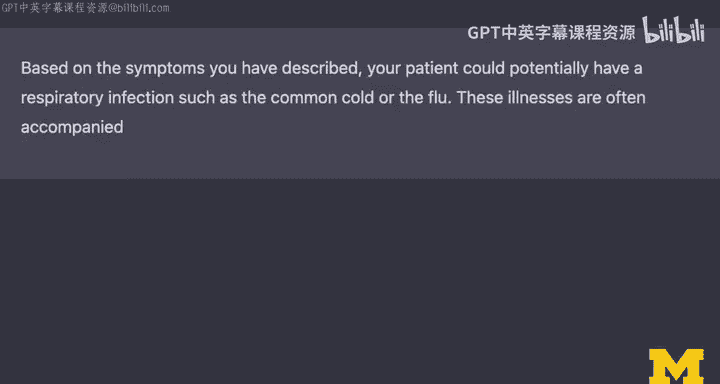

# ChatGPT 示教：31：AI在医疗实践与教育中的应用 🏥🤖

## 概述
在本节课中，我们将探讨人工智能在医疗实践与教育领域的具体应用。我们将了解临床医生和患者参与AI开发的重要性，并展望AI在诊断、治疗、预后及医学教育等方面的未来影响。

---

## 临床医生与患者在AI开发中的必要性 👥

当我们思考人工智能或旨在影响临床护理的程序开发时，临床医生的必要参与至关重要。不仅如此，我认为这个群体还应包括患者。关键在于理解真实的临床实践或患者居家护理的实际情况。

如果开发这些技术时，房间里只有开发者，那么无论他们的初衷多么良好，由于缺乏真实的临床经验，或者不了解患者经历特定共病或健康状况的体验，可以想象，这些技术的使用方式、人与技术的互动方式，乃至其落地实施，都可能存在某种程度的脱节。

我们经常关注的一个问题是：这些技术将如何影响临床医生的工作流程？这需要临床医生提供输入，以确定或告知开发者工作流程的具体样貌，进而帮助决策在何处最恰当或最有效地部署人工智能或机器学习模型。对于患者而言，情况也是如此。

---

## AI对医疗实践与教育的广泛影响 🔄

谈到人工智能和机器学习对临床护理或临床实践的影响，我敢说它将以某种形式影响临床实践的方方面面。医学教育领域也是如此。

目前，我们看到影响最大的领域主要是诊断，特别是基于影像的诊断。考虑到这些技术的特性，这是可以理解的。但最终，我认为它将影响治疗和预后判断。

它将对诊断产生影响，这也是我目前正在研究的领域。而在医学教育方面，当涉及到评估、辅导，或医学生与“非人类”导师进行互动和双向交流时——这位导师在某些方面具备与人类导师同等的知识水平——这种可能性正在显现。

---

## AI在医学教育中的未来应用 🎓

想象一下，如果学生实际坐在教室里，他们会与导师互动。但在家中，他们也能向人工智能代理询问医学教育中的特定问题、主题或科目。我认为，这无疑是即将在不久的将来实现的事情。

---

## 总结
本节课中，我们一起学习了临床医生和患者参与AI开发的必要性，探讨了AI对医疗工作流程、诊断、治疗及预后的影响，并展望了AI作为智能导师在医学教育中的未来应用前景。理解这些协同作用，对于负责任地开发和部署医疗AI至关重要。