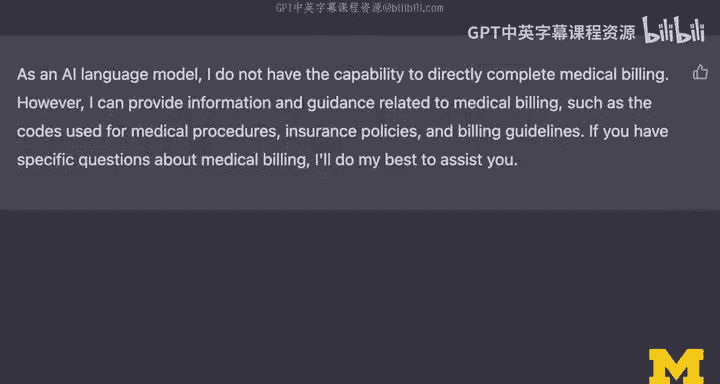

# ChatGPT 示教：P32：ChatGPT通过认证考试的影响 📚

在本节课中，我们将探讨ChatGPT通过各类专业认证考试（如美国医师执照考试、律师资格考试、顶尖商学院考试）所引发的讨论与影响。我们将分析这些成就的实际意义，并思考人工智能如何与人类专业人士协作，而非简单替代。

---

关于ChatGPT通过高难度专业考试的话题很多。我们必须重视这一现象。同时，我们也需要适度调整预期，并认识到何时需要审慎看待这类消息。

媒体和技术领域存在过度炒作技术的倾向。这可以理解，但有时可能引起相关从业者的担忧或恐慌。例如，临床医生可能会想，这是否意味着技术将取代我？患者可能担心，这是否意味着技术将完全取代我的医生？

问题的表述方式很容易让人产生这种印象。然而，我通常建议从**任务特定**的视角来看待人工智能和机器学习。这回到了我之前关于“团队协作”的观点。我们必须承认一个事实：ChatGPT通过了美国医师执照考试。这对我意味着什么？这意味着临床护理中可能有一些事情我不再需要亲自去做。

你会听到“去技能化”这个术语。这不一定是坏事。它可能为临床医生创造机会，让他们能更专注于那些本应投入更多精力的任务。例如，提供更富同情心的护理、花更多时间与患者相处，而不是处理那些繁琐的、甚至他们当初学医并非为了从事的工作，比如文书工作和账单处理。

如果我们有一个**AI智能体**能替我们处理这些事务，它就可能让我们专注于以患者为中心的沟通、共同决策、富有同情心的关怀，以及我们渴望与患者进行的那些有意义的对话。

这并不意味着我们将不再需要医学知识。我们现在所处的阶段，需要认真思考从概念层面我们需要知道什么。我看到一种趋势：医学生不再需要成为信息的唯一来源，医疗专业人员也不再需要成为绝对的信息权威。他们正更多地转向成为信息管理者，能够定位、综合信息，并以有效的方式将信息传达给患者。

因此，我们必须从概念层面思考：医学生、住院医师、医疗保健专业人员需要知道什么？需要做什么才能提供有效的护理？

接着，将这一点与人工智能和机器学习结合起来思考：作为队友或工具，AI能做什么来让我们更好地工作？AI将如何增强我们的能力？而我们又将做什么来增强AI的能力？

这就是为什么我再次强调，当我们从团队视角思考时，能更容易地看到：AI不一定会取代医生。我不相信这会发生。你可能会听到一种说法：AI不会取代所有医生，但它很可能会取代那些无法与AI协作或无法有效利用AI作为工具的医生。

---

**本节课总结**  
本节课我们一起探讨了ChatGPT通过专业考试的影响。核心在于理解这并非简单的替代，而是人机协作模式的演进。关键在于人类专业人士需要转型为**信息管理者**和**协作领导者**，利用AI处理繁琐任务，从而更专注于需要人类同理心、复杂沟通和高级决策的核心职责。未来的竞争力在于能否有效地与AI组队工作。