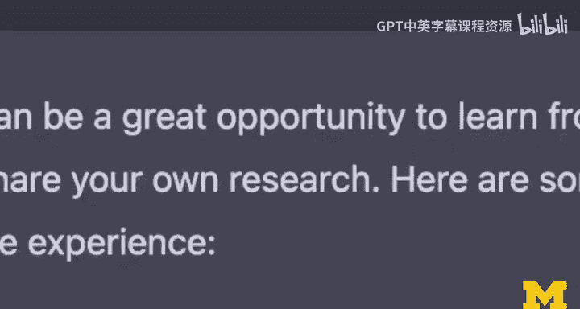

# ChatGPT 示教：35：AI在自助建议中的应用 🧠

在本节课中，我们将探讨人工智能（尤其是像ChatGPT这样的模型）在提供自助建议方面的应用。我们将分析其工作原理、优势、潜在风险以及它如何通过聚合大众智慧来提供“中庸”的建议，而非极端观点。

---

上一节我们讨论了AI的社会影响，本节中我们来看看AI在自助建议中的具体应用。与社交媒体平台可能放大极端观点不同，AI模型经过训练，旨在提供更为平衡和合理的建议。

AI建议的核心机制是**信息聚合**。它并非一个具有独立意识的“超级大脑”，而更像是一个高效的**信息平均器**。其公式可以简化为：
`AI建议 ≈ 对海量人类生成文本进行模式识别与概率加权后的输出`

以下是AI在提供建议时的几个关键特点：

1.  **提供基础与合理的建议**：对于常规问题，如职业发展或会议准备，AI能给出结构清晰、实用的步骤。
2.  **倾向于“中庸”立场**：通过人类反馈强化学习（RLHF）等机制，模型被训练避免提供极端或有害的观点，力求客观全面。
3.  **激发用户思考**：与AI对话的过程可以促使用户从多角度审视问题，这比单纯搜索信息更能引发深度思考。
4.  **存在回答边界**：对于涉及非法、有害或高度敏感的话题，模型会拒绝回答，这是内置的伦理防护机制。

---

然而，这种技术也带来了深刻的挑战和问题。

将如此强大的工具交予私营公司掌控，引发了关于透明度与责任的担忧。与作为平台的社交媒体不同，如果AI提供了导致不良后果的建议，其法律责任的界定尚不明确。这可能导致开发方过度收紧回答范围，从而限制其潜在益处。

因此，持续的**多方监督**和建立恰当的**防护栏**至关重要。目标不应是将其用途限制在特定领域，而是在鼓励创新与探索的同时，确保其发展符合公共利益。

---

本节课中我们一起学习了AI在自助建议领域的应用。我们看到，它通过聚合人类集体智慧，能提供实用且相对平衡的指导，并成为激发思考的对话伙伴。同时，我们也必须审慎对待其背后的治理、责任与伦理问题，以确保这项技术能被负责任地使用，帮助人们改善生活，而非带来新的风险。