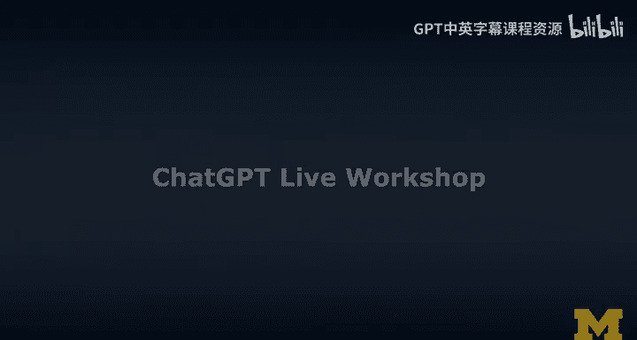
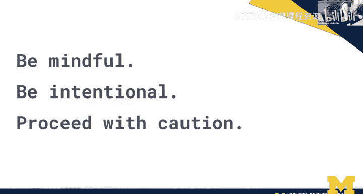
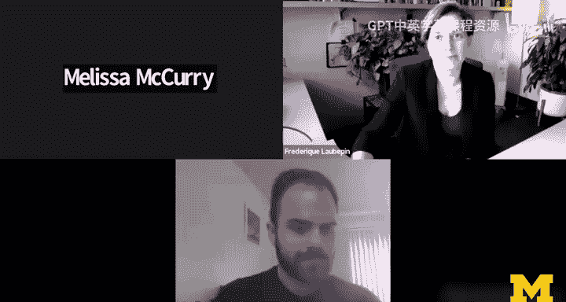
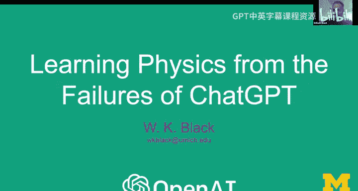
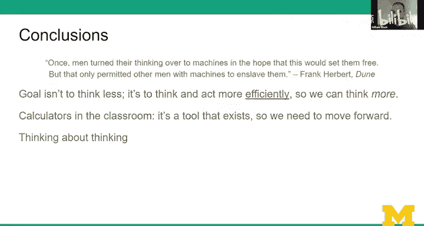

# ChatGPT 示教：37：ChatGPT现场研讨会实录

## 概述
在本节课中，我们将学习密歇根大学《ChatGPT 示教》现场研讨会的核心内容。三位专家将分享他们在教学、科研及未来展望中应用ChatGPT的实践经验、挑战与思考。我们将探讨如何负责任地使用AI，以及它如何影响教育和工作。

---

## 开场与介绍
大家好，欢迎来到ChatGPT示教现场研讨会。

我是密歇根大学学术创新中心的学习体验设计师Melissa McCurry。今天我将与我的同事Nathan共同担任本次活动的协调人。

本次现场活动汇集了三位独特的专家，他们将分享现在及未来如何使用ChatGPT的实例。我们希望这次研讨会能激励您尝试使用ChatGPT，并批判性地思考如何将其应用于自己的生活。

ChatGPT示教课程仍在Coursera上开放，欢迎随时加入并与我们的全球学习者社区互动。您可以在聊天区找到链接。感谢所有已在课程和活动注册中提交问题的参与者。

在今天的现场环节中，我们邀请您在Zoom的问答区提交更多问题给我们的专家小组。我们将在研讨会结束前尽力回答尽可能多的问题。鉴于时间有限，请为您认为重要的问题点赞。同时，请确保您的问题与主题相关。

在我们汇集这个多元化社区进行讨论时，请您在参与活动和课程时尊重我们的演讲者和其他学习者。请注意，本次活动正在被录制，之后会上传到Coursera的课程中。

此外，需要指出的是，实时字幕功能已开启。您可能需要按下Zoom窗口底部的“CC”按钮来查看字幕。

现在，我很高兴向大家介绍今天的演讲者。

首先，我们有Frederick Luepon。他是密歇根大学公共卫生学院教学服务部的助理主任。她一直在领导密歇根大学各校区教学设计师之间关于ChatGPT的讨论。

接下来是William Black，他是密歇根大学的物理学博士候选人。他一直在探索如何有效地教导学生将ChatGPT用作工具或助手。

最后，我们有Cantaro Toyama。他是密歇根大学信息学院的WK Kellogg社区信息学教授。在他的研究中，Cantaro关注社会变革和国际发展，特别是受数字技术影响的方面。

非常感谢我们的演讲者今天加入我们。现在，让我们从第一位演讲者Frederick开始。

---

## Frederick Luepon：教学设计与ChatGPT

谢谢Melissa。今天能与大家在一起真是太棒了。我现在开始我的演讲。

正如Melissa介绍的，我是密歇根大学公共卫生学院教学服务部的助理主任。我的角色是帮助人们在工作中做到最好，尤其是在将人工智能融入工作时。

为了确保我恰当地使用AI，我会牢记一些指导性问题。例如：这是AI的合适用途吗？使用AI来完成特定任务，我们获得了什么，又失去了什么？我确保技术服务于目的，而不是让目的迁就技术。我使用AI的方式如何支持我个人或我所在机构所珍视的价值观？在教育背景下尤为重要的一点是：当我使用AI时，缺失了什么信息或视角？

这一点尤其相关，因为像ChatGPT这样的平台虽然利用了海量信息，但它仍然只是信息宇宙的一个局部窗口。关于哪些信息是合适的，已经做出了一些决定。有些内容被排除在外，有时当你给出提示时，你会遇到这些边界。

众所周知，ChatGPT在几个方面存在偏见，其中一个特别之处在于它呈现了一种非常特定的文化视角。那么，这对它在教育中的应用意味着什么？它还存在扼杀想象力和创造力的风险。它的运作方式是不透明的，并且有时有“幻觉”的倾向。

尽管如此，我们团队面临的问题是：ChatGPT在我们的工作中可以扮演什么角色（如果有的话）？我能否将其作为教学设计师团队中的一员来使用？它能够做很多事情，包括创建教案和演示文稿。我在会议开始时看到聊天区有人提到了这些用途。

就我个人而言，我对它创建的教案质量印象并不深刻。它们缺乏创造性。这里也许我们需要区分信息和知识，以及信息在何时转变为知识。

话虽如此，我认为在教学设计背景下，ChatGPT有一些合适的用途。例如，如果你给ChatGPT一份讲座文稿，你可以要求它从中推导出学习目标。它可以优化这些学习目标。它会给你一些改进讲座的建议，尽管我认为这些建议并不特别有启发性。它可以给你评估的想法，为你编写多项选择题并提供讨论问题。

当我们思考作为教学设计师的工作时，我们很少有机会从头到尾完整地应用一个教学设计流程。我们面临的一个主要痛点是时间，包括我们团队的带宽以及我们合作的学科专家的时间。我认为，在思考如何最好地利用专家的知识和专长时，也许ChatGPT可以处理一些事情，从而解放他们的时间，让他们专注于最重要的事情。

从这个特定用例中，我的收获是：是的，它有助于解决我们作为教学设计师遇到的一些主要痛点。它是一个平庸、乏味的教学设计师。它不会为教学提出创新性的想法。它非常擅长整理信息，但在信息和教学知识之间存在一些差异。

当我们想到像密歇根大学这样以提供卓越教育为荣的机构的教学时，我希望得到超越ChatGPT自身能力所能创造的东西。

我们学校正在进行一些有趣的探索，例如课程修订和课程图谱绘制，这尤其耗费时间和资源。我们正在研究ChatGPT是否能帮助我们减轻部分工作负担。

另一个与课程相关的用途是让我们的教师将他们的课程内容输入ChatGPT，并回答这个问题：AI能通过这门课吗？我想以此为契机展开讨论：如果答案是肯定的，那么这门课的评估方式需要发生什么变化？我们在这门课中教授的内容是否需要因此改变？

这是我想讨论的一个用例。

另一个用例是我们实际上使用ChatGPT帮助我们进行了一些研究。每年我们都会调查我们的学生，询问他们对我们使用的学习管理系统Canvas的体验。今年，我们让ChatGPT为我们总结了开放式回答，它做得相当好。我们询问学生什么对他们有效，什么效果不佳，ChatGPT很好地总结了所有这些开放式回答。

这里需要注意一件有趣的事情：使用相同的提示和相同的数据，当我提问时和当我团队的一位同事提问时，ChatGPT提供了略有不同的摘要，并关注了略微不同的信息点。因此，我认为利用像ChatGPT这样的工具来帮助分析定性数据是一个很好的用例。你应该总是复核它的工作，原因正如我刚才提到的，它可能给出略有不同的答案，并且你总需要复核它是否在摘要中产生了“幻觉”。

完全无效的是，当我们跟进并询问如何解决它在摘要中提出的问题时。例如，如果学生提到课程网站组织混乱，ChatGPT的建议是“组织好你的课程网站”。这很明显，但这实际上不是真正的问题。真正的问题是我们需要与教师解决的技能差距、动机差距或信息差距。因此，它在为你分析事物方面会做得很好，但在为问题提出创造性解决方案方面就不那么好了。

第三个用例是我上周刚刚做的。我一直有一个大问题，就是无法处理好我的待办事项清单。我尝试了所有能想到的项目管理系统，但都没有真正奏效。所以上周我想到，也许我可以创建一些东西，它涉及电子表格和一些编码，以实现我心中的想法。这不是我的专业领域，所以向ChatGPT描述我想做什么实际上是一个痛苦的过程，因为我不懂专业术语。这涉及大量的来回沟通。最终，我得到了一个公式，但它不工作。后来我想到可以要求它调试我的公式，它做到了。现在我的电子表格按照我的意图工作了。

这对我来说是一次有趣的学习经历，因为它真正凸显了提示的重要性。这并不新鲜，也不是人工智能特有的，但问题的质量总是决定答案的质量。如果你像我一样，难以清晰地表达你的问题，那么你得到的信息就会不尽如人意。

因此，当我们思考教育时，我们绝对需要考虑如何教导学生正确使用这项技术，以及如何构建能产生良好信息的提示。另一件事是，我们绝不能将输出误认为是学习成果。在这个案例中，是的，我达到了目的，但在这个过程中我学到了什么吗？并没有。如果我必须再做一次，我必须回到ChatGPT让它再给我公式。在思考教学时，这是一个需要牢记的重要事项。最终，我们得看看这个系统是否比我尝试过的其他系统更好，因为使用它前后，我还是同一个人。

最后，我留给大家这些建议：当涉及人工智能和教学时，要**保持警觉、有意识、并谨慎行事**。

---

## William Black：物理学教学与ChatGPT

谢谢Frederick分享你的见解和用例。我们期待在会议结束时再次与你联系回答问题。

接下来，我很高兴介绍我们的第二位专家，William。

我将讨论我们如何学习物理学，或者希望你们都能想象到一些方法，这些方法可以应用于你们感兴趣的任何其他领域。我们如何真正从ChatGPT的失败和成功中学习？

首先，关于人工智能的一个大警告是，它们有点像没有身体的灵魂，它们从未有过身体，不理解任何在现实世界中待过10秒的人都能理解的许多事情。例如，我尝试使用ChatGPT帮助我为量子力学儿童读物想一些点子。它给出的关于叠加的例子中，有一个是“一棵树既是固体又是液体”，这毫无意义，你无法真正想象它。除了其他一些糟糕的例子，它实际上想出了一个非常好的主意：一只鸟同时唱两个音符。这确实在现实世界中发生，是叠加的一个美丽例子。

另一个这些基本失败的例子是，如果你曾经有过眼睛，你就会理解。我要求它编写一个星空飞过的代码，它确实做到了，但它将白色的星星绘制在白色背景上。任何做这个项目的人都会立刻知道必须用黑色背景，但对AI来说，它只是说：“哦，是的，我会绘制星星，这就是你要求的。”还有一些其他有趣的例子，比如AI生成的《哈利·波特》章节中说“皮革般的雨片”。雨从来没有皮革般的感觉，任何感受过雨的人都知道这一点。

在最近我参加的美国物理教师协会会议上，有人举了一个例子，它成功地编写了一个Python迷你高尔夫球洞的代码。然而，它让高尔夫球半截滚进了地里。同样，对AI来说，它说：“是的，我完成了任务。”但对任何人类来说，你从根本上错过了一个任何有身体的人都会理解的重要现实方面。

我想让大家领会的另一个要点是，AI非常擅长把握事物的要点，但在具体细节上会失败。所以，如果你现在移开视线，只用余光看屏幕，你会立刻说：“是的，那是两个时钟。”然而，如果你开始仔细看，你会注意到“4”前面可能有三四甚至五条刻度线，而不是一条；“10”看起来很像“5”；而且这里有五根指针。在右边，当我要求它显示6:30时，它看起来像是在“16”和“0.4”之间，指针指向了16和0.4的中间。所以，尽管它在把握整体感觉方面做得很好，但在具体细节上做得很差。

一个更有趣的例子是AI画手。同样，如果你移开视线，只用余光看，你的大脑会说：“是的，那是一群人在握手。”但如果你直接看超过半秒钟，你就会意识到：“哇，这太可怕了，所有东西都放错了位置。”

所以，再次强调两个要点：它缺乏你作为一个活生生的存在（而不仅仅是一台计算机）所拥有的实践智慧；尽管它非常擅长获得整体图景，但它错过了这些具体细节。

这些在尝试教ChatGPT物理学的例子中体现出来。如果你想看完整的对话，可以扫描这个二维码或使用左边的小网址。我只会快速浏览一下，所以不需要完全阅读任何幻灯片。

我给了它一个阿特伍德机的问题，这是一个经典的入门物理问题：两个质量不同的重物通过滑轮连接。结果证明，它们的加速度比重力产生的加速度稍慢，这个因子与两个质量有关。

首先，它再次很好地把握了整体轮廓。它正确地识别出牛顿第二定律适用于这里。它知道其中一个质量的加速度方向必须相反，所以它正确地得到了那个负号。尽管它正确地说力需要作用在单个质量上，但当它试图求解F_net时，它把两个质量相加了，而不是分别求解。所以，虽然它读起来像一个正确的回答（我实际上读的时候愣了一下，心想它是不是偷偷做了我没想到的事情），但并没有，它在一个核心细节上犯了根本性错误，最终得到了一个错误的答案。

然后我回到它那里，就像我在物理辅导室里对学生说话一样：“这里有一些你弄错的地方，这里有一些你做对的地方，这是你需要改变答案的方式。”注意，它在这里漏掉了负号，但后来它正确地分别求解了M1和M2。最后，我给了它一些关于如何更好地解决问题的建议，让它不那么混乱，并提醒它注意那个负号，最终它得到了正确答案。

我们可以从中学到几个教训。首先，它得到了正确的想法类型，比如整体感觉、正确的概念、方程和解决问题的轮廓。然而，它在几个具体细节上失败了。正因为如此，错误会传播，导致得到错误的答案。但它可以学习，或者至少可以得到正确答案。第四点（幻灯片上未展示）是，在我问了一些后续问题后，它导致了更多错误的答案，所以它还没有正确地学会，但在足够的提示后，它得到了正确的答案。

那么，我们如何利用这一点来帮助学生教授物理学或任何其他主题（尽管具体应用需要改变）？

首先是纠正ChatGPT的错误输出。就像我的例子一样，你可以让学生要求ChatGPT就某个主题写一篇文章，然后批判其输出。同样，你可以要求ChatGPT定义熵，然后比较维基百科、教科书，并写一个简短的概要，说明ChatGPT做得如何，维基百科做得如何，或者这些对熵的描述在这些不同方法之间有何变化。这两项活动本身既能教你关于ChatGPT的知识，也能教你关于物理学或其他你要求它解释的主题的知识。

最后一个例子是与ChatGPT一起解决问题，将其作为一种副驾驶。这正是我开始看待ChatGPT的方式：不是它能为我解决问题，而是它能帮助我克服写作障碍，或者为我想要做的事情提供一个轮廓思路。

因此，如果学生与ChatGPT一起解决问题，他们就在获得自己的教学经验，因为他们可以告诉ChatGPT它做错了什么，这将帮助他们发现自己的错误思维。教别人是学习的最佳方式之一，所以这将帮助学生不仅更好地学习材料，还能批判性地思考ChatGPT的输出，认识到它在哪些方面做对了，在哪些方面做错了，或者它可能在哪些地方出错。

最后是关于“框架化答案”的想法。ChatGPT在首先被“启动”时效果更好。例如，如果你说：“请以某某人的身份回答这个问题”，或者“告诉我一个好论证的原则，然后就此话题提出一个论证”，那么它给出的输出会比直接提问更好。

这里的“启动”可以用于物理问题。你可以问：“解决这个问题有哪些相关原则？”“解决问题的一般轮廓是什么？”“第一步是什么？”然后，当你逐步进行时，你可以迭代地问：“这一步正确吗？”并继续迭代，直到得到一个用户和ChatGPT都认为是正确的最终答案。

最后，我想留下几点思考。最近我在读《沙丘》，这句话让我印象深刻，因为我刚开始使用ChatGPT。引文说：“一旦人们将思考交给机器，希望这能解放他们，但这只会让其他拥有机器的人奴役他们。”因此，当我们在生活中使用ChatGPT和其他工具时，我们需要确保不让算法奴役我们。也就是说，我们不应该为了ChatGPT或其他工具而放弃思考，而应该只使用它来辅助我们的思考，让我们更有效、更高效地思考，从而思考得更多。

我想提出的另一点是，这是一个现在存在的工具，所以试图在课堂上禁止它，我认为通常是适得其反的。现实生活中的工程师很少用手工进行长加法或其他计算，他们通常会使用计算器。所以你应该教学生如何使用计算器。同样，ChatGPT是一个存在的工具。如果ChatGPT已经能完成工作，那你为什么还要要求学生去做呢？你可能需要重新思考作业，想出一种在未来有用的方式来完成作业。

最后，ChatGPT是一个思考“思考”本身的绝佳工具。能够看到它在哪些方面做对了，在哪些方面做错了，对于理解、分析你自己的思维过程、思考你自己可能在哪些地方出错以及ChatGPT可能在哪些地方出错非常有用。

我的分享到此结束，非常感谢。

---

## Cantaro Toyama：ChatGPT的未来展望

谢谢William分享你在物理教育中使用ChatGPT的激动人心的工作。我们今天的最后一位演讲者是Cantaro。Cantaro，请开始。

谢谢Melissa。我想重点谈谈ChatGPT及类似技术的一些潜在未来应用。在此之前，我想说，这些技术如此强大和通用，以至于它们的发展轨迹实际上非常难以预测。例如，我猜Frederick和William指出的ChatGPT当前的许多问题可能会在几年内（如果不是几个月内）得到解决。但也有可能这些问题在技术上很难解决，我们将不得不忍受这种产生看似准确但实际上错误的“幻觉”回答的水平。

但无论如何，我将基于这些技术会变得越来越好的假设进行讨论。我要做的是思考一些我认为很快就会看到的ChatGPT及类似技术的应用。

最明显的用途是作为写作和其他基于文本的任务（如计算机编程）的辅助工具。实际上，在介绍过程中，我看到网络研讨会聊天区有很多人表示他们已经在用ChatGPT做这些事情：帮助起草文本、获取诗歌灵感、编写计算机程序中繁琐的部分等等。其中一些事情在专业背景下甚至在ChatGPT出现之前就已经发生了。例如，一些新闻文章，特别是关于天气或体育赛事结果等更公式化的文章，有时已经由AI撰写。一些法律文件主要由计算机汇编等等。

我猜所有这些都会加速发展。事实上，我们都会开始使用ChatGPT来起草东西。我们已经收到电子邮件中的那些小提示，对于某些类型的电子邮件，你可能会想给出一个非常简单的回复。想象一下，让ChatGPT为你起草完整的回复，你只需要稍作编辑就可以发出。正如Frederick提到的，教师可能会依赖ChatGPT来帮助开发课程材料和讲座。记者可能会使用ChatGPT来加速写作过程。我记得就在几周前，范德比尔特大学发生了一场争议，一个办公室发出了一封关于枪击事件的慰问信息，这封信息是由ChatGPT撰写的。当然，读者们非常不安，因为这个办公室发出了一条自动生成的信息，但整条信息实际上都是由ChatGPT写的。

我认为这种使用的后果当然是，第一，它对工作构成威胁。要让AI从头到尾完成一项工作的所有任务，才会导致工作消失。但技术只需要能够从人类工作者手中接过一些工作，这样一个人就能做许多人的工作。我们已经看到自动化在制造业中发生了这种情况，至少在美国，工厂现在由极少数人运营，其余都是机器人。我认为ChatGPT和其他AI有趣之处在于，它们也将开始对白领工作产生这种影响。

我预见的ChatGPT的第二个潜在应用是你可能称之为“对话式用户界面”的东西，不仅用于某些事情，而且几乎用于我们数字化的所有事情。你可以想象设置闹钟、在线订购商品、安排非常复杂的旅行行程，所有这些都可以通过你与计算机的对话来完成，要么是打字，但越来越多的是语音识别和语音生成，所以你可能只需要和你的电脑说话。这有点像《星际迷航》里的场景。你可以看到在线搜索的演变方式已经是这方面的一个体现，所以你现在可以用多种语言向微软和谷歌的搜索引擎提问，而ChatGPT（或谷歌的Bard）会用常规语言回答。大多数情况下，这可能会让我们的生活更轻松，所以我认为这将是我们以积极方式体验ChatGPT的途径之一。希望负面影响很少，尽管同样，如果漏洞没有全部解决，在某些情况下可能会产生可怕的后果，比如你可能要求计算机为你做某事，期望它做得很好，结果却发现它犯了很多错误。

我的第三个例子是，随着时间的推移，我认为我们都将开始拥有智能数字管家，这些系统基本上就像个人仆人，根据我们用常规语言给它们的指令行事。例如，我是密歇根大学的教员，我预计在不久的将来，我的学生将拥有这样的系统：如果他们迟交作业，一封自动生成的电子邮件会发送给我，请求延期，并附上根据情况量身定制的理由。而学生们自己可能几乎不知道有这样一封邮件被发送了。当然，我也会有我自己的系统来阅读那封邮件并做出回应。这将会发生，而且很快。有趣的是，我们的设备将彼此进行完整的