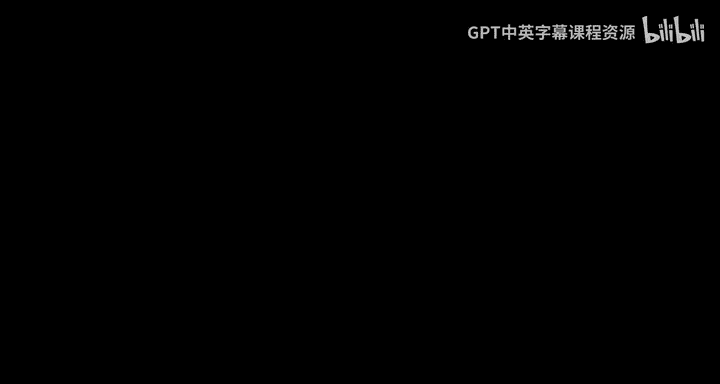
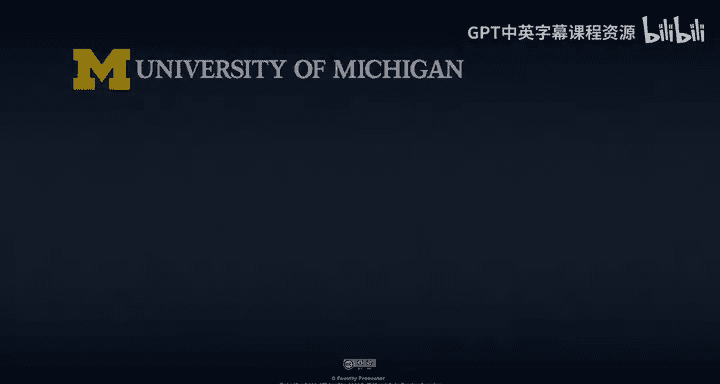

# 生成式AI基础知识：2：生成式AI与大语言模型（LLMs）解析

在本节课中，我们将要学习生成式人工智能（Generative AI）的基本概念，特别是其核心驱动力——大语言模型（LLMs）。我们将了解什么是语言模型、它们如何被训练，以及像ChatGPT这样的应用是如何构建在这些基础模型之上的。

---

## 什么是生成式AI？🤖

生成式AI是人工智能的一个新分支。它关注的是模型根据某种文本输入生成新内容的能力。它可以生成问题的答案、生成图像、生成音乐，或者生成编程语言代码。

## 基础模型与大语言模型 🧠

实现生成式AI的是近期在基础模型，特别是大语言模型（如GPT系列）方面取得的进展。这些模型基于海量数据（通常是互联网规模的数据）进行训练。一旦这些模型训练完成，它们就可以被用于自然语言处理的下游任务。

## 语言模型的核心概念 📖

语言模型指的是可以基于语料库文本进行训练，以预测下一个单词的计算模型。这就是语言建模的核心。

例如，给定一个语言上下文，如“我上周去参加了一个会议，你知道的，那是上个……”，接下来最可能的词可能是“星期”、“年”或“五月”，存在多种可能性。语言模型就是用来预测在“上个”之后最可能出现的单词。

**公式表示**：给定一个单词序列 `W1, W2, ..., Wt-1`，语言模型的目标是计算下一个单词 `Wt` 的概率：`P(Wt | W1, W2, ..., Wt-1)`。

## 大语言模型（LLMs）的构成 🧩

大语言模型指的是使用深度神经网络来预测下一个单词的模型。这些模型之所以“大”，是因为它们拥有数十亿甚至数千亿的参数。研究人员使用来自互联网的海量文本数据（例如数千亿个单词）来训练这些大型模型。

神经网络的设计灵感来源于人脑，人脑由数十亿神经元组成。同样，大语言模型也由大量的节点及其相互作用构成。模型的参数指的是这些节点之间连接的权重。

当我们说训练大语言模型时，我们试图获取的是这些参数的数值，以确保模型在特定任务上表现良好。

## 模型的训练过程：自监督学习 🔄

训练过程依赖于自监督学习。例如，在预测下一个单词的任务中，我们拥有海量的句子，并且我们确切知道每个句子的下一个单词是什么。这为我们提供了监督信息来训练语言模型。

本质上，我们希望训练模型，使其能够预测数据中真实的下一个单词。通过比较真实的下一个单词和模型预测的下一个单词，会涉及一个称为**反向传播**的数学过程。这个过程本质上是调整模型参数以改进其预测。

你可以想象，模型针对数据中的每一个单词进行训练。在训练结束时，我们得到了一个**预训练模型**，其参数已被调整优化，可以用于下游任务。

**代码概念示意**：
```python
# 简化的训练循环概念
for sentence in massive_text_corpus:
    for i in range(len(sentence)-1):
        context = sentence[:i+1]
        true_next_word = sentence[i+1]
        predicted_next_word = model.predict(context)
        loss = calculate_loss(predicted_next_word, true_next_word)
        model.backward_propagate(loss) # 反向传播调整参数
        model.update_parameters()
```

## 从基础模型到ChatGPT：指令微调与人类反馈 🎯

上一节我们介绍了大语言模型如何通过预测下一个单词进行预训练。本节中我们来看看像ChatGPT这样的应用是如何在此基础上构建的。

ChatGPT由OpenAI开发并发布。在基于预测下一个单词训练出的模型之上，ChatGPT使用**指令数据**进行了进一步的训练。这些指令数据本质上告诉模型，给定某种输入，什么样的输出是正确的。

此外，如果你在OpenAI的Playground上试用ChatGPT，你会注意到他们要求你对生成的内容给出“赞”或“踩”的反馈。ChatGPT也利用这种**人类反馈**来微调其模型，使其输出更符合人类的期望和价值观。

---





本节课中我们一起学习了生成式AI的基础，理解了大语言模型作为其核心引擎的原理。我们探讨了语言模型如何预测下一个单词，大语言模型的海量参数与训练过程，以及如何通过指令微调和人类反馈将基础模型转化为像ChatGPT这样实用的对话AI。掌握这些概念是深入理解当前AI浪潮的关键第一步。