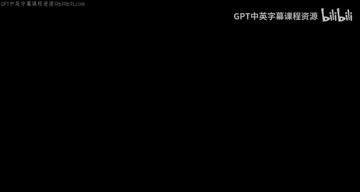

# 生成式AI基础知识：3：生成式AI在艺术与建筑中的应用 🎨🏛️

在本节课中，我们将学习生成式人工智能在艺术与建筑领域的应用、其背后的基本原理，以及它如何拓展这两个领域的创作可能性。

大家好，我是巴斯蒂安·坎贝尔。我是密歇根大学陶布曼建筑与城市规划学院的副教授，也是大学人工智能实验室（建筑人工智能实验室）的主任。

## 生成式AI的历史渊源

上一节我们介绍了生成式AI的基本概念，本节中我们来看看它在艺术与建筑中的具体应用。首先需要明确，生成式算法和生成式AI并非全新的发明，它有其历史渊源，并且历史上已被建筑师和艺术家所使用。

我个人可以谈及2018年“绘画阿米”和“配对空间”小组的作品，他们当时已经使用了生成式AI工具进行创作。直到我们如今看到的最新迭代，如Midjourney等图像生成器，它们正在影响建筑和艺术领域，允许艺术家和建筑师超越我们自身想象力的局限，拓展我们能够使用的想法、可能性和概念。

## 核心原理：从数据到生成

那么，大型语言模型和旨在创建图像或文本的生成式图像模型之间有何区别？其背后的基本思想并无太大不同。

核心概念在于：你只需向神经网络提供海量数据，使其能够进行特征识别，然后根据学习到的特征来构建图像。

从概念上讲，无论是处理语言还是图像，这两者都非常相似。对于图像，我们主要处理的是图像中的像素。需要理解的是，AI主要与数字打交道。因此，任何我们能转化为数字的东西，都可以在人工神经网络中使用。对于像素，就是RGB值；对于语言，就是字母和句子。

## 从分析到生成的转变

这使我们能够执行这些生成概念。实际上，它们都源自另一个功能：最初的模型被设计用于识别或分析。但当你开始逆转信息流，从分析转向生成时，就产生了我们现在看到的遍地开花的新工具。

以下是生成式AI工作的一个简化流程：

1.  **数据输入**：向模型输入海量数据（如图像或文本）。
2.  **特征学习**：神经网络学习数据中的模式和特征。
3.  **生成输出**：基于学习到的特征，模型生成新的、原创的内容。

## 对艺术与建筑的影响

这些新的生成式AI工具影响艺术和建筑的方式是怎样的？

对于建筑而言，现在断言它将如何真正影响这个学科还为时过早。但我们确实注意到，当我做讲座、发表论文或书籍时，关于它将如何影响该学科的咨询和问题频率越来越高。我毫不怀疑它会产生影响，因为一方面，与艺术类似，它允许建筑师拓展可能性的框架。由于AI的使用，他现在能够探索的设计空间要大得多，并且我们可以更快地处理更大量的数据。

## 艺术与建筑的差异

我认为艺术和建筑在对待各自学科的方式上可能略有不同。建筑有非常具体的功能性要求必须满足，而艺术则不一定需要这样做，因此在以更具创造性的方式探索工具时，艺术更加自由。尽管如此，就我所见，生成式AI的使用绝对在激励建筑师们思考超越该学科当前所能做的事情，并探索那些以前可能因需要处理过多数据而无法触及的空间。

## 当前应用与未来展望

简而言之，我们现在看到的实际上只是这种工具使用的开端。我们已经看到了将其应用于大规模建造和大规模设计理念的可能方式。同时，它也使建筑学科能够探索整个历史，因为它首先必须获取这段漫长历史的数据，才能为未来做些事情。

对于艺术，我认为情况类似。我看到许多新兴艺术家涌现，他们基本上能够提取当今作品背后大量的艺术史，并能够以某种方式将其转化并投射到未来可能的艺术趋势中。

本节课中，我们一起学习了生成式AI在艺术与建筑领域的应用基础。我们了解到，其核心在于利用海量数据训练神经网络进行特征学习，并逆转信息流以实现内容生成。虽然艺术更自由，建筑需兼顾功能，但生成式AI正为两者极大地拓展创作的可能性边界，成为连接历史数据与未来创新的强大工具。