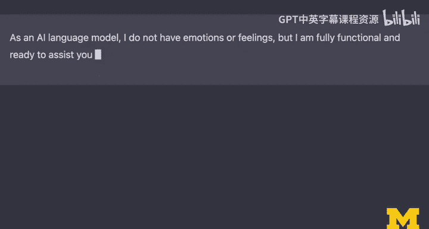

# 生成式AI基础知识：P4：3_生成式AI的感知准确性

## 概述
在本节课中，我们将要学习生成式人工智能（AI）在文本生成方面表现出的高度流畅性与连贯性，如何影响我们对信息准确性和可靠性的判断。我们将探讨这种“感知准确性”带来的挑战，以及个人和组织应如何应对。

---

我是迈克尔·韦尔曼，密歇根大学计算机科学与工程系的教授兼系主任。我从事人工智能研究多年，我的工作主要研究经济学与AI的交叉领域，既包括AI如何运用经济学原理，也包括理解AI在经济背景下的应用及其经济影响。

我们都已经习惯于根据一份知识产品（如文档或文本）的呈现是否专业、语言是否流畅连贯、内容是否切题来评估其质量。

因为ChatGPT等工具在自动生成文本方面实现了显著的飞跃，能够达到非常好的连贯性和流畅度，所以我们很可能基于我们惯常的判断方式，将其感知为准确和可靠的。

在以往的世界里，这种判断方式通常是可靠的，因为创作出连贯、流畅且有学识的文本需要投入大量的时间、教育和研究成本。

然而，当AI可以廉价地完成这项工作时，这个等式就被颠覆了。我们可能不再拥有文本表面的流畅度等因素与其可靠性和准确性之间的那种关联。

那些试图维护自身声誉的企业、组织或个人，可能会对大量使用ChatGPT或类似技术生成他们无法确保其准确性或质量的材料持谨慎态度。

事实上，我认为声誉是我们遏制滥用行为的最佳机制之一。我们更需要担心的是那些没有声誉的实体，例如匿名攻击者、网络喷子，以及我们不确定材料来源的第三方。他们没有声誉可损失，因此更可能利用这些方法来达成他们的目的。

我认为，这也意味着我们可能需要投入更多资源来建设追踪来源、认证材料出处的技术基础设施。这样我们才能确保信息与一个拥有声誉、且在意维护该声誉的实体相关联，而不是仅仅声称其来源可信。

如今，对于在互联网上遇到的任何信息，或者任何你不确定其来源的信息，都必须非常谨慎和警惕。因为它可能是为了误导而恶意人工创建的，也可能是通过不可靠、不准确的方法生成的。任何一种情况都可能带来不良后果。

因此，这意味着你需要对信息持保留态度，我们所有人都必须稍微调整一下我们的信息过滤器。

---

## 总结
本节课中我们一起学习了生成式AI生成的文本因其高度的流畅性和连贯性，容易让我们产生其内容准确可靠的“感知”。这种感知与实际情况可能脱节，因为AI降低了高质量文本的创作成本。为了应对这一挑战，维护声誉的实体会更加谨慎，而我们作为信息消费者，需要对来源不明的信息保持警惕，并可能需要依赖更强大的技术来追踪信息源头。