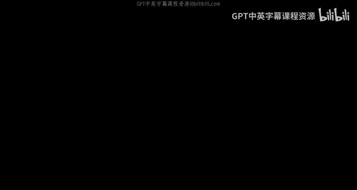
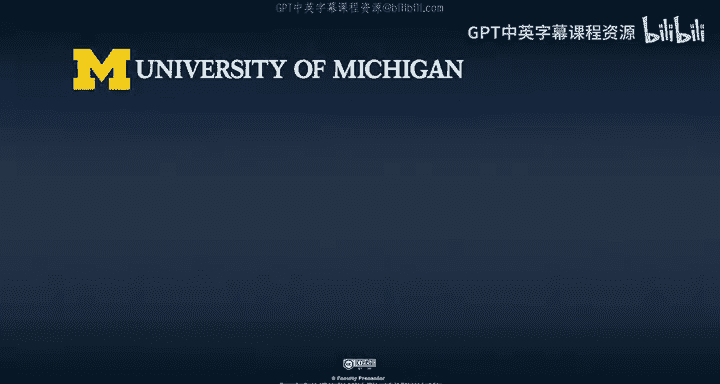

# 生成式AI基础知识：9：抄袭行为与作品归属问题

## 概述
在本节课中，我们将探讨在使用生成式AI（如ChatGPT）时，如何避免抄袭行为，并理解作品归属的重要性。我们将明确抄袭的定义，分析AI生成内容是否构成抄袭，并讨论在学术和创作环境中应如何恰当地引用AI工具。

## 什么是抄袭？
上一节我们提到了使用AI时可能面临的诱惑，本节中我们来看看抄袭的具体定义。抄袭并非法律上的违法行为，而是对学术规范的违反。

以下是抄袭行为的核心表现：
*   不承认特定语言或想法的来源。
*   将他人成果错误地归于自己名下，例如为吸引读者而在论文上添加他人姓名。

## AI使用与抄袭的界限
理解了抄袭的定义后，我们来看看AI生成内容是否天然构成抄袭。ChatGPT通过分析海量信息来生成针对查询的、独立的回应，这类似于人类基于毕生经验来组织语言和观点。

因此，AI从接触的大量信息中创造新的表达，其本身行为**不构成抄袭**。这只是一种技术的沟通方式。当然，理论上存在AI直接引用第三方内容而未告知用户的可能性，这种情况下可能涉及抄袭，但目前看来有相应的防范机制。

## 如何负责任地使用AI
既然AI工具本身不必然导致抄袭，那么关键在于我们如何使用它。当前，围绕如何引用AI贡献尚未形成统一的规范，学生、教师和出版商都可能感到困惑。

过渡到具体行动，以下是在使用AI时应考虑的原则：
*   **秉持诚信**：在学术界，确保引用来源至关重要。
*   **主动告知**：在使用AI协助完成作业、论文或出版物时，主动说明使用了此类技术。
*   **遵循要求**：关注教师或出版方的具体规定。有些课堂可能将使用AI作为教学的一部分，则无需额外说明。

我认为，尤其是在现阶段，主动承认使用了AI是明智之举。这能引发必要的讨论，帮助我们共同塑造未来引用AI的文化与规范。

## 总结
本节课我们一起学习了在使用生成式AI时如何避免抄袭。我们明确了抄袭是违反学术规范的行为，分析了AI生成内容的性质，并强调了在使用AI工具时保持学术诚信、主动进行归属说明的重要性。建立清晰、负责任的AI使用规范，对于维护学术和创作环境的健康发展至关重要。

