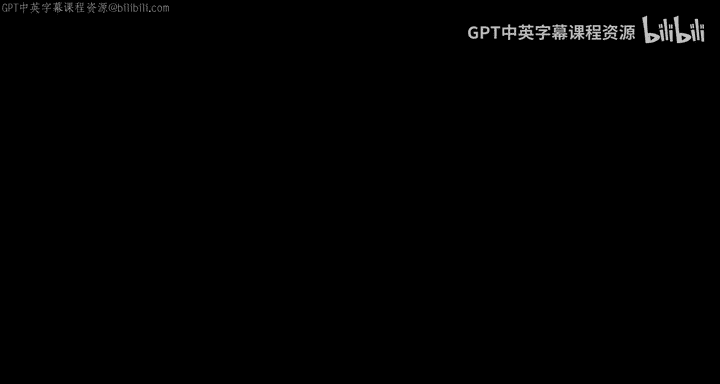
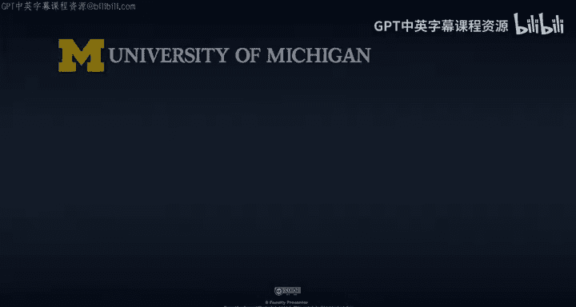
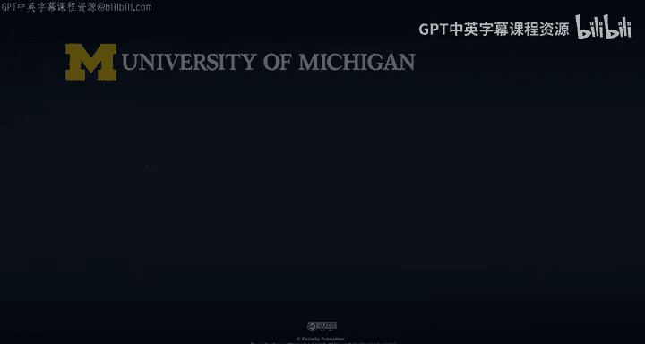

# 生成式AI基础知识：10：生成内容所有权与商业化路径 🧠

## 概述
在本节课中，我们将探讨生成式AI（如ChatGPT）所产生内容的所有权归属问题，以及围绕其进行商业化的可能路径与相关伦理挑战。我们将从法律、商业和伦理三个维度进行分析。

---

## 生成内容的所有权归属

上一节我们了解了生成式AI的能力，本节中我们来看看其产出的内容在法律上归谁所有。

从版权角度看，根据当前美国版权法，任何非由人类创作的作品都无法获得版权保护。因此，ChatGPT等AI生成的内容是否拥有版权尚不明确。公式可以表示为：`版权保护 ⊆ 人类创作`。

AI软件本身的代码版权由开发公司（如OpenAI）持有。然而，AI的**输出**则不同。美国版权局目前不承认非人类作者创作的作品具有可版权性。

我们面临的一个核心挑战是：如何区分一部作品中哪些部分由AI生成，哪些部分由人类创作？这目前非常困难。例如，如果一只猫在画布上抓挠作画，该作品没有版权。但如果人类声称这是自己的作品，版权局很难核实真伪。

---

## 商业化路径与可能性

了解了所有权问题后，我们来看看如何将AI生成的内容进行商业化。

目前，对于使用ChatGPT等工具生成的材料进行商业化，似乎没有明确的普遍禁令。但使用者必须仔细阅读服务条款，因为开发公司（如OpenAI）可能在条款中设置限制。

OpenAI及其投资者（如已投资数十亿美元的微软）必将找到商业化途径以产生收入。公式可以表示为：`投资 + 技术 → 商业化模型 → 收入`。

对于个人用户能否将AI输出进行货币化，目前难以断言。这些技术能创造出独特而有趣的内容。例如，可以要求ChatGPT以托尔金的风格为《霍比特人》撰写一个后续章节，它便能生成风格契合的叙事。

---

## 伦理考量与诚信问题

在探索商业化可能性的同时，我们必须关注其背后的伦理问题。

一般而言，我们需要引用并承认信息来源。风险在于，有人可能将ChatGPT生成的内容冒充为自己的作品进行发布。虽然目前这样做不一定违法，但法律在此领域的发展有待观察。

这引发了关于作品真实性和诚信的担忧。使用ChatGPT在某种程度上类似于咨询他人，它能以类似人类的方式产生信息或创意作品。因此，将本由AI产生的成果归功于某人，并使其因此获得声誉、机会或利益，作为一个社会，我们需要对此保持警惕。

然而，也不必过度恐慌。历史上也存在枪手作家、代笔画家，我们的许多创意也来自与他人的交流，甚至不记得灵感具体来源。有趣的是，ChatGPT本身并不独立产生创意——但或许人类有时也是如此。

---

## 总结
本节课我们一起学习了生成式AI内容的所有权、商业化及伦理问题。关键点包括：AI生成内容的版权归属目前存在法律空白；商业化是必然趋势但受条款约束；我们必须严肃对待由此产生的作品真实性与诚信伦理挑战。社会需要持续思考并制定相应规范。