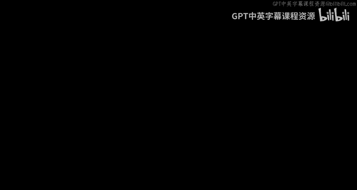

# 生成式AI基础知识：概述和影响｜P17：生成式AI对人类资本的影响 📈

在本节课中，我们将探讨生成式人工智能（AI）对人类资本的影响，特别是它在替代与互补效应之间的平衡如何塑造未来的工作模式。

## 替代与互补效应的平衡

生成式AI对人类资本的影响，很大程度上取决于替代效应与互补效应之间的平衡。

上一节我们介绍了影响的基本框架，本节中我们来看看具体的表现形式。

## 替代效应：任务转移与潜在替代

当AI能够完全执行人类创意知识工作者此前的工作时，可能会产生一定的替代效应。这可能导致某些工作岗位的减少，或者改变人类与AI之间的任务分配格局。

## 互补效应：作为人类能力的放大器

当AI与人类形成互补关系时，它能显著放大内容创作者和知识工作者的效能。这种互补效应不是取代，而是增强。

## 案例分析：软件工程领域的应用

一个贴近我所在领域的创造性活动是计算机编程。我是一名计算机科学教授，我们培养软件工程师。这无疑是一个蓬勃发展的知识工作领域，通常极具创造性。

像ChatGPT这样的技术可以应用于编程。此外，还有类似GitHub Copilot的相关技术，它已存在一段时间，同样利用机器学习研究大量代码，并能根据提示生成代码。

以下是软件工程师使用此类工具的主要发现：
*   许多软件工程师发现这些工具非常有用。
*   这些工具并未完全取代他们的工作，至少目前如此。
*   它们作为能力放大器，帮助工程师快速为面临的任务构思草案解决方案。
*   这最终可能提升他们的生产力和产出质量。

## 技能转型与教育新挑战

生成式AI改变了人类的工作内容。工作者可能需要掌握新技能，以学习如何与AI良好协作。

这实际上也为我们教育者提出了新问题：我们应如何培训知识工作者，使其能在创造性流程中与AI技术协同工作？我认为，我们目前尚未完全掌握有效的方法。因此，我们未来需要学习并发展相关的教学法。

## 总结

本节课中，我们一起学习了生成式AI对人类资本的双重影响。关键在于替代效应与互补效应之间的平衡。AI既能替代部分人类任务，也能作为强大的工具放大人类的创造力与生产力，尤其是在编程等领域。这要求工作者掌握与AI协作的新技能，同时也对教育体系提出了培养新型人才的全新挑战。