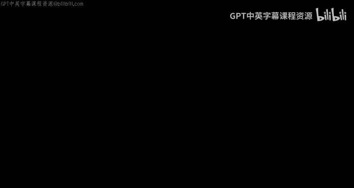

# 生成式AI基础知识：18：提示词工程学方法论 🧠

在本节课中，我们将要学习提示词工程学的基本概念、其重要性以及它未来可能的发展方向。提示词工程学是有效利用生成式AI模型的关键技能。

## 课程概述

我是Kurt Givsstead，密歇根大学创业中心的执行主任。我拥有密歇根大学的人工智能博士学位，并且在商业化新技术方面拥有超过30年的经验，这些技术包括来自AI实验室的成果。我正在教授一门关于AI商业应用的新课程。

## 什么是提示词工程学？

上一节我们介绍了课程背景，本节中我们来看看提示词工程学的核心定义。

提示词工程学，你也可以将其理解为提示词创作。它研究如何生成文本、音乐或图像等字符串，并将其输入到这些AI系统中，以引导出你期望的输出结果。

这些AI系统具有独特的特点和行为模式，而你组织输入内容的方式会改变它们的输出。这种专门知识将在未来数月和数年内持续发展。

## 提示词工程学的类比与意义

理解了基本定义后，我们通过一个历史类比来探讨其潜在影响。

观察新技术如何在劳动力市场中创造新机会时，我们可以回顾互联网的兴起。搜索引擎优化（SEO）这个角色在25年前并不存在，但现在对于任何面向网络的企业都至关重要。

以下是关于提示词工程学未来发展的一个关键思考：

*   它是否会像搜索引擎优化一样，演变成一个独立的专业学科和专门技能？
*   抑或它会变成我们所有人都掌握的一项通用技能，就像今天我们都能熟练使用谷歌搜索引擎进行网络搜索一样？要知道，25年前我们并不这样做。

因此，提示词工程学将如何演变会非常引人入胜。我们需要观察它是否会发展成为一种特定的专业技能，并成为未来组织中的一个新角色。

## 核心概念总结

本节课中我们一起学习了提示词工程学。我们了解到，它是一门关于如何有效构建输入（提示词）以引导AI模型生成理想输出的学问。其未来可能走向专业化，也可能成为人人必备的通用技能，这将是值得关注的重要趋势。

