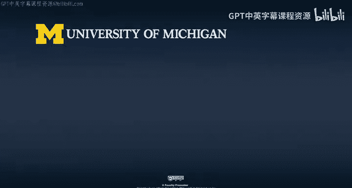

# 生成式AI基础知识：P22：生成式AI技术未来展望

## 概述
在本节课中，我们将探讨生成式AI技术，特别是像ChatGPT这样的大型语言模型的未来潜力。我们将分析其在教育、医疗等领域的应用前景，并思考技术普及与伦理问题。

---

当我初次看到ChatGPT时，我的第一反应是为这些进步感到欣喜。

这也是我第一次真正看到这类语言模型在能力上取得的重大进展。

使用大规模语言模型并非首次，此前已有其他模型。

但我认为，当前的输出成果，不仅源于语言模型本身，还结合了人类监督，使得输出结果非常**拟人化**。

这为众多社会应用开启了大门。

我的第一个想法是，这非常棒。人们将无需花费大量时间仅仅用于构建语言模型、微调模型和调整参数。这为许多研究人员腾出了大量时间，可以真正投入到社会影响的研究中。至于这是否会发生，我们还需观察。

在应用方面，例如在教育领域，我们一直在讨论个性化教育的重要性。

现在，这成为可能。对于教师或用户而言，个性化的程度如何？面对成百上千的学生，我仍然只能以一种方式授课。

当你拥有像这样的工具，它可以接收信息并根据个人背景进行个性化匹配或调整时，其影响将非常深远。

我相信这只是一个例子，比如个性化教育。因为我们现在拥有了如此强大的工具，我们才能真正开始思考这个问题。即使是我这学期教的拥有250名学生的课程，我也可能考虑创建根据每个学生知识水平调整的材料。仅凭我个人，绝对无法做到这一点。

但如果我借助这些模型的力量，我就可以开始思考如何实现它。

还有许多其他方式。作为一名学生，我可以想象不过度使用它，因为这可能会阻碍我的学习。但我可以想象它几乎像一位私人导师。例如，如果我学习一门语言，我可以向它提问。它可能不一定是开箱即用的ChatGPT，可能需要调整或使用类似的模型，然后将其调整为适合语言学习，它可以帮助我，就像母语者帮助我一样，例如与我互动、对话，甚至在我出错时纠正我。

其他许多领域也是如此，例如在医疗保健领域。将已经存在于网络上的信息，以一种更易于人们理解的方式呈现出来。例如，有些信息使用的是更偏向医生专业的语言，难以理解。

将其转化为我能理解的、更简单的语言，这对于未受过医学训练的人来说很有帮助。甚至，以ChatGPT为例，它并非必然设计为支持多种语言。它进行了一些尝试，但并非总是成功。

但我可以看到，未来技术可能会使用多种不同语言的大量语料。让应用程序支持多种语言，将再次为许多事情打开大门。

我们现在可能只对少数几种语言有这些应用，比如问答、摘要、生成问题或查找关键词等。未来，如果世界上所有其他语言都能拥有这些功能，对许多人来说可能将是一个重大的转变。

再次强调，正如我之前所说，关键问题在于人们将在多大程度上开始关注这一点。我们可以仅仅停留在像GPT这样的少数几种语言上，并继续向前发展。或者，正因为我们拥有了这类工具的能力，我们现在也可以思考如何将其推广到更广泛的语言和文化中。

---

## 总结
本节课中，我们一起学习了生成式AI技术，特别是大型语言模型的未来展望。我们看到了其在实现**个性化教育**、充当**私人导师**、促进医疗信息通俗化以及推动**多语言应用普及**等方面的巨大潜力。同时，我们也认识到，技术的未来不仅取决于其能力，更取决于社会如何引导和利用这些能力，以创造广泛而积极的社会影响。