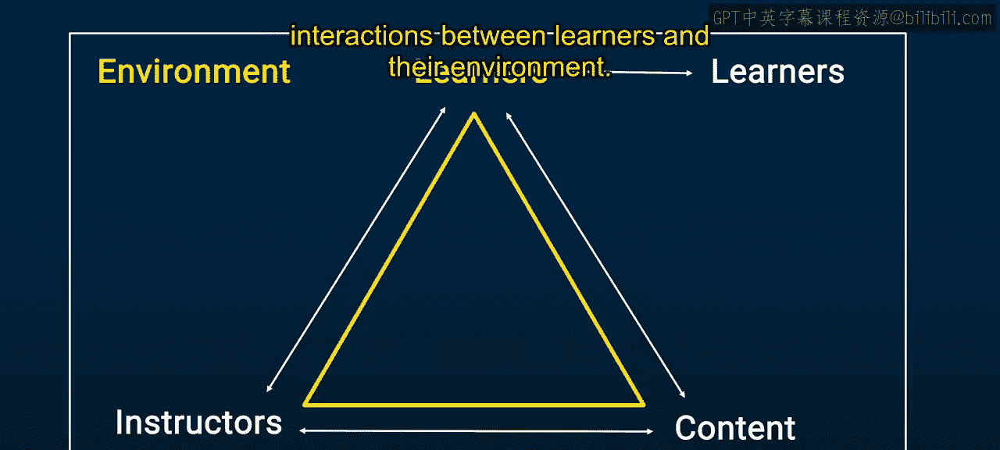
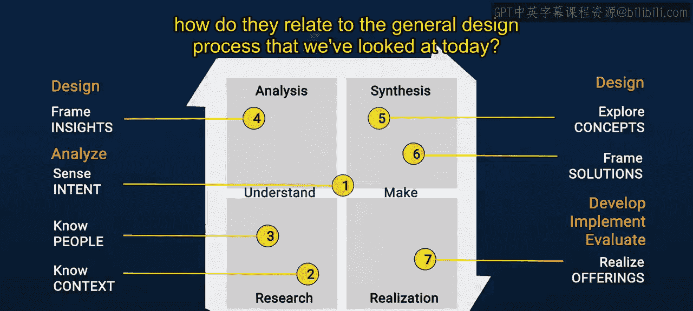
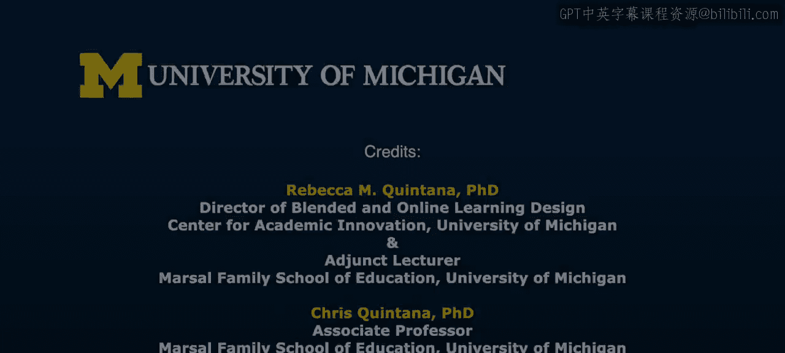

# 生成式AI作为学习设计伙伴：1：设计流程概述 🧭

在本节课中，我们将从宏观层面审视学习设计流程。这旨在提供一个快速的回顾。如果你对这个主题完全陌生，我们建议你查阅本课引言部分提供的资源。理解这个主题将有助于我们思考，生成式AI如何在设计流程的各个阶段作为学习设计伙伴发挥作用。

我们想强调，我们并不固守某一种特定的学习设计模型或框架。快速搜索网络就会发现，设计学习体验的方法多种多样。学习设计师通常会借鉴多个框架，因为每个框架都为我们的学习设计带来了不同的关注点，例如技术整合，或对多样性、公平性和包容性问题的思考。

## 学习设计框架概览

一个较为知名的模型是**ADDIE**，它代表分析、设计、开发、实施和评估。其他著名的学习设计框架包括**7Cs模型**、**对话框架**、**逆向设计**以及**通用学习设计**。

所有这些框架都将帮助我们思考，在我们创建的学习设计中，我们希望促进何种类型的互动。

## 教学三角与互动

我们发现，**教学三角**有助于我们概念化这些互动在学习情境中如何协同工作。这些互动包括：
*   学习者与内容之间的互动
*   学习者与教师之间的互动
*   教师与内容之间的互动
*   学习者与其他学习者之间的互动
*   学习者与其环境之间的互动

## 通用设计流程与ADDIE框架

正如我们将看到的，这些框架都触及了学习设计流程相同的基本要素，尽管它们彼此看起来可能不同。为了说明这个观点，我将首先介绍一个通用设计流程的图示，然后展示ADDIE框架的各个组成部分如何与之对应。

这个设计流程图源自伊利诺伊理工学院的Vijay Kumar教授，他将设计过程描述为围绕四个象限排列的七种模式。

### 通用设计流程详解

以下是通用设计流程的四个象限：

1.  **感知意图**：从象限中心开始，设计师专注于他们试图解决的总体问题或议题。这涉及看到全局，能够阐明项目或设计挑战如何融入其所在的更广阔背景中。
2.  **研究**：左下角的研究象限让设计师专注于了解人和了解情境。设计师可以通过各种用户体验研究方法来确定受众和情境特征。
3.  **分析**：进入分析象限，设计师将研究象限中收集的想法转化为设计的总体方向。设计师需要能够评估设计情境中存在的资源和约束，并定义他们将遵循的参数。
4.  **综合**：在综合象限中，设计师专注于探索概念和构建解决方案框架。这是他们开始规划和勾勒人物角色、场景和设计方案的阶段，设计在此变得更加清晰。
5.  **实现**：最后，在实现象限中，设计师开发、实施、测试和评估他们在流程早期阶段勾勒和计划的设计。

正如图示所传达的，设计流程是流动且动态的。设计师可以在每个象限内的不同任务之间来回移动。

### ADDIE框架与通用流程的对应关系

现在，让我们将ADDIE学习设计框架叠加到这个通用设计流程图上，以展示它们如何相互关联。作为一个思维练习，你也可以尝试用其他学习设计框架来做这个练习。

*   **感知意图与分析**：从感知意图开始，学习设计师也需要考虑他们试图解决或应对什么问题。设计中要解决的学习问题或教学挑战是什么？这些问题的答案可以用学习目标来描述，这是设计过程的核心活动。这与ADDIE的**分析**部分相关。
*   **研究与分析**：ADDIE中**分析**的另一部分是理解人和理解情境，这与研究象限相关。在这里，学习设计师寻求关于学习者学习特征以及与课程相关的情境因素的信息。
*   **分析与设计**：一旦确定了学习成果、受众和情境，学习设计师就会将注意力转向ADDIE所称的**设计**。这包括思考学习体验的核心要素，例如如何评估学习者，以及主要内容和活动是什么。这些活动体现在设计流程图示的**分析**象限中。
*   **综合与设计**：设计还包括草图绘制、大纲规划和原型制作，这些任务很好地对应了**综合**象限。尽管ADDIE模型称此阶段为“设计”，但我们可以将整个活动或事业都视为设计。值得注意的是，与ADDIE相关的设计任务横跨了两个象限，因此不一定能整齐地归入某一个象限。
*   **实现与开发、实施、评估**：设计模型的第四个象限——**实现**，可以涵盖ADDIE模型的最后三个阶段：**开发**、**实施**和**评估**。评估、活动和内容在学习环境中被开发和实施，使设计师能够测试、评估并确保他们的学习设计按预期运行。

## 思考与实践

你在自己的工作中借鉴了哪些学习设计框架？它们与我们今天看到的通用设计流程有何关联？希望你能尝试一下这个思维练习。这将帮助你更清晰地聚焦于学习设计过程，这对于我们考虑引入AI工具和方法至关重要。

## 总结

本节课中，我们一起学习了学习设计的通用流程，并了解了ADDIE等经典框架如何与之对应。我们认识到设计是一个动态、迭代的过程，涉及从问题定义到方案实现的全方位思考。理解这些基础，将为我们后续探索生成式AI如何融入并辅助这一流程奠定坚实的基础。