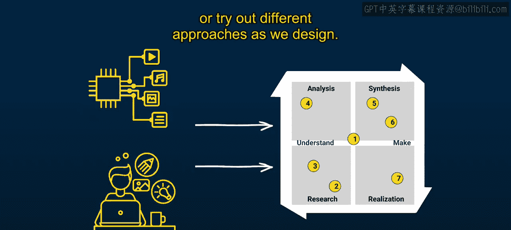
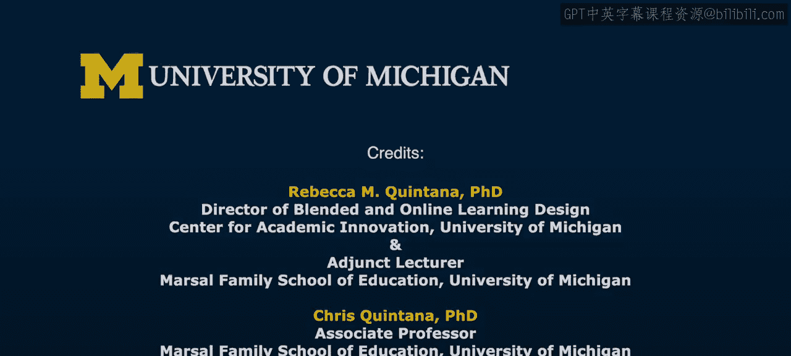

# 生成式AI作为学习设计伙伴：P3：与生成式人工智能的伙伴关系 🤝

在本节课中，我们将要学习如何以及为何在教学设计中使用生成式AI工具。现在，是时候探讨我们在使用这些技术时应持有的正确心态了。

## 从工具到伙伴的思维转变 🔄

上一节我们介绍了生成式AI的能力。本节中我们来看看如何将其视为伙伴。虽然我们经常听到关于生成式AI工具及其能力的讨论，但我们必须记住，它们本质上只是**工具**。思考工具及其使用方式似乎很直接：我们使用工具来完成任务，理想情况下是快速、高效地完成，我们并不总是深究结果。例如，如果需要在墙上打孔，我们只需使用电钻。打好孔，任务就完成了。

即使在技术领域，我们也可以使用不同类型的工具来完成任务。我们可以使用文字处理器来撰写文本，或者使用计算器或电子表格来求和。我们只是使用这些工具来完成心中所想，并以某种方式应用这些工具的结果。

然而，生成式AI是一个有趣的工具类别，其核心在于“生成”这一概念，这能帮助我们以不同的方式工作和思考。

## 超越任务完成：作为设计伙伴 🧠

我们当然可以像刚才描述的例子那样使用生成式AI：我们给工具一些输入（可能是一个问题或其他提示），然后直接获取它给出的信息并将其应用到某个地方。任务完成。

但是，当我们开始讨论将生成式AI用于教学设计时，我们希望采用一种不同的思维方式：将生成式AI视为**设计伙伴**或**智力伙伴**。在整个教学设计过程中持续使用它，帮助我们生成想法、迭代不同的设计可能性，或在设计时尝试不同的方法。

我们不一定只想让生成式AI为我们生成完整的、可以直接使用的答案。这不是我们所说的“伙伴关系”。相反，我们可以思考正在处理的具体设计任务，然后与生成式AI合作，生成我们可以像审阅草稿一样审阅的初步想法，看看哪些可以使用、哪些可以扩展、哪些可以删除。

我们可以观察生成式AI是否生成了我们未曾想到的新想法。我们还可以判断是否以及如何继续扩展这些新想法，甚至可以借助工具来完成。我们可以向生成式AI提供额外的、经过修改的方法和提示，以尝试新的设计方向，并在设计过程的不同迭代中持续扩展想法。

## 伙伴关系的核心：持续协作与迭代 🔄

这种在整个设计过程的活动及其不同迭代中持续与工具协作的理念，就是我们所说的将技术作为伙伴。我们不仅仅是获取生成式AI的结果并简单地复制粘贴其输出。相反，我们是在一段时间内持续与工具协作，以发现新路径、完善我们的工作，并确保我们生成内容的质量。

这是我们自己在工作中以及在整个讨论中所秉持的心态。这也是我们希望您采纳的心态。我们将生成式AI的输出，**不视为最终答案**，而是视为可以在整个设计工作中修改和重塑的想法与可能性。

## 总结 📝

本节课中我们一起学习了如何将生成式AI从单纯的“任务完成工具”转变为“学习设计伙伴”。关键在于思维的转变：从一次性索取答案，转变为在整个设计过程中与其进行**持续、迭代的协作**，利用它来激发灵感、探索可能性和完善方案。记住，它的输出是创意的起点，而非终点。