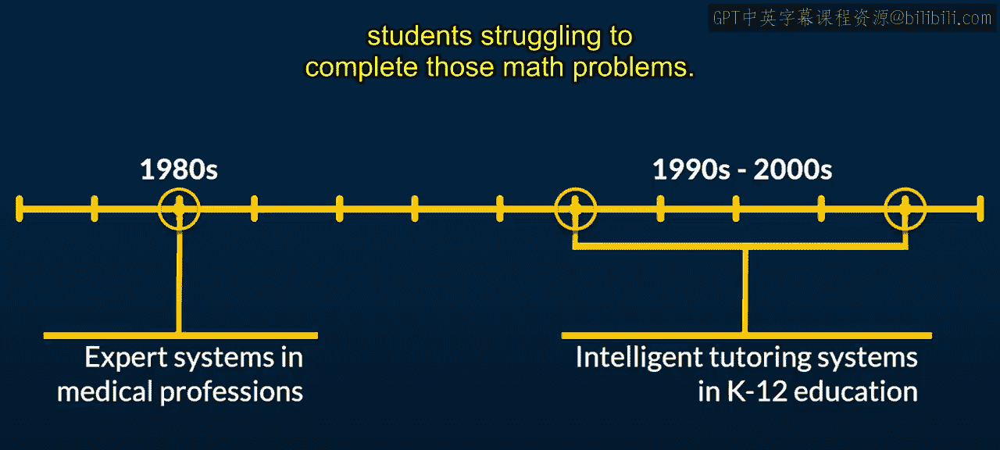
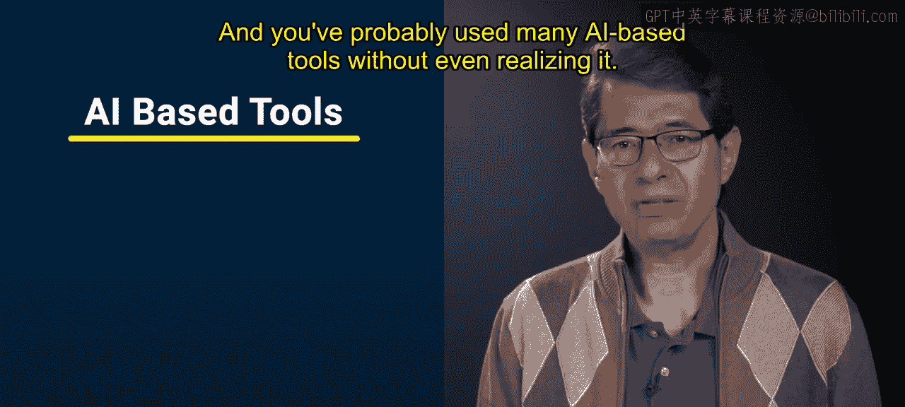
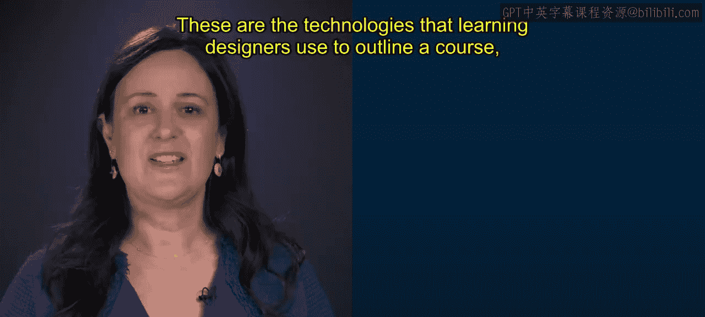
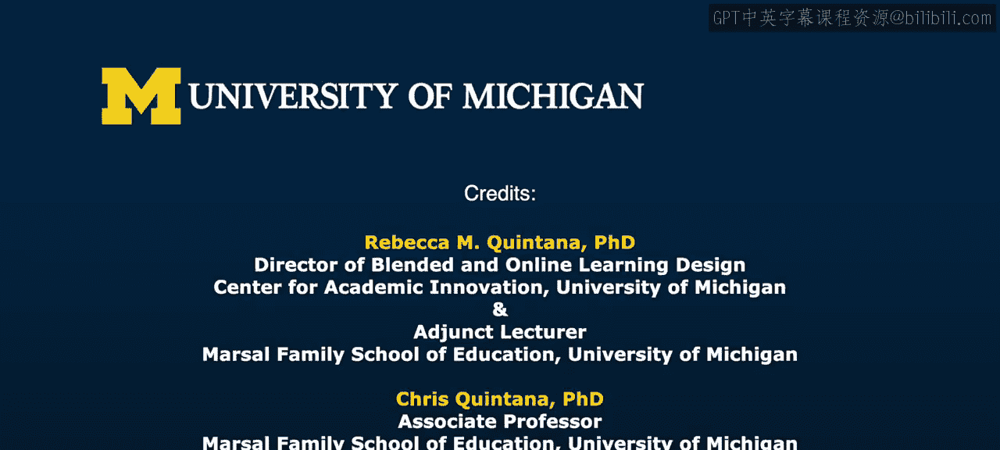

# 生成式AI作为学习设计伙伴：P4：面向学习专业人士的生成式人工智能

在本节课中，我们将学习生成式人工智能（Gen AI）的基本概念，特别是大型语言模型（LLM），并探讨学习设计师如何将其作为专业实践工具来使用。我们将从人工智能的历史背景谈起，明确生成式AI的定义，并重点分析其在学习设计领域的应用潜力。

## 🤖 人工智能与生成式AI概述

在深入探讨生成式AI在学习设计中的具体应用之前，我们首先需要明确生成式AI的含义。

我们经常听到关于生成式AI的讨论，这可能会让人觉得人工智能是一个全新的话题，或者当前这波AI工具是首次出现的人工智能工具。但人工智能绝对不是一个新话题。人工智能研究已经持续了大约60年，并催生了人们可用于工作和教育的各种工具。

我们曾见过专家系统这类工具，它们试图囊括特定学科的知识，以便从业者可以向系统查询以获取帮助。例如，在20世纪80年代，我们看到了医学领域的专家系统，它们可以用来辅助医生的诊断工作。在20世纪90年代和21世纪初，我们看到了K12教育中使用的智能辅导系统，它们可以评估学生在代数等科目中的作业情况，并在观察到学生难以完成数学问题时提供提示和指导。

你可能在不知不觉中已经使用过许多基于人工智能的工具。

语法检查器和文字处理器、汽车中的停车辅助系统、家中的智能恒温器，这些都包含了一定程度的人工智能。

## 🛠️ 什么是生成式AI？

现在，当我们谈论生成式AI时，我们指的是哪种工具？在本系列课程中我们将使用哪些工具？

当我们说生成式AI时，我们指的是一种能够生成某些“制品”的人工智能工具；它可以生成文本、图像、视频或其他类型的数据。它将在响应用户给出的提示（prompts）时生成这些制品。

生成式AI工具也可以在接收信息时学习其中的模式和结构。随着它获取更多信息并持续学习，它将改进其提供的输出。

生成式AI工具有很多类型，但目前我们接触越来越多的两类包括**大型语言模型（LLM）** 和**大型行动模型（LAAM）**。

*   **大型语言模型（LLM）**：ChatGPT就是大型语言模型的一个例子。LLM是学习语言模式的统计模型。当我们向LLM发出提示时，它会根据其当前的模型生成文本来尝试回答我们的提示。随着我们向LLM提供更多信息，它将利用这些信息识别模式并建立更多统计关系，从而优化其模型。
*   **大型行动模型（LAAM）**：这类模型与LLM类似，但更侧重于采取某种行动并与世界互动。大型行动模型可以分析数据然后做出决策，或者根据你家的信息控制智能设备（如恒温器），或者为你自动化任务。

出于我们的目的，我们将重点关注LLM和ChatGPT这类工具。

## 🔄 不断发展的工具生态

现在，虽然我们这里可能以ChatGPT为重点，但还有许多其他可用的工具，我们鼓励你在探索生成式AI用于学习设计时进行实验。

正如我们讨论技术时通常发生的情况一样，事物变化很快。因此，在你观看本视频时，可能已经出现了许多新的LLM。

需要注意的是，存在一些类似于LLM但可以生成其他媒体类型（如图像）的工具。有时你会看到这些工具被称为使用**扩散模型**。例如，OpenAI整合了DALL-E来根据你的文本提示生成图像。一些LLM也开始同时生成图像和文本。

尽管这些类型的工具在技术上各不相同，但我们都可以将它们归入生成式AI这把大伞之下。我们将使用一个能够生成文本、图像、音频、视频甚至计算机代码的工具库。

## 🎯 为什么在学习设计中考虑生成式AI？

那么，为什么我们要在学习设计的背景下思考生成式AI呢？

我们可以从两种方式来思考学习设计师如何将技术作为其专业实践的一部分：

1.  **为学习者识别和整合技术**：作为更广泛学习体验的一部分，让学习者使用这些技术。这些是学习者自己用来与内容、其他学习者及其讲师互动，以及展示他们所学知识的技术。
2.  **学习设计师使用技术进行设计和开发**：将技术作为专业实践的一部分来设计和开发学习体验。这些是学习设计师用来规划课程大纲、创建数字材料、管理项目等的技术。

在本课程中，我们重点关注生成式AI在**第二类**中的应用，即允许学习设计师增强他们的专业实践。

## 💡 大型语言模型如何助力学习设计？

当我们思考大型语言模型的作用时，应该记得它们擅长理解和生成人类语言。它们可以进行自然对话、生成内容，并总结大量文本信息。

鉴于LLM的这些能力，学习设计师可以从以下几个角度利用它们：

*   **作为对话伙伴**：由于LLM可以进行自然对话，将它们视为聊天机器人可能会有所帮助。学习设计师可以用它们来回答问题、提供反馈，并为课程设计提出想法和建议。
*   **作为内容生成助手**：由于LLM擅长生成内容，学习设计师可以用它们来准备草稿。并且由于它们能够处理人类语言，学习设计师可以提供各种形式的文本输入来帮助塑造期望的输出。
*   **作为信息处理工具**：由于LLM擅长筛选大量文本，学习设计师可以用它们来审阅内容、提供摘要，并根据需要压缩材料。

## 📝 总结

本节课我们一起学习了人工智能，特别是生成式AI和大型语言模型的基础知识。我们回顾了AI的发展简史，明确了生成式AI（尤其是LLM）的定义和核心能力，并重点探讨了学习设计师如何将LLM作为专业实践工具，用于对话、内容生成和信息处理，从而增强课程设计与开发工作。

我们希望这为你提供了关于AI工具的一些历史背景，并对大型语言模型是什么、能做什么进行了高层次的解释。我们也希望向你展示了学习设计师如何将LLM作为专业实践工具的一线曙光，为我们后续的讨论做好准备。

