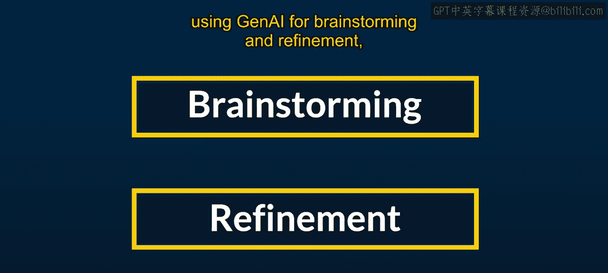
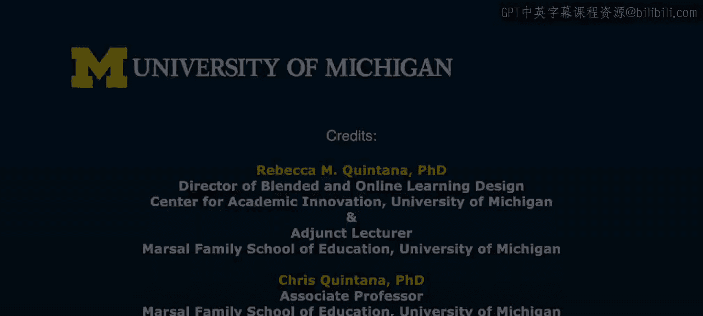

# 生成式AI作为学习设计伙伴：6：生成式人工智能在学习设计中的应用 🚀

在本节课中，我们将探讨生成式人工智能（Gen AI）如何在学习设计流程中充当合作伙伴。我们将从两个主要阶段——早期构思与后期优化——来识别其应用潜力，并提供具体的任务示例。课程旨在帮助你将这些概念应用到自己的专业实践中。

## 课程概述

在课程的第一部分，我们探讨了将生成式AI作为学习设计伙伴的理念。我们还从宏观层面审视了设计流程，并思考了如何将我们偏好的框架映射到该流程中。采取这一步是为了让你将最熟悉的学习设计流程置于思考的核心。

既然我们已经对这些领域进行了思考，现在可以开始识别我们认为Gen AI具有应用潜力的具体环节。我们将在此分享我们的观点，以引导你进入这种思维方式和工作方式，然后鼓励你制定自己的策略，将这些想法应用到你的专业实践中。我们在此提出的想法应作为你独立开展工作的起点，并很好地适应你自己的特定情境。

## 识别应用机会

当我们思考整个学习设计流程以及学习设计师在该流程中执行的众多任务时，有时很难精确确定应将注意力集中在何处。因此，从两种方式来思考潜在机会可能会有所帮助：**早期构思**和**后期优化**。

### 早期构思阶段的应用

随着我们对这些工具的能力和潜力越来越熟悉，我们开始意识到它们在工作的早期草拟阶段非常有用。当我们思考从零开始起草内容与在已有基础上进行构建之间的区别时，我们可以开始想象生成式AI在生成初稿方面可能扮演的角色，学习设计师可以将这些初稿作为深入工作的起点。

以下是学习设计师需要起草的项目类型。如果我们回顾学习设计流程，可能会想到一些核心的学习设计任务，包括：
*   开发学习者画像。
*   制定学习目标。
*   创建高层级大纲。

这些早期的设计任务有助于为我们的学习设计设定方向和创建结构。

继续考虑学习体验的核心要素，我们也可以考虑使用生成式AI来起草评估、内容和活动。例如：
*   生成式AI可用于开始创建测验问题、作业。
*   起草介绍性内容、活动与参与者结构，以及讨论提示。

这些是学习者作为学习体验一部分而与之互动的关键要素。

更进一步，生成式AI可用于开始创建重要的附加元素，例如：
*   教学大纲语言。
*   内容摘要。
*   支架式语言。
*   替代文本生成。
*   测验或作业反馈。

这些任务对于为学习者提供无缝、集成且愉快的学习体验至关重要。

### 后期优化阶段的应用

一旦学习体验的所有关键要素都已就位，学习设计师可以考虑如何利用生成式AI作为思维伙伴，来改进已起草的结构和要素。

在这个阶段，我们可以将生成式AI用于角色扮演，即我们设计提示词，让工具从不同角色类型的视角来审查内容，包括学习者、教师和管理员。例如，我们可以向GenAI工具提供我们画像的关键特征、动机和观点，并要求GenAI工具从这些视角审查内容。通过这样做，我们可以识别内容中需要改进的空白或领域，以更好地满足画像的需求。

另一种将生成式AI用于课程设计审查的方法是确定课程是否按预期运行。例如，学习设计师可以使用学习目标作为查询的基础，检查其与内容设计的一致性。另一种策略可以是检查评估是否包含让学习者展示与预定学习目标一致的知识和认知水平的机会。

在这个后期阶段，生成式AI可用于验证课程是否符合其预期目标。

最后，学习设计师可以使用生成式AI来识别评估、活动和内容设计中的空白、冗余和不一致之处。由于学习设计流程通常需要数周甚至数月的时间，借助一个能够一览全局并指出设计可加强之处的工具会很有帮助。生成式AI可以协助进行质量保证。

## 课程总结

本节课中，我们一起学习了生成式AI作为学习设计伙伴的两个主要应用方向。我们探讨了如何利用GenAI进行**早期构思**，快速生成学习目标、内容大纲、评估题目等初稿；以及如何将其用于**后期优化**，通过角色扮演和一致性检查来审查和改进设计。我们希望这两种方法能帮助你构想哪些学习设计任务可以通过与GenAI工具的合作来加速、增强或改进。