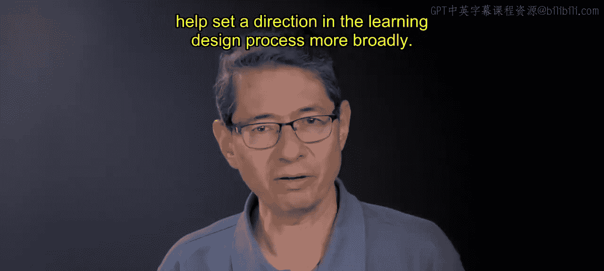
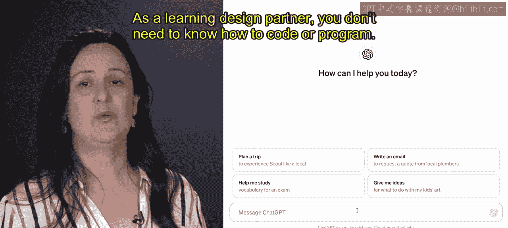
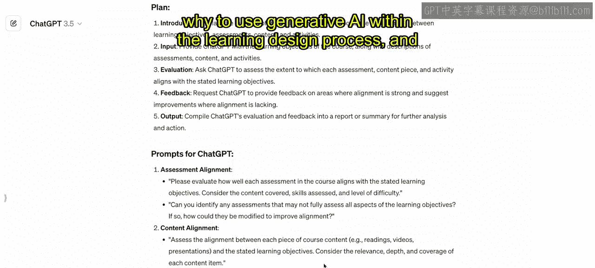
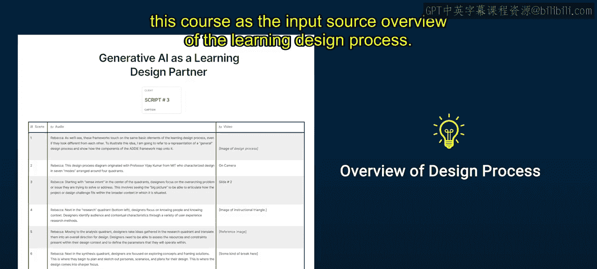
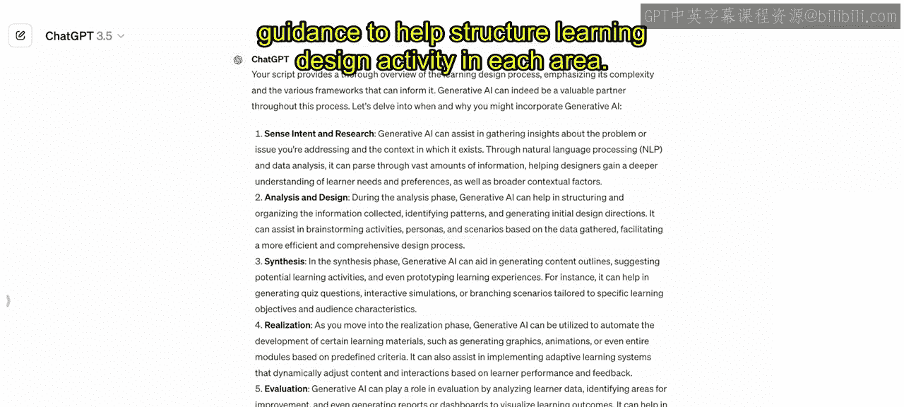

# 生成式AI作为学习设计伙伴：7：设计过程中的机遇

在本节课中，我们将探讨如何在学习设计流程中战略性地运用生成式AI，并通过一个实际演示来展示如何将其作为设计伙伴，以获取灵感和方向。

我们已经花了一些时间审视生成式AI可以在学习设计流程中的哪些环节发挥作用。我们识别了早期设计阶段以及后期阶段的一些任务，在这些任务中，生成式AI可以成为设计过程中的有用伙伴。

当你考虑如何将生成式AI作为学习设计伙伴时，采取战略性方法很重要。你的目标不应是用生成式AI取代你作为学习设计师的角色和责任，而应考虑如何利用它来启动项目、摆脱困境并改进你的实践。

思考何时以及为何使用生成式AI的一种方式是，用它来助推那些你觉得具有挑战性或繁琐的任务。你希望能够专注于工作中给你带来最多快乐和满足感的部分。同时，你也需要能够向项目利益相关者解释你工作的基本原理，包括你使用生成式AI所做的一切。因此，在直接投入之前，采取审慎的方法很重要。

此时，我们想演示一下如何将生成式AI用作学习设计伙伴。与其在此演示一个具体的学习设计任务，我们更想展示生成式AI如何能在更广泛的学习设计过程中提供灵感或帮助设定方向。

让我们从一个场景和一个问题开始。你可以提供一些关于你的角色以及你对“生成式AI作为学习设计伙伴”这一主题的兴趣的信息。

你不需要知道如何编码或编程，可以将其视为在进行一场对话。

**示例对话：**
> 你好，ChatGPT。我是一名经验丰富的学习体验设计师，但在使用生成式AI方面是新手。我对ChatGPT能作为我学习设计实践的伙伴这个想法很感兴趣。你能帮我思考一些潜在的使用案例吗？

即使使用这样一个相当基础的提示，ChatGPT也提供了一个详尽的选项列表，但其中一些比另一些更有用。一些生成的想法涉及学习者如何与生成式AI互动，另一些则涉及学习设计师的特定任务。

当发生这种情况时，你可以尝试重新表述问题或要求更多细节。

**例如：**
> 你能再提供一些关于我作为学习设计师如何使用ChatGPT来设计和规划课程的想法吗？

这些选项看起来更接近我们寻找的目标。如果提供的任何选项特别吸引你，你可以跟进并要求ChatGPT进一步扩展那个想法。

**例如：**
> 我对与学习目标的一致性特别感兴趣。你能帮我创建一个计划或一组提示词，让ChatGPT来评估课程学习目标与课程评估、内容和活动的一致性吗？

ChatGPT为学习设计师提供了一套具体的步骤和提示词，以确保与目标的一致性。

现在，让我们看看是否能回到最初关于何时以及为何在学习设计过程中使用生成式AI的问题上。

为此，向工具提供更多关于我们如何概念化学习设计过程的信息可能会有所帮助。为了本示例的目的，我们将输入本课程的一个脚本作为输入源，概述学习设计过程。

让我们开始一个新的对话。我们可以保存刚刚完成的那个。

**提示：**
> 你能帮我思考一下何时以及为何要在学习设计过程中使用生成式AI吗？我将分享一些我对设计的一般性思考，以及我如何看待一个学习设计模型如何映射到那个过程，形式是我写的一个脚本。

在输入提示并粘贴脚本后，我们看到了一些有用的结果，以及一些关于在学习设计过程中使用生成式AI的好处和潜在注意事项的一般性指导。

你可以根据库马尔的一般设计过程，使用部分或全部结果来指导你在研究、分析与设计、综合、实现和评估方面的思考。然后，你可以深入每个类别，要求提供额外的想法和指导，以帮助构建每个领域的学习设计活动。

重要的是要记住，你可以重新表述问题、要求更多细节、要求更少细节、深入探究、重新组织结果等等。你可以保存对话并开始新的对话。

生成式AI可以生成大量内容，有时可能会让人不知所措，因此你可能还想将特别有前景的想法复制到你自己的数字笔记空间中，以免这些重要的想法丢失。

我们希望这个简短的演示能给你一些关于如何开始考虑将生成式AI作为学习设计伙伴的想法。我们鼓励你尝试我们刚刚演示的活动，使用你自己的问题和措辞。你会发现你可能会得到与我们相似或不同的结果，我们也有兴趣在课程后期听取你关于计划开始、停止和继续使用这些工具的想法。

在本节课中，我们一起探讨了在学习设计流程中战略性地应用生成式AI的时机与原因，并通过实际对话演示了如何将其作为伙伴来获取灵感和具体指导。关键在于明确目标，利用AI处理繁琐任务以解放创造力，并通过迭代对话细化需求，从而有效提升设计效率与质量。