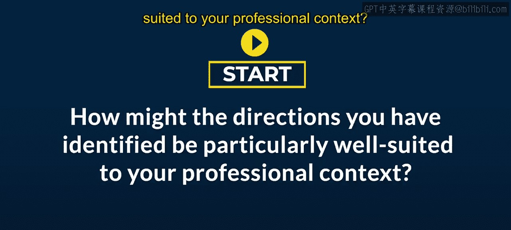
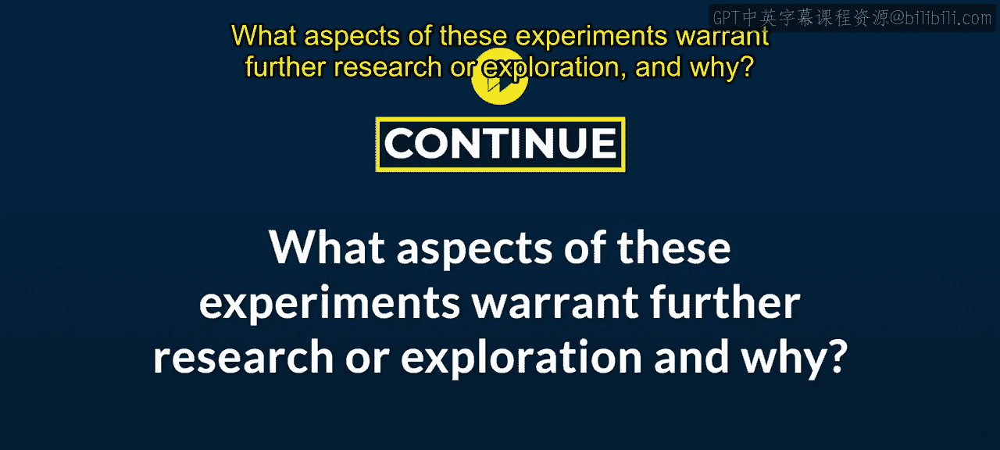

# 生成式AI作为学习设计伙伴：P8：深入思考

在本节课中，我们将一起回顾如何将生成式AI作为学习设计伙伴来运用。我们将通过一个结构化的反思框架，帮助你梳理所学知识，并思考如何将其应用到你的实际工作中。

---

## 概述

在本课程中，我们探讨了如何将生成式AI作为学习设计伙伴来加以利用。考虑到每位学习者都处于独特的专业背景中，我们希望为你提供一个机会，反思所学内容，并思考如何将这些想法应用到自己的工作中。为了引导你的反思，我们将提供一个基本的结构来组织你的思路。

---

## 反思框架：开始、停止、继续

作为学习设计专业人士，你可能听说过“开始、停止、继续”模型。教师常用此方法来收集学生对学习过程中有效和无效部分的反馈。我们将以略有不同的方式使用这些类别，来激发你思考如何利用生成式AI作为学习设计伙伴。

### 开始：探索新应用

上一节我们介绍了反思的整体框架，本节中我们来看看“开始”部分。我们思考了生成式AI在**设计初期阶段**的应用方式，例如：
*   起草学习者画像
*   起草课程大纲
*   起草学习目标

任何学习设计师通常需要提供草稿支持的任务，都可以归入此类。

我们也思考了生成式AI在**设计后期阶段**的应用方式，例如：
*   润色或修改草稿
*   从特定视角（如通过公平和包容的设计视角）审查课程内容

以下是引导你反思“开始”部分的问题：
*   你听到了哪些有前景、想要尝试的想法？
*   你会优先考虑其中的哪些想法？为什么？
*   你确定的方向如何特别适合你的专业背景？

---

### 停止：识别风险与保持谨慎

现在，让我们考虑“停止”部分。我们讨论了哪些学习设计任务特别适合由生成式AI支持，但也可能存在一些任务，最好由学习设计专业人士直接处理。

我们还讨论了像生成式AI这样的工具可能陷入的**炒作周期**，包括最初的热忱逐渐消退并转为幻灭。学习设计师可能需要在课程和项目开发中使用这些工具时，应对利益相关者的不同观点。“停止”一词也可以理解为保持谨慎。

以下是引导你反思“停止”部分的问题：
*   对于将生成式AI作为学习设计伙伴，你有什么顾虑？
*   在你的专业实践中，哪些部分让你对使用生成式AI感到犹豫？是什么引发了你的顾虑或谨慎？

---

### 继续：深化现有实践

最后，我们来审视“继续”部分。如果你正在学习本课程，你可能已经开始尝试使用生成式AI来支持你的专业实践。或者，你可能正在与已经开始尝试这些工具的同事共事。你甚至可能在本课程的讨论区中听到了同行们正在进行的实验。

以下是引导你反思“继续”部分的问题：
*   你或你同事的实验中，哪个方面让你觉得最有前景？为什么？
*   这些实验的哪些方面值得进一步研究或探索？为什么？

---

## 总结

在本节课中，我们一起学习了如何通过“开始、停止、继续”模型，结构化地反思将生成式AI作为学习设计伙伴的应用。我们探讨了可以开始尝试的新领域、需要保持谨慎或停止的风险点，以及值得继续深化和探索的现有实践。我们期待听到你的想法，并了解你目前如何看待生成式AI作为学习设计伙伴这一角色。