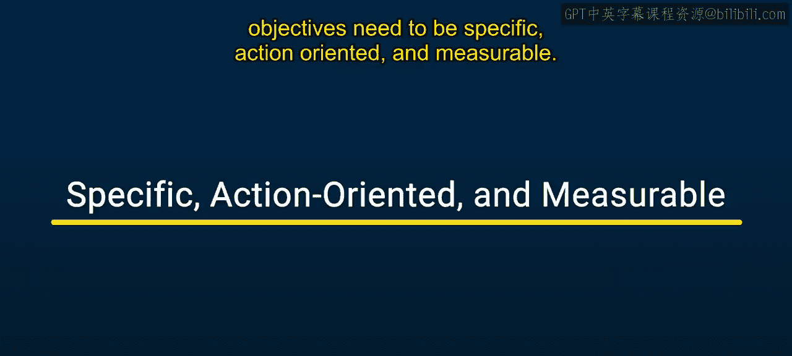
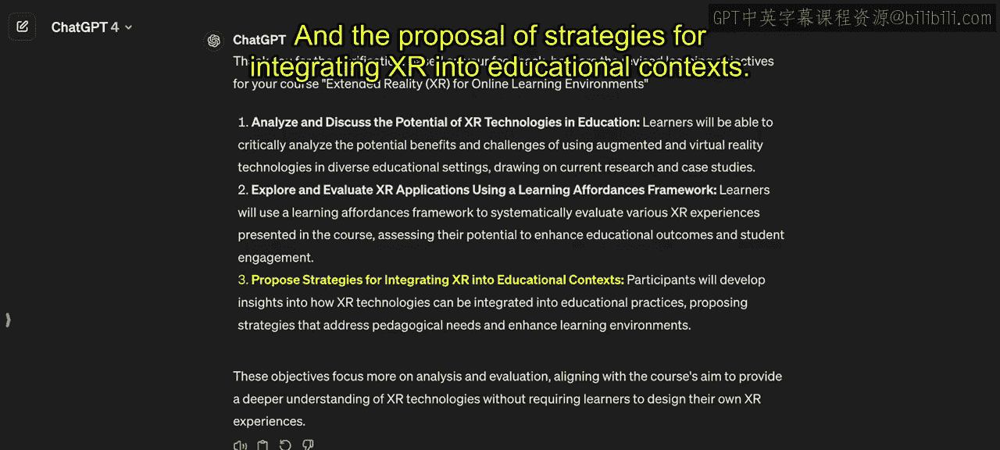

# 生成式AI作为学习设计伙伴：2：起草学习目标 ✍️

在本节课中，我们将学习如何起草学习目标，并探讨生成式AI如何作为合作伙伴，协助我们完成这项核心设计任务。

起草学习目标是学习设计师工作的核心部分。学习目标通常是设计流程中的首要任务，它为所有后续的设计决策指明了方向。

## 回顾逆向设计框架

上一节我们介绍了学习设计的基本概念，本节中我们来看看一个经典的设计框架。让我们回顾一下逆向设计框架。该框架的第一阶段称为“确定预期成果”，它支撑着后续的两个阶段：“确定可接受的学业证据”以及“规划活动与教学”。

在“确定预期成果”阶段，要求学习设计师能够清晰地阐述，学习者在完成一门课程或学习体验后，应该能够**知道**什么、**做到**什么以及**感受**到什么。这些学习成果或目标需要是**具体的、以行动为导向且可衡量的**。

## 生成式AI作为设计伙伴

现在，让我们考虑生成式AI如何在此学习设计任务中充当合作伙伴。虽然生成式AI无法取代学习设计师，但它有可能为学习设计师提供一个起点，一个可供反应和改进的基础。

我们将以“在线学习环境中的扩展现实”课程为例，向ChatGPT输入提示和信息，以获得我们想要的结果。在这种情况下，我们不会从零开始，而是输入原始课程的学习目标，并要求将其修改为适用于一门开放的在线课程。

以下是我们提供给ChatGPT的提示信息：

> 我们正在与ChatGPT合作，创建一门新的在线短期课程：“在线学习环境中的扩展现实”。这门课程灵感来源于我们现有的一学分在校课程，该课程更广泛地关注扩展现实的教育应用。我们原始课程的学习目标如下：
>
> 1.  识别与增强现实、虚拟现实及教育情境相关的学习可供性。
> 2.  将教育研究中的概念与个人使用增强现实和虚拟现实教育应用的经验联系起来。
> 3.  探索与人们如何使用增强现实和虚拟现实进行学习相关的新兴议题。
> 4.  通过主动学习体验，培养关于增强现实和虚拟现实的新感受、价值观和兴趣。
> 5.  评估新的增强现实和虚拟现实应用在教育场景中使用的适宜性。
> 6.  将你所学到的关于增强现实和虚拟现实环境对学习有效性的知识，应用到一个以设计为重点的个人项目中。
>
> 请参考这些学习目标，为面向全球学习者的开放在线课程（将在一个可用平台上提供）起草2到3个适合的学习目标。谢谢。

## 分析AI生成的初步目标

ChatGPT的输出结果很有意思。首先，它概述了学习设计师在制定学习目标时应考虑的因素。它提醒我们，全球在线学习者可能背景各异，技术访问水平不同。因此，学习目标应清晰、可实现、具有包容性，同时又要足够详细以确保对主题的深入理解。

以下是它根据提示生成的学习目标建议：

1.  **分析与讨论XR技术在教育中的潜力**：学习者将能够批判性地分析在不同教育环境中使用增强现实和虚拟现实技术的潜在益处与挑战，并借鉴当前研究和案例。
2.  **设计基于XR的学习体验**：使学习者掌握设计和批判沉浸式XR教育体验的技能，确保这些体验具有包容性、符合教学法并能有效融入各种学习环境。
3.  **评估XR创新在现实教育环境中的应用**：学习者将培养评估新XR教育应用的适宜性和有效性的能力，并在自己的教学或学习环境中提出实际实施方案。

让我们逐一审视这些目标。

*   **第一个目标**与我们原始课程的目标一致，并且非常适合开放在线课程的学习者。
*   **第二个目标**可能超出了我们在线课程的范围，因为它强调设计技能，所以我们需要回头修改这个目标。
*   **第三个目标**看起来总体可行，但我们希望学习者使用课程中将介绍的“学习可供性”框架来分析课程中展示的XR体验。

## 修改与完善目标

基于以上分析，我们需要修改讨论过的两个学习目标。我们构思了一个新的提示，要求ChatGPT根据我们的具体说明进行修改。

> 对于学习目标2，“设计基于XR的学习体验”超出了本课程范围，我们希望专注于分析。对于学习目标3，我们希望学习者使用“学习可供性”框架来分析课程中展示的扩展现实体验。

修改后的结果如下，它们更接近我们的期望：

1.  **分析与讨论XR技术在教育中的潜力**：学习者将能够批判性地分析在不同教育环境中使用增强现实和虚拟现实技术的潜在益处与挑战，并借鉴当前研究和案例。
2.  **使用学习可供性框架评估XR应用**：学习者将能够运用“学习可供性”框架，评估课程中展示的扩展现实体验，以确定其教育价值和适用性。
3.  **提出在教育环境中整合XR的策略**：基于对XR潜力和具体应用的分析，学习者将能够提出切实可行的策略，将扩展现实技术整合到特定的教育情境中。

当按此顺序排列时，我们得到了一个符合逻辑的学习序列：从讨论XR技术在教育中的潜力，到使用学习可供性框架探索和评估XR应用，再到提出在教育环境中整合XR的策略。

## 总结与要点

在这个具体示例中，我们要求ChatGPT为新的情境修改一组现有的目标。经过一些调整，我们最终制定了三个坚实的目标来指导开放在线课程的开发。

我们也可以使用生成式AI从零开始制定学习目标，但这可能需要我们付出更多努力来反复修订，直到目标更符合我们瞄准的学习设计情境。

正如我们的演示所示，要让生成式AI在起草学习目标时有所帮助，学习设计师必须**清晰了解学习者在完成课程后应能达成什么成果**。同时，学习设计师也必须**熟悉布鲁姆分类法或其他学习目标分类法**，以确保制定的学习目标是**具体的、以行动为导向且可衡量的**。

本节课中，我们一起学习了如何利用生成式AI作为合作伙伴来起草和优化学习目标，这是确保课程设计方向正确、内容有效的重要第一步。