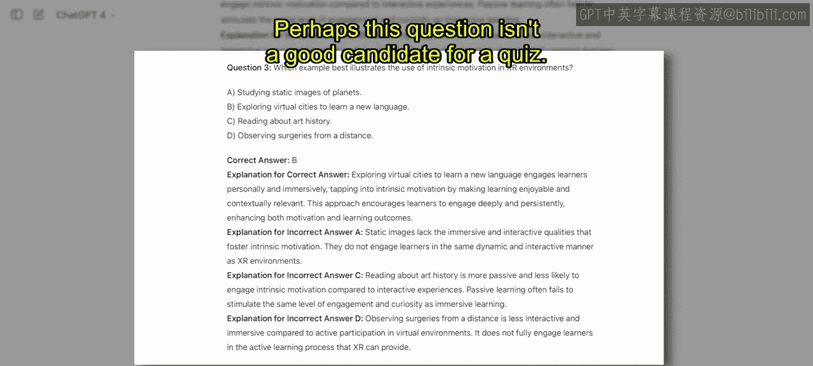

# 生成式AI作为学习设计伙伴：3：制定评估和详细反馈 📝


在本节课中，我们将学习如何与生成式AI合作，共同制定不同类型的评估工具，并为学习者提供详细的协作反馈。我们将重点探讨如何利用AI生成选择题测验，并为每个选项提供解释性反馈，以帮助学习者更好地理解学习内容。

---

## 与AI合作设计评估

上一节我们探讨了AI在内容生成方面的应用。本节中，我们来看看另一个关键的设计任务：制定评估和反馈。你可以与生成式AI合作，为学习者开发不同类型的评估工具和协作反馈。这包括设计各种考试题目或选择题测验，这也是我们今天关注的重点。

我们可以利用生成式AI不仅帮助开发评估本身，还能在评估中为学习者提供详细的反馈，解释测验中不同答案正确或错误的原因。这有助于学习者更好地理解他们正在被测验的内容。

为了说明这一点，让我们看一个例子：为我们之前创建的一个视频课程制作一个选择题测验。

---

## 构建测验的步骤

在这个例子中，我们需要向生成式AI提供描述我们需求的提示词，以及我们为之制作测验的视频脚本，以便为测验提供内容和背景。

以下是我们在ChatGPT中实现此过程的方法。

首先，我们将输入以下提示词。但在提交提示词之前，我们还会复制并粘贴测验所基于的脚本，然后将所有这些信息一并提交给ChatGPT。

为此，我们可以使用以下提示词：

```
请根据以下脚本编写五道选择题，指出正确答案，为正确答案提供20到40字的解释，并为每个错误答案提供20到40字的解释。
```

然后，我们将脚本直接复制粘贴到提示词之后，接着点击发送按钮，将所有内容发送给ChatGPT并查看结果。

---

## 审查与优化生成的测验

当我们审查生成的测验时，可以看到初步结果还不错，其中一些问题为我们提供了一个良好的起点。

但有一点立即引起了注意：详细的反馈。ChatGPT按照我们要求的篇幅提供了详细反馈，但现在我们发现，这些反馈可能过于简略。虽然所有正确和错误答案都有反馈，但这些反馈可能太短，对学习者用处不大。

因此，让我们尝试通过以下提示词使反馈更详细一些：

```
谢谢，这是一个很好的开始。能否请你为每个问题的解释再增加一到两句话？
```

查看结果后，我们可以看到详细的反馈看起来更好了，有更多的反馈来解释为什么不同的答案正确或错误。每个问题的反馈仍然简洁但信息丰富，并且比我们测验的先前版本提供了更有用的反馈。从这个角度看，这个最新版本是一个改进。

---

## 人工审查与调整的必要性

然而，仍然有一些问题需要我们处理。我们总是需要审查生成的测验问题，以确保它们有意义、准确，并且符合我们设计的背景。



在这里，如果我们审查生成的问题，会发现其中一个问题比其他问题要弱。具体来说，第三个问题感觉没有很好地构建，不太适合这个测验。即使有详细的反馈，也感觉测验问题中给出的选项并不是内在动机的固有例子。所提供的反馈也没有真正帮助说明这些选项是或不是内在动机。你或许可以从两方面进行论证。因此，也许这个问题不适合作为测验题。

此时，你可以直接删除它并自己编写一个问题，或者让AI生成一个替代问题，或者自己修改这个问题。这再次说明了将生成式AI视为设计伙伴的观点。

---

## 设计师的核心责任

在这里，我们看到了如何让AI生成一些带有反馈的潜在测验问题。但是，设计师仍然有责任利用这些信息来创建实质性和准确的评估。你可以让系统生成一些问题，但你仍然需要评估这些问题，并根据需要进行修改。你可以利用所有这些作为材料，帮助你创建自己的评估材料，利用AI帮助你集思广益，为正在创建的更大规模的评估做出贡献。

---

## 总结


本节课中，我们一起学习了如何将生成式AI作为协作设计伙伴，来开发评估工具和详细反馈。我们了解了从构建提示词、生成初步测验，到审查反馈质量并进行人工优化和调整的完整流程。关键在于，AI是一个强大的创意生成和效率工具，但最终确保评估的准确性、教育意义和情境贴合度，仍然是人类设计师不可替代的核心责任。请思考你如何运用生成式AI，探索它作为协作设计伙伴，帮助你为学习者开发评估和反馈的不同方式。