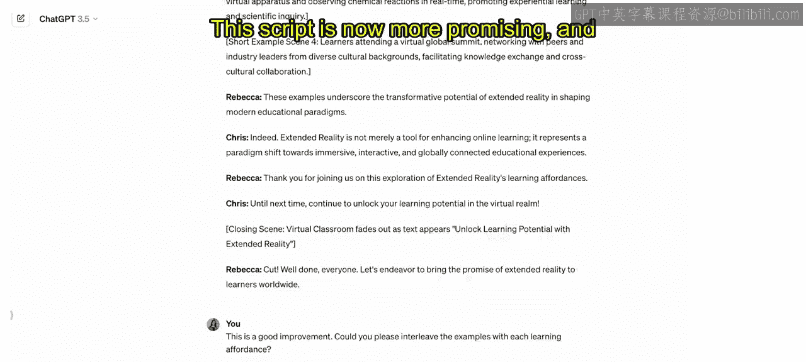

# 生成式AI作为学习设计伙伴：3：开发脚本 📝

在本节课中，我们将学习如何利用生成式AI作为合作伙伴，来协助我们开发在线教育视频的脚本。我们将通过一个具体的课程案例，演示从初始构思到逐步优化脚本的完整过程。

***

在线教育中，视频演示非常普遍，就像您正在观看的这个视频一样。在准备这些视频时，我们必须参与的设计任务之一就是开发视频脚本。

脚本可以为视频扮演不同的角色。它们可以作为帮助我们组织思路、形成谈话要点的工具，以便我们即兴录制视频。有时，我们也会创建更详细的脚本来为视频演示进行朗读。无论哪种方式，创建脚本都是一个设计任务，我们可以与生成式AI合作，帮助我们启动一些想法和初始脚本的构思，然后在需要开发演示文稿的阶段进行修改和定制。

***

## 初始脚本生成

我们可以通过一个例子来展示这个过程。我们将为之前讨论过的“扩展现实与教育”示例课程，开发一个更详细的脚本。

在这个例子中，我们希望为关于“学习可供性”的示例课程开发一个脚本。您将看到我们在提示词中包含了一些具体信息，例如我们对“学习可供性”的工作定义，以及我们样本课程感兴趣的可供性。我们还提出了一些具体要求：脚本的长度、需要包含一些例子，并且脚本是为两位将共同出现在视频中的演示者（Chris和Rebecca）编写的。

以下是我们提供给ChatGPT的第一个提示词，作为脚本开发任务的一部分：

> 我们正在与ChatGPT合作，创建一个新的在线短期课程“在线学习环境中的扩展现实”。该课程灵感来源于我们现有的一个学分制线下课程，该课程更广泛地关注扩展现实的教育应用。我们希望创建一个简短的介绍性视频，描述在扩展现实环境中可能实现的学习可供性。视频时长应在4到6分钟之间，有两位演讲者：Chris和Rebecca。视频脚本大纲应如下：
> 1.  学习可供性的定义。
> 2.  为扩展现实的教育应用确定的4个学习可供性：空间知识、内在动机、体验式学习、知识迁移。
> 3.  一个包含上述一个或多个学习可供性的扩展现实学习环境示例。

当我们查看生成的脚本时，发现它相当不错。它提供了我们想要传达的大量信息，我们可以审查脚本的准确性，看起来也没问题。脚本也涉及了我们提到的四个学习可供性。

***

## 脚本评估与迭代优化

然而，脚本仍有改进空间。

首先，我们希望有更多例子。脚本最后确实提供了一个参观虚拟艺术画廊的例子，但我们希望为每个学习可供性都提供例子。

其次，脚本的语气有点随意。虽然我们不希望演示过于正式或僵硬，但这里的语气有点太“家常”了。例如，我们通常不会以喊“停！收工！”来结束任何视频。

因此，我们可以继续与ChatGPT合作，通过后续提示词给出更多指示来优化脚本。

以下是第一个后续提示词：

> 谢谢，这是一个很好的开始。😊 能否请您修改脚本，使其听起来稍微更正式一些？同时，能否为每个学习可供性提供一个简短的例子，而不是只在最后提供一个例子？

这次的结果好一些。请注意，您仍然需要审查脚本，因为生成的脚本与之前的略有不同。结果脚本的语气更正式了一些，尽管ChatGPT仍然希望我们在脚本结尾说“停”，并且它确实包含了更多例子。但它是在脚本末尾给出了一系列关于学习可供性的例子，而我们更希望每个学习可供性都伴随例子进行描述，而不是在脚本末尾集中呈现。我们希望这样能使脚本流程更顺畅，对每个学习可供性的解释更清晰。

所以，让我们看看当我们要求进行这种修订，将每个学习可供性与例子分组时，它能做些什么。以下是第二个后续提示词：

> 这是一个很好的改进。能否请您将例子与每个学习可供性交织在一起？

现在这个脚本更有希望了，它确实列出了每个学习可供性并附带了简短例子。这为我们提供了一个流程更好的脚本，有助于我们清晰地解释每个学习可供性。

***

## 作为设计伙伴的生成式AI

那么，这是否意味着您可以直接使用生成的脚本？也许可以，也许不行。重申一下，当我们将生成式AI视为设计伙伴时，我们可以将其输出视为成品，也可以视为帮助我们起步的起点。

因此，我们仍然需要审查脚本，并决定是否需要检查准确性，以及是否需要进行任何更改、澄清或其他修订，以获得我们满意的最终脚本。这些更改可能是内容导向的、语法上的，或是风格上的。例如，无论如何提示，ChatGPT似乎总想让我们以喊“停”来结束每个脚本，所以我们可能仍需要进行一些编辑。

***

## 课程总结

本节课中，我们一起学习了如何与生成式AI合作开发脚本。您了解了如何通过提供具体的提示词来传达需求，更重要的是，您明白了必须审查任何生成的结果，并将其作为您工作的起点。生成式AI是一个强大的设计伙伴，但最终的判断、调整和优化仍需由人类设计师来完成。