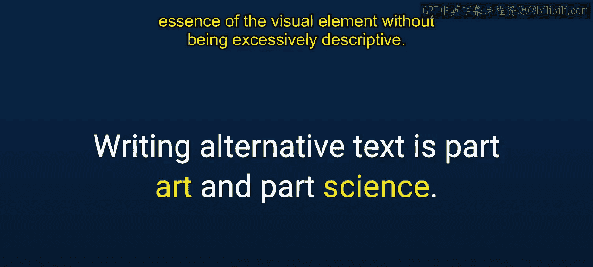
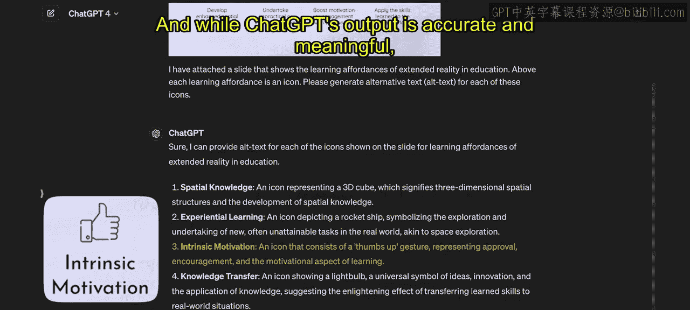
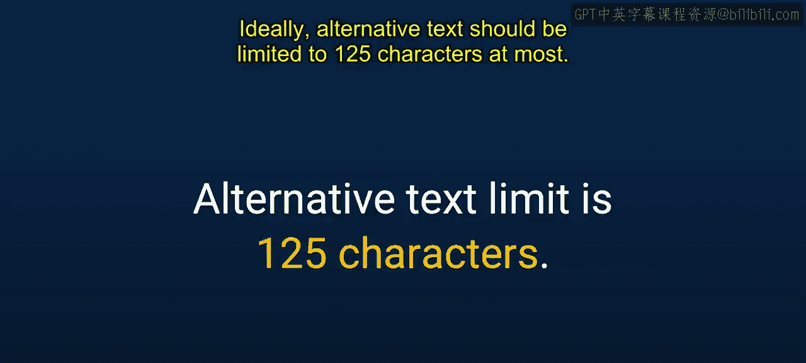
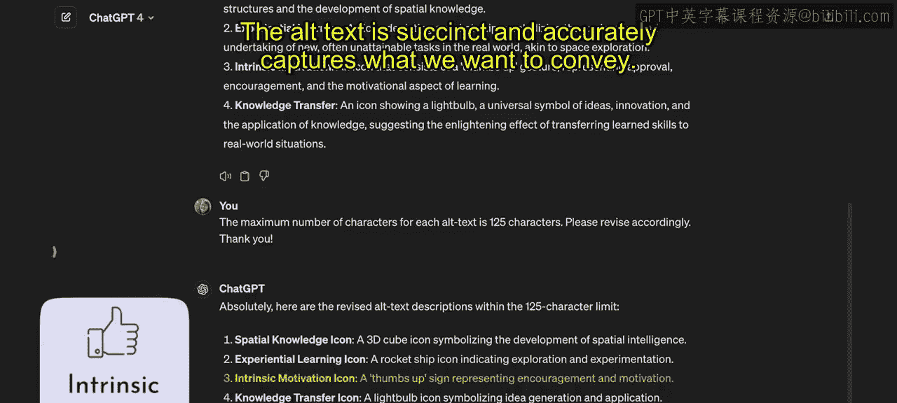

# 生成式AI作为学习设计伙伴：14：提高数字内容的可访问性


在本节课中，我们将学习如何利用生成式AI来辅助撰写“替代文本”，这是提升数字内容可访问性、实践包容性设计原则的核心技能之一。

---

学习设计师的一项核心能力是在工作中融入包容性设计的原则与实践。包容性设计的一个方面涉及数字资产的可访问性，包括文档、视觉呈现和其他类型的媒体。数字可访问性的一个具体体现是撰写“替代文本”，即为视觉内容提供文字描述，以帮助有视觉障碍的学习者理解。

在某些学习体验中，部分视觉元素可能仅具装饰性，而另一些则可能承载着理解内容所需的关键含义。因此，学习设计师必须能够撰写替代文本，以支持学习者理解那些蕴含意义（而非仅是装饰）的视觉内容元素。

替代文本可以嵌入到各种文档类型中，并能被屏幕阅读器检测到。撰写替代文本兼具艺术性与科学性，它需要在不过度描述的前提下，准确捕捉视觉元素的含义与本质，并传达图像的意图。

这项关键的学习设计任务需要反复练习才能熟练掌握，且即使熟练后，也可能非常耗时。基于以上背景，让我们看看如何利用生成式AI来辅助起草替代文本。



---

## 实践案例：为扩展现实课程图标生成替代文本

我们将使用一门关于“扩展现实与教育”课程中的例子。我们可以向ChatGPT上传一张幻灯片，其中包含了与课程中讨论的各个学习特性相关联的图标：空间知识、体验式学习、内在动机和知识迁移。每个图标下方都有一段简短的说明文字。

以下是我们提供给ChatGPT的提示示例：
```
你好，ChatGPT。我附上了一张展示扩展现实在教育中的学习特性的幻灯片。每个学习特性上方都有一个图标，请为这些图标生成替代文本。
```

现在，我们来审视ChatGPT为每个图标生成的输出结果。ChatGPT为每个图标提供了描述，并解释了每个图标象征的意义。令人印象深刻的是，ChatGPT准确地描述了每个图标，并对我们赋予每个图标的含义给出了合理的解释。

例如，对于“内在动机”图标，ChatGPT最初生成的描述是：
> 一个由竖起大拇指手势组成的图标，代表认可、鼓励以及学习的动机方面。

ChatGPT提供的描述准确地描述了图标，其解释也捕捉到了我们使用该图标想要传达的意图。

---

## 优化输出：符合最佳实践准则

尽管ChatGPT的初始输出准确且有意义，但作为替代文本来说仍然过于冗长。理想情况下，替代文本的长度应限制在最多125个字符以内。





幸运的是，我们可以要求ChatGPT进行修改，将每个图标的描述限制在125个字符内。我们可以使用如下提示：
> 替代文本的最大字符数为125个字符，请据此进行修改，谢谢。

经过修改后，生成的替代文本变得简洁得多，并符合了替代文本的最佳实践准则。

让我们再次查看“内在动机”图标优化后的替代文本：
> 一个竖起大拇指的标志，代表鼓励和动机。



现在的替代文本简洁明了，并准确捕捉了我们想要传达的核心信息。

---

## 总结与启示

作为一名学习设计师，手动起草第一版替代文本需要一定时间，修订第二版则需要额外时间。通过观察生成式AI在此特定用例中的表现，我们可以确信它能够帮助我们提升撰写有效替代文本的能力。


此外，生成式AI能够加速并改进与包容性设计原则和实践相关的重要学习设计流程。因此，利用ChatGPT撰写替代文本以增强数字可访问性，是一个值得探索且有前景的用例。我们鼓励你亲自尝试这一方法。