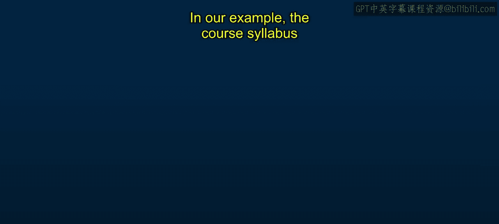
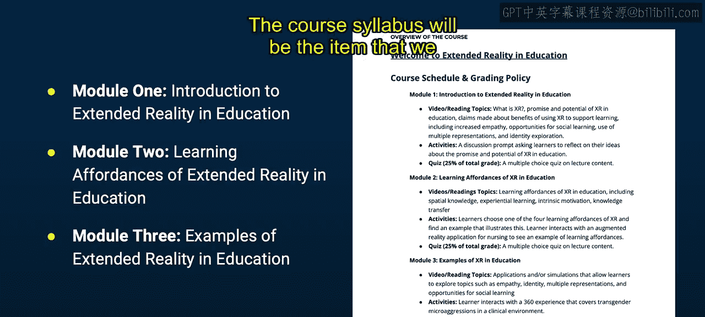
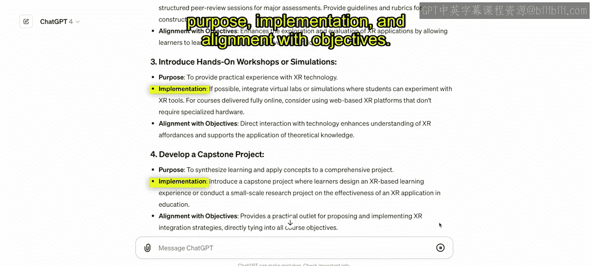

# 生成式AI作为学习设计伙伴：15：6_将课程目标与设计成果对齐


在本节课程中，我们将学习如何利用生成式AI来验证和优化课程设计，确保所有的教学活动与评估都与预设的学习目标保持一致。我们将通过一个具体的课程大纲案例，演示如何使用ChatGPT来完成这一任务。

---

作为学习设计师，验证课程设计是否与既定学习目标保持一致至关重要。

学习目标应具体、以行动为导向且可衡量。这些目标能有效指导课程设计，确保所有提议的活动与评估都是为了支持这些目标而开发的。由于设计过程往往耗时数周甚至数月，时刻牢记学习目标非常重要。

然而，即使意图良好，学习设计有时也会偏离轨道。学习设计师可能会遇到内容范围蔓延的问题，即活动与评估超出了课程的最初目标。相反的情况也可能发生，可能由于时间和资源的压力与限制，我们的学习设计未能达到预期。换句话说，练习机会和学习资源未能充分帮助学习者在总结性评估中展示其知识。

因此，当我们考虑将生成式AI作为学习设计伙伴时，特别是在学习设计流程的优化阶段，利用生成式AI来实现这一目的似乎是合理的。

---

上一节我们探讨了生成式AI在设计流程中的角色，本节中我们来看看如何用它来对齐课程目标与设计成果。

让我们回到一直在研究的示例课程。现在，关于扩展现实与教育的在线课程已开发完成，我们需要确保计划的活动和评估与我们为课程定义的学习目标保持一致。与其他示例一样，我们将使用ChatGPT。

我们为课程设定了以下学习目标：
1.  分析并讨论XR技术在教育中的潜力。
2.  运用学习赋能框架探索和评估XR应用。
3.  提出将XR整合到教育情境中的策略。

在我们的例子中，课程大纲描述了课程的组织结构：
*   **模块1**：扩展现实在教育中的介绍。
*   **模块2**：扩展现实在教育中的学习赋能。
*   **模块3**：教育中的扩展现实实例。

课程大纲提供了更多细节，包括每个模块的主题、包含的活动以及学习者展示知识的方式。课程大纲将是我们输入到ChatGPT中的内容，连同我们的提示词。




---

我们的提示词将非常直接。以下是提供给ChatGPT的提示词示例：



```text
这是我们的“扩展现实与教育”在线短期课程的课程大纲。请提取大纲中的学习目标，并确保大纲中的课程结构与课程目标保持一致。
```

然后，我们将课程大纲复制并粘贴到ChatGPT中。让我们看看结果。😊

ChatGPT按学习目标组织了结果。每个目标都对应一个高级主题：技术与教育、学习赋能框架、教育情境。

对于每个学习目标及其对应主题，ChatGPT提供了课程设计如何支持这些目标的具体示例，看起来相当不错。请注意，我们只使用了提示词和课程大纲，无需特别指出学习目标或课程结构，ChatGPT能够自行识别。

但除了回应我们关于学习目标与课程结构设计是否一致的问题外，ChatGPT还更进一步。其输出内容评论了课程的驱动性问题，以及它们如何支持所述的学习目标。

此外，除了评论课程目标与评估如何与每个目标挂钩外，ChatGPT的输出还提供了关于课程活动与评估的总结性陈述。

ChatGPT的评估相当积极：“总体而言，该大纲看起来连贯且结构良好，有效地将学习目标映射到课程内容和活动中。这种一致性支持了一种连贯的学习体验，应能有效实现课程的教育目标。”

尽管如此，如果能听取关于如何加强学习目标与课程设计元素之间一致性的建议会更好。

---

让我们尝试这个后续提示词：“你有什么建议来填补这些差距？”

哇，ChatGPT提供了一些高级建议，例如纳入案例研究、扩展同伴协作以及开发一个顶点项目。

每个建议的结构如下：**目的**、**实施方式**、**与目标的契合度**。



作为学习设计师，你可以审查这些建议，看它们在你的设计情境中是否合理。它们可能会激发一些有趣的想法来增强你的设计。另一方面，纳入过多建议可能会导致我们之前提到的问题：范围蔓延。


因此，作为学习设计师，运用你的最佳判断至关重要。这包括验证ChatGPT的评估是否合理（而非过于宽容），以及决定是否采用生成式AI提供的额外建议。


---


本节课中，我们一起学习了如何利用生成式AI（如ChatGPT）来审核课程大纲，确保学习目标、教学活动和评估之间的一致性。我们看到了AI不仅能进行一致性检查，还能提供结构化的改进建议。关键在于，设计师需要运用专业判断来评估AI的反馈，并决定采纳哪些建议，以避免设计范围失控，最终创造出目标明确、结构严谨的学习体验。