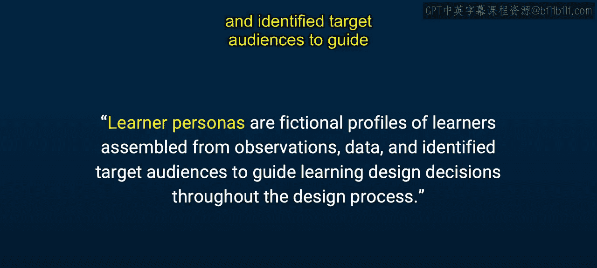
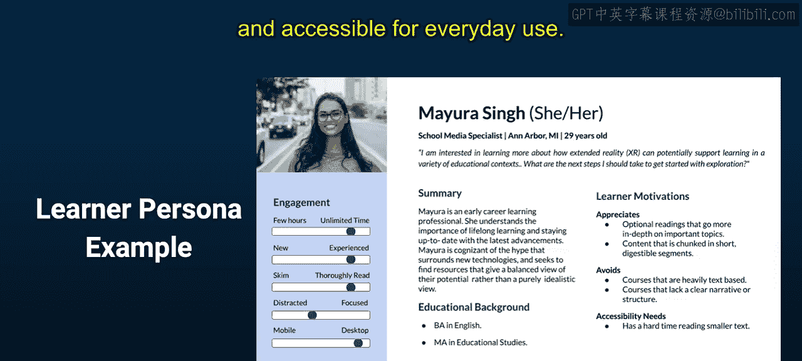
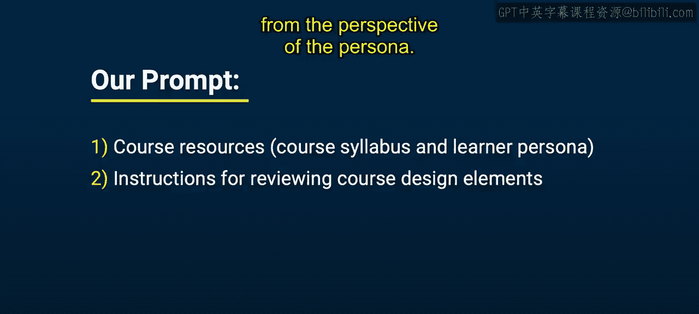
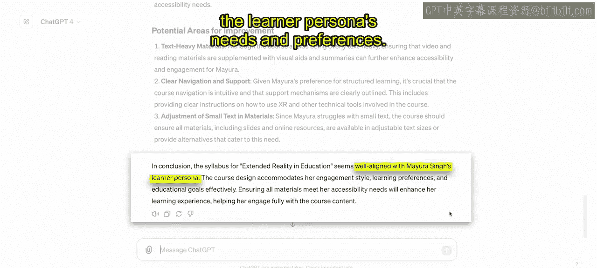

# 生成式AI作为学习设计伙伴：P16：扮演学习者角色 👤

在本节课中，我们将学习如何在学习设计流程的“精炼”阶段，利用ChatGPT扮演特定的角色——特别是学习者角色——来评估课程设计。我们将了解学习者角色的概念，并学习如何构建提示词，让AI从特定学习者的视角提供反馈。

---

在学习设计流程的精炼阶段，我们可以使用ChatGPT来检查我们的工作。这通常表现为评估学习目标与课程设计元素之间的一致性。

然而，我们也可以超越纯粹的学术性问题，通过提示让GPT承担更具体的角色或视角。学习者角色是学习设计师工具箱中的一个工具，可以作为ChatGPT角色扮演提示的基础。

简而言之，学习者角色是虚构的学习者档案，它基于观察、数据和已识别的目标受众构建，用于在整个设计过程中指导学习决策。

---

学习者角色可以用多种格式呈现，学习设计师会采用最适合其设计需求和利益相关者需求的风格和格式。

幸运的是，一些GPT模型也允许我们以多种格式提供输入，包括包含数字化文本的图片。例如，这是为我们示例课程“扩展现实与教育”开发的一个学习者角色。

该角色格式包含了对角色背景和选课动机的总结、教育背景以及偏好的参与模式。

这个特定角色格式的一个显著特点是，它通过滑动条来表示参与模式。每个类别（如可用时间、经验水平、技术使用、移动或桌面设备偏好）都以从低到高的光谱形式展示。这使得学习设计师能够一目了然地看到这些特征，让这种格式在日常使用中非常实用和便捷。

---

我们的提示词将包含两个部分：一是课程资源，二是从该角色视角审查课程设计元素的指令。

我们可以上传我们通常使用的格式的角色档案。换句话说，我们不需要提供模板版本的文本等价物。

因此，我们的提示词可以这样写：
> 我附上了一个我为这门短期课程开发的学习者角色。请从该学习者角色的视角审查我们的教学大纲，并就其是否能满足该学习者角色的目标、目的和偏好的参与模式提供反馈。这是教学大纲。

然后我们附上学习者角色。现在让我们看看结果。

首先，我们可以看到ChatGPT将结果组织成了四个类别：参与度与学习风格、内容与学习方法、课程主题与目标，以及潜在的改进领域。

我们并未要求以这种方式组织反馈，但看到它如此呈现，为我们提供了一个全新的视角，直接回应了我们关于课程设计是否满足学习者角色目标、目的和偏好参与模式的问题。ChatGPT确认该课程设计应该非常适合该学习者角色的需求和偏好。

---

这是一个积极的信号。同时，确保设计质量的最終责任在于学习设计师。

因此，以批判性的眼光看待反馈，并对课程设计是否达到其预期目标做出最终判断，仍然非常重要。

---

本节课中，我们一起学习了如何利用学习者角色作为提示基础，让ChatGPT从特定学习者的视角评估课程设计。我们了解了学习者角色的构成与格式，并实践了构建包含课程资源和审查指令的两部分提示词。最后，我们认识到，虽然AI能提供有价值的反馈视角，但设计师的批判性判断和最终决策权至关重要。