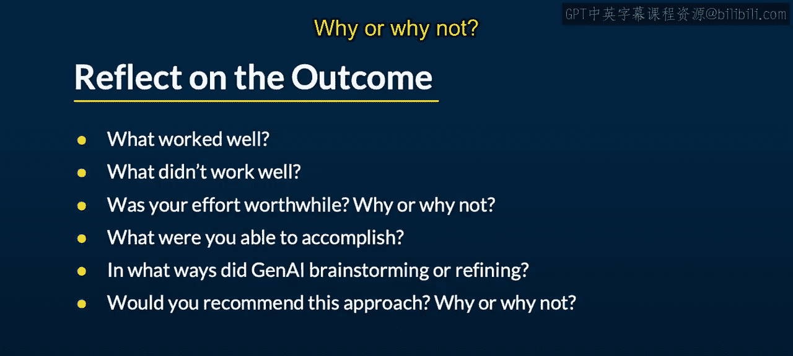

# 生成式AI作为学习设计伙伴：3：实践尝试 🧪

在本节课中，我们将把前两节学到的知识付诸实践。我们将引导你完成一个实验，让你亲身体验如何使用生成式AI（GenAI）来辅助学习设计工作。课程将分为四个步骤：确定实验背景、明确设计任务、使用AI工具尝试以及反思实验结果。

---

## 实验步骤概述

以下是本次实践尝试的四个核心步骤。我们将逐一进行详细说明。

### 第一步：描述实验背景

首先，你需要为你的实验设定一个背景。这决定了你实验的起点和方向。

*   **使用现有项目**：如果你手头有正在进行的项目，请简要描述该学习体验的内容以及你希望通过本次实验达成的目标。
*   **使用示例场景**：如果你没有现成的项目，可以直接使用课程提供的示例场景作为起点，并补充一些细节，同时说明你的实验目标。

### 第二步：明确设计任务

接下来，你需要进一步界定实验范围，确定一个具体的学习设计任务。这个任务应属于“头脑风暴”或“优化精炼”中的某一类别。

*   **复现课程任务**：你可以选择复现我们在课程中演示过的任务，例如**起草学习目标**或**将课程核心目标与学习成果对齐**。
*   **尝试全新用例**：你也可以完全根据自己的想法，阐述一个全新的使用场景。选择权完全在你。

### 第三步：使用AI工具尝试

现在，是动手操作的时候了。使用像**ChatGPT**这样的生成式AI工具来尝试你的想法。

*   这个过程可能需要多次尝试。通过试错，你很可能获得一些有趣的结果。
*   **关键提示**：务必记录你尝试过的**提示词（Prompts）** 以及AI生成的**结果**。这对最后一步的反思至关重要。

### 第四步：反思实验结果

最后，请对实验的结果进行反思。这是将实践经验转化为个人知识的关键环节。

*   哪些部分效果很好？哪些部分效果不佳？
*   整体的努力是否值得？为什么？
*   借助GenAI，你完成了哪些原本无法独立完成的事情？
*   生成式AI在“头脑风暴”或“优化精炼”方面以何种方式提供了支持？
*   你会向其他学习设计师推荐这种方法吗？为什么？

---

## 总结与展望

在本节课中，我们一起完成了从理论到实践的跨越。你学习了如何设定实验背景、选择设计任务、使用AI工具进行尝试，并对整个过程进行系统性反思。

我们期待看到你的尝试，并聆听你对于实验结果的思考与见解。通过亲手实践，你将能更深刻地理解生成式AI如何增强学习设计工作的能力。