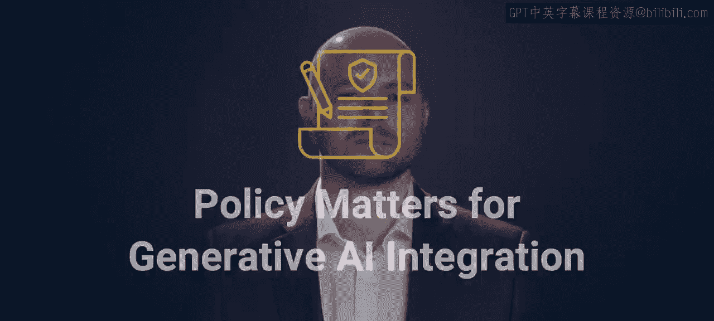
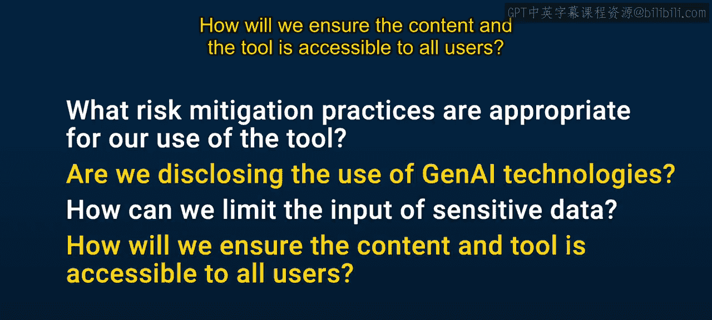
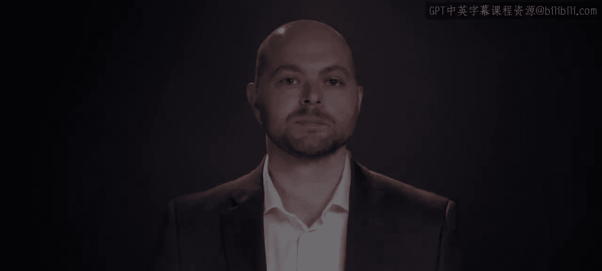
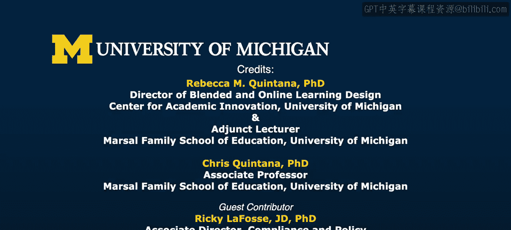

# 生成式AI作为学习设计伙伴：2：生成式人工智能集成的政策问题 🧑⚖️

在本节课中，我们将探讨在高等教育中集成生成式人工智能（GenAI）时面临的主要政策问题。我们将了解从知识产权到数据隐私等一系列关键挑战，并学习如何在创新与合规之间取得平衡。

---

大家好，我是密歇根大学学术创新中心的合规与政策副主任 Merul La Foss。我的日常工作涉及大量关于技术创新与教育交叉领域的深度思考、研究和讨论，以及它们给机构和学生带来的独特风险，无论是法律、道德、声誉还是其他方面的风险。

## 当前高等教育中GenAI面临的最大政策问题

上一节我们介绍了政策讨论的背景，本节中我们来看看当前高等教育中涉及生成式人工智能的最大政策问题是什么。

问题清单上确实有很多内容，并且这个清单还在不断增长。在2022年底OpenAI公开推出ChatGPT之后，最初的讨论大多集中在学术诚信上。人们真正担心，学生这种新的、或许无法阻止的作弊能力会摧毁高等教育。即使到现在，这些担忧也依然存在。但可以公平地说，人们也越来越认识到，在大多数教育环境中，我们不可避免地需要学会与这些技术共存。

因此，呼吁彻底禁止的声音已经减弱，注意力已经转移到许多其他领域。就目前而言，我认为知识产权，尤其是版权问题，一直处于前沿和中心位置。

目前已有无数针对大公司的诉讼，指控其侵犯版权，这引发了一系列涉及各种媒体的复杂新问题。

但首先需要指出的是，作为入门知识，只有人类才能享有版权保护，任何GenAI工具生成的原始输出本身都不会获得版权保护。人类作者身份是必不可少的。现在，基础的提示词，假设它们具有足够的创造性，可能是可受版权保护的。

但对于使用这些工具的人来说，这里通常更重要的是，实际的输出本身不会获得版权保护，因为没有人类真正创造这些输出。因此，这本身就会产生问题，至少就机构可能希望以后限制他人使用GenAI创作的作品而言。

然而，试图限制或声称对GenAI工具生成的特定图像或其他输入拥有所有权，对于一个以分享知识和信息为核心的行业来说，真的不会是一个主要问题。这只是我们需要时刻牢记的一个限制。

在我看来，一个更大的问题是，当这些GenAI模型被输入可能受版权保护的作品时，无论是开发者还是个人用户，例如要求总结他们在网上找到的一篇文章。至少有可能，某些收集这些材料的方法会构成合理使用。但界限究竟在哪里，目前还不完全清楚。

此外，还有知识共享许可下的作品问题，这些许可至少要求署名，但在输出中仍然被使用，却没有任何形式的致谢。即使该衍生作品的使用在其他情况下可能是被允许的，前提是保留了任何知识共享许可。这些都是目前正在我们的法庭上解决的问题。但底线是，无意的侵权行为可能正在发生，一旦被发现，GenAI创作的作品至少需要被下架。

关于这个话题我要快速说明的最后一点是，当我们与第三方工具合作时，也需要考虑我们机构以及教职员工的知识产权。合同或服务条款中规定版权考虑的方式可能是一种相当常见的做法，表面上可能暗示所有者保留所有版权，但授予工具或服务使用、展示和创作该作品衍生品的许可。这种方式通常涉及多种可能性，例如上传的课程材料现在可能被用于训练GenAI模型，这些潜在的用途现在可能远远超出了这些合作最初设想的目的。

## 其他值得关注的政策问题

在某种意义上，可以说我们需要在GenAI的背景下重新思考一切，因为它是一项如此具有变革性的技术。因此，清单相当长。我将重点指出我认为目前最关键的另外三个重要领域。

以下是三个关键的政策关注领域：

1.  **数据隐私与安全**
2.  **深度伪造**
3.  **“机器人非人”问题群**

关于数据隐私和安全考虑，虽然我不会说在GenAI方面，数据隐私法律和原则的应用有什么特别新颖或独特之处，但我们确实需要更多地关注第三方如何以新颖的方式访问和共享数据，以用于训练其AI模型，因为这可能产生包含潜在敏感数据的输出，而无法进一步控制谁现在可以访问这些数据。换句话说，这种数据共享并不一定依赖于第三方的任何蓄意行为。许多公司现在确实提供不同层级的服务，允许封闭环境，高等教育机构的输入不会被用于训练他们的模型，但这是需要检查的事项，然后需要根据这个关键因素制定使用该工具的适当指南。

我想在这里提出的一个更重要的观点是，GenAI工具的非人面孔以及这些工具提供的一些诱人便利，似乎正导致教职员工和学生更愿意做一些事情，例如邀请工具阅读和总结可能敏感的电子邮件，或参加私人会议做笔记并分享可能敏感对话的摘要。希望不言而喻的是，在没有首先完成至少一些审查和批准步骤之前，不应该发生这种情况。因此，GenAI素养仍然很重要，提醒人们仅将某些经批准的工具用于特定类型的活动和特定数据敏感度类别也同样重要。

接下来是可能在更广泛的社会层面对GenAI的担忧中排名相当高的问题，即GenAI合成媒体导致的深度伪造泛滥。深度伪造本质上是一种经过修改或可能从头创建的图像或录音，作为一种冒充手段，通常带有一些负面含义，其根本意图可能是通过错误信息造成伤害，或暗示当事人做了某种有损名誉的事情，而实际上他们并没有。我们确实开始看到一些有针对性的法规来解决这些问题，包括美国联邦贸易委员会（FTC）的规则制定以及国外的法规，即欧盟的《人工智能法案》。

深度伪造不仅可能对我之前提到的领域产生影响，而且还涉及欺诈和虚假陈述框架，以及人格权，如姓名、形象、肖像权。在高等教育背景下，希望我们会将这些技术用于不那么恶意的目的，并理想地为了学生和社会的利益，我们至少应该在任何使用合成媒体的地方披露其使用，以避免任何疑问。还应该与出现在视频中、之后可能被修改的任何教职员工或嘉宾讨论这些技术的使用，即使这种修改可能只是为了在将内容翻译成不同语言时以不同方式移动说话者的嘴唇。始终需要事先获得许可。

然后还有更复杂和有争议的问题，例如在演讲者去世后继续使用其姓名、形象、肖像权来更新课程内容以反映新发展。通常会有在个人去世后继续生效的人格权保护，尽管这可能因州而异，既然这项技术已经到来，现在进行这些有些令人不适的对话将非常重要。

最后，我们还有我称之为“机器人非人”的问题。当GenAI聊天机器人失控时，谁应承担责任？如果它们实施骚扰或提供如果被依赖可能导致严重伤害或死亡的信息，该怎么办？如果机构对供应商提供的系统进行了自己的修改，该怎么办？不幸的是，我们需要向前看，思考这些事情，并确保在我们的合同中解决责任问题，并采用适当的披露和监督实践。

我们还需要知道法律和法规何时限制计算机做人类的工作，这在高等教育中尤其常见。例如，加州目前有一项法案正等待州长签署，该法案将禁止在加州社区学院用GenAI工具取代包括助教在内的教师。此外，联邦对远程教育的要求仍然规定，机构必须通过“定期和实质性互动”规则，为学生提供与合格的人类教师定期互动的机会。虽然这些工具在教学环境中确实有其用武之地，但它们不应该被用来完全取代教师。

## 学习设计专业人士应牢记什么？

我认为需要牢记的主要一点是，我们需要在创新与道德合规之间取得适当的平衡。你可能会想，这里有太多需要担心的事情了，我们为什么不干脆完全停止使用这些工具呢？这种心态无助于让我们的教职员工和学生为一个因这项真正具有变革性的技术而迅速变化的社会做好准备。还有其他我甚至没有提到的主要问题，例如许多流行的GenAI工具中固有的多种形式的偏见，这些偏见可能反映并延续有害的刻板印象，并继续压制边缘化的声音。这些工具还有显著的环境影响，以及它们使用起来是多么耗费资源。

但我们绝对可以以鼓励创新的方式向前迈进，同时仍然确保我们有合理的流程和程序，并留出时间讨论指导原则。我认为，至少这些对话需要涉及以下内容。

以下是进行内部讨论时应考虑的三个核心问题：

1.  我们是否真的需要使用GenAI工具来实现我们的目标？如果是，使用它有哪些道德影响？
2.  我们对提供商的声誉以及我们同意的条款感到满意吗？我们理解这些条款吗？
3.  对于我们使用该工具，哪些风险缓解措施是合适的？我们是否披露了GenAI技术的使用？我们如何限制敏感数据的输入？我们将如何确保所有用户都能访问工具和内容？

我认为在团队内部进行这些对话，并在需要时引入其他专家，仍然能够在绝大多数情况下启用特定工具，并且应该有望在整体上带来更平衡和可持续的GenAI采用方法。

---

本节课中，我们一起学习了在高等教育中集成生成式人工智能时面临的主要政策挑战。我们探讨了知识产权与版权、数据隐私与安全、深度伪造以及责任归属等关键问题。最重要的是，我们认识到需要在拥抱技术创新与坚守伦理合规之间找到平衡点。通过进行审慎的内部评估、理解服务条款并实施适当的风险缓解措施，教育工作者可以在利用GenAI潜力的同时，负责任地应对其带来的复杂政策环境。