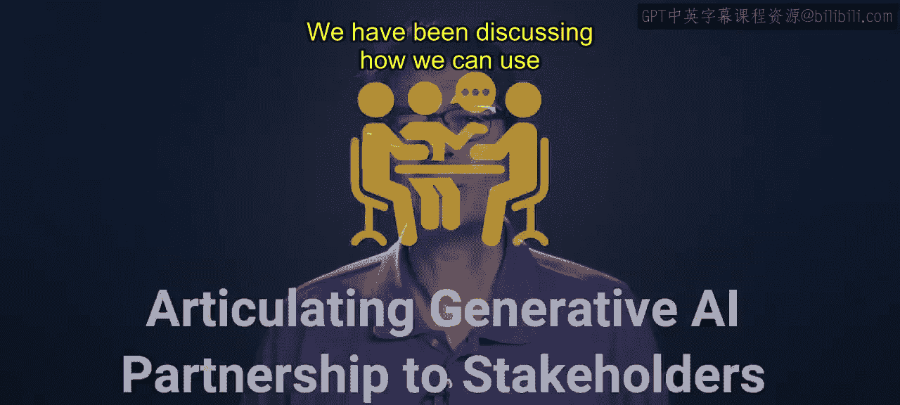
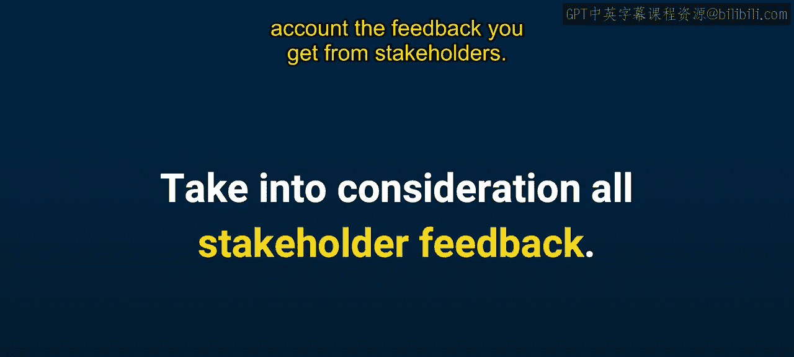
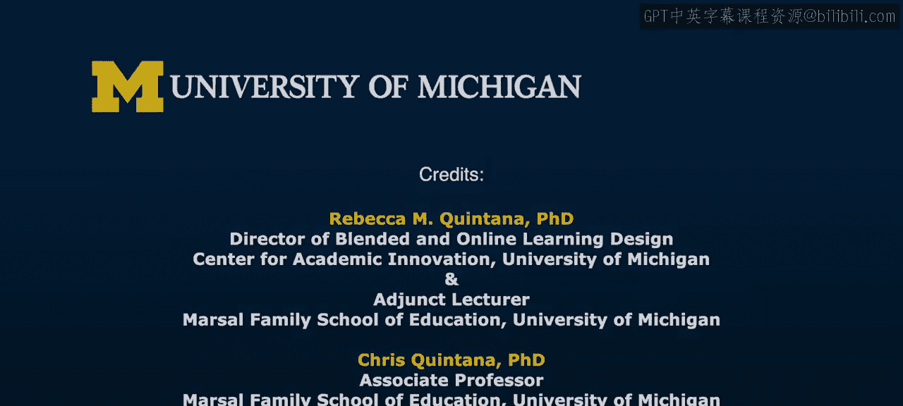

# 生成式AI作为学习设计伙伴：3：向利益相关者阐述生成式人工智能合作 🤝

在本节课中，我们将学习如何向项目中的其他合作者与利益相关者阐述生成式AI在设计中的应用。我们将探讨如何将讨论焦点从工具本身转移到设计任务上，并有效管理各方对这项新技术的不同期望与担忧。

---

我们一直在讨论如何将生成式AI用作学习设计的工具和伙伴。

之前的讨论主要从设计师的视角出发，聚焦于设计师如何将生成式AI工具纳入自己的工具箱。

但设计师并非在真空中工作。在任何学习设计项目中，都会有许多不同的合作者和利益相关者参与，他们会影响工作的各个方面。

例如，一个项目团队可能包括你需要协作的多位设计师。其他利益相关者可能包括监督项目的项目经理、开发媒体素材的媒体设计师，或为项目进行编程及其他技术开发的软件开发人员。此外，还有你为其设计项目的客户，以及在整个设计过程中与你合作、沟通的教育者或其他顾问。

所有这些利益相关者都会不同程度地参与项目。但当像生成式AI这样令人兴奋的新技术出现时，你可能需要处理关于技术的不同意见，这会影响你作为设计师的工作。

一些利益相关者可能对这类工具感到非常兴奋，并仅仅因为这是热门、潮流的技术，就推动你在项目中使用它们。另一方面，一些人可能对生成式AI抱有担忧或恐惧。例如，一位教师可能不希望自己的讲义材料被用于生成式AI工具中。或者，可能对生成式AI工具内的版权问题存在其他担忧。因此，一些利益相关者可能不愿意采用这项技术。

对于作为设计师的你，可能需要在驾驭这些不同的观点和请求的同时，最终目标仍是推进你所设计的学习体验向前发展。

因此，作为设计师，你的角色的一部分不仅仅是设计，还包括向项目中的其他利益相关者阐明你在设计中采用的方法。

---

当你与利益相关者讨论生成式AI的使用时，可以考虑采用一些通用的方法。

首先，虽然这似乎与我们阐述生成式AI的议题相悖，但描述生成式AI的效用和使用的一种方法，是实际聚焦并突出你正在执行的设计任务，而不是过分关注你正在使用的工具（如生成式AI）。

谈论技术总是很有趣。但我总是告诉我们的学习技术专业学生，当我们谈论学习时，将重点放在你使用的特定工具上并不那么重要。相反，重要的是你为支持学习而开发的任务和学习活动，这应该是你讨论的焦点。

然后，你可以讨论你使用何种工具和方法来完成这些设计任务，这可以包括提及生成式AI作为该工具箱的一部分。换句话说，你不一定非要在设计项目中把聚光灯打在生成式AI上。相反，应突出你正在做什么、研究什么，然后你可以谈论你如何完成这些设计任务，其中可以包括你对生成式AI和其他工具的使用，以帮助你完成任务并实现学习设计目标。

学习设计目标应该成为焦点。你可以将像生成式AI这样的工具定位为实现这些目标的伙伴和手段。

---

现在，这种对任务而非工具的聚焦，也能帮助你强调生成式AI的伙伴关系属性，这是我们在整个系列中一直在讨论的。

当出现像生成式AI这样的新潮技术时，一些人可能会有这样的印象：仅仅使用生成式AI就足以完成你所有的任务。另一方面，正如我们所说，另一些人可能担心我们把过多的设计工作交给生成式AI，从而将人类排除在外。

在这两种情况下，你都需要说明，你是在将生成式AI用作设计伙伴。你并非将所有设计任务都交给生成式AI。你，作为设计师，仍然在设计过程中起主导作用，但你会在需要且对过程和你有帮助时，使用像生成式AI这样的工具。

因此，当我们谈论这种设计伙伴关系时，我们是在强调设计师是主导者，他们决定何时以及如何引入像生成式AI这样的不同工具。

---

最后，虽然这些想法可以帮助你定位如何在你的学习设计项目中使用生成式AI，但这并不意味着你不应该考虑从利益相关者那里得到的反馈。

作为设计师，关键是要充分理解你正在使用的不同工具，比如生成式AI。这样你才能清晰地描述这些工具的优势和局限性，并且也能在谈论工具能做什么时，指出哪些炒作可能是不切实际的。

如果其他利益相关者对生成式AI的某些方面有重大担忧，你需要做好准备，以便能够回应这些担忧，而不是简单地驳回反馈。或者，如果一些利益相关者对生成式AI的能力过度炒作或描绘出不切实际的图景，你需要能够以更均衡的评估来回应。

当一些利益相关者提出关于使用生成式AI的其他有趣想法，而这些想法你可能尚未想到时，你也应该记下这些想法并进行探索，看看如何能扩展你对生成式AI的使用。

---

正如我们所讨论的，生成式AI是设计伙伴关系的一部分。项目中的不同利益相关者也构成了一个伙伴关系，这将引发许多关于技术的讨论、想法和观察。

对不同技术的兴奋和担忧会传递给不同的利益相关者，你需要准备好谈论你希望如何使用这些技术，它们如何对你的工作有益以推进项目，同时也要指出你认为不需要或不想使用这些技术的情况。

提供有分寸的反馈，并清晰地说明你如何为工作使用不同的工具，这可以是任何设计过程中的重要组成部分，尤其是在像生成式AI这样的新工具出现在学习设计领域时。

---

本节课中，我们一起学习了如何向利益相关者阐述生成式AI在设计中的角色。核心在于将讨论焦点从**工具**转向**设计任务与目标**，将生成式AI定位为实现目标的**伙伴**而非替代品。作为设计师，你需要充分理解工具的**优势与局限**，以管理各方期望，有效整合反馈，并在设计伙伴关系的框架内推进项目。