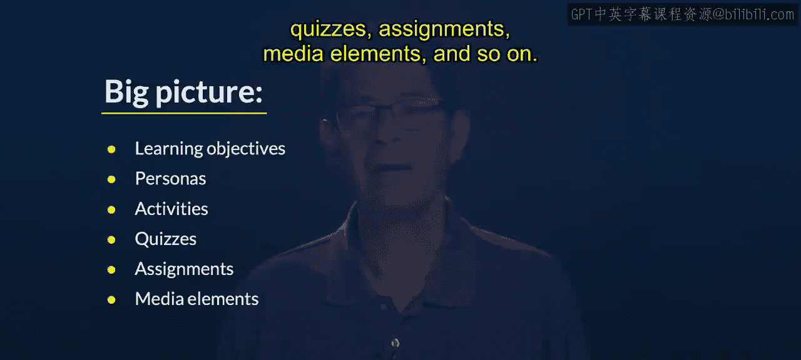
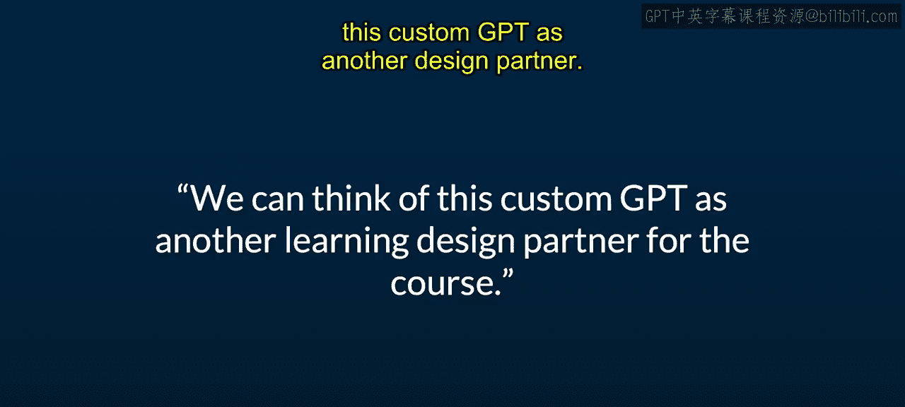
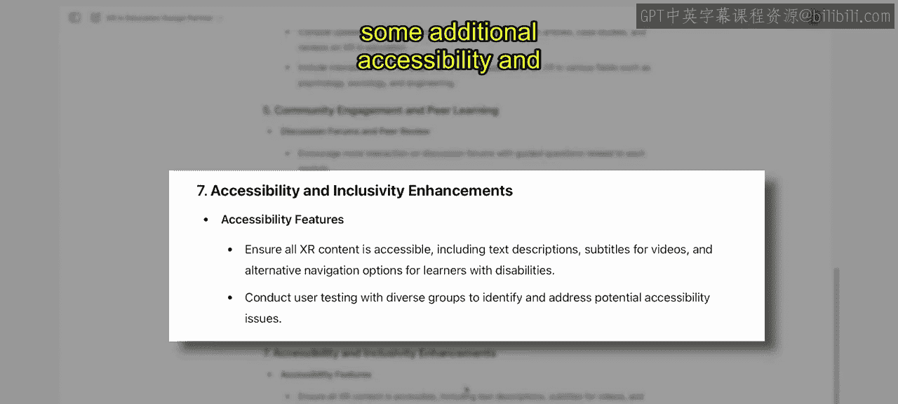
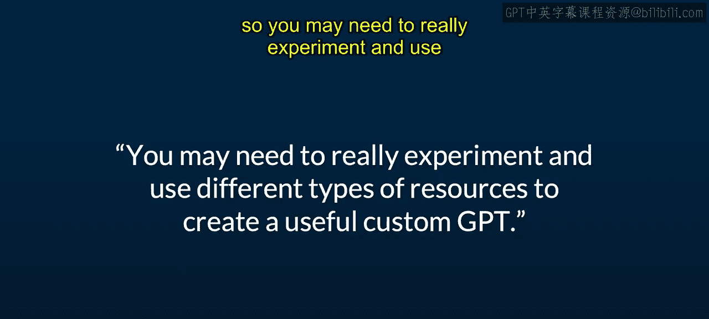
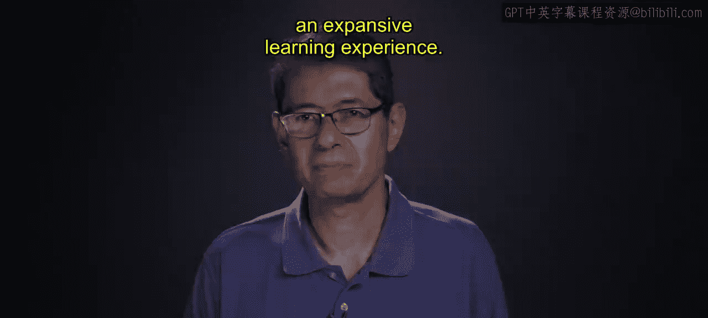

# 生成式AI作为学习设计伙伴：P22：4_面向学习设计师的定制GPT

在本节课中，我们将要学习学习设计师如何利用生成式AI工具作为设计伙伴。我们将重点探讨如何创建定制化的GPT工具，以帮助跟踪和评估学习体验设计中的众多元素。

---

## 定制GPT的设计需求

上一节我们介绍了使用通用AI工具辅助设计任务。本节中我们来看看如何创建更专业的工具来管理复杂项目。

学习设计过程会产生大量需要跟踪的项目，例如学习目标、用户画像、活动、测验、作业和媒体元素等。

随着学习体验的规模扩大，同时把握整体框架和具体细节会变得更具挑战性。因此，我们可以借助生成式AI工具来协助处理这些任务。

除了向ChatGPT这类通用工具提问，我们还可以创建定制的GPT工具，专门支持学习设计师跟踪和评估其项目的不同组成部分。

---

## 创建定制GPT：以XR教育课程为例

让我们通过一个具体例子，看看如何为课程创建定制GPT，并探索其使用方式。

这个例子基于我与Rebecca Kinana博士在大学共同教授的课程。课程名为“XR in Education”，探讨如何利用虚拟现实和增强现实等技术来支持学习。

虽然我们在大学里进行过线下授课，但在这个例子中，我们正在创建该课程的完全在线版本。我们将创建的定制GPT将协助完成这项学习设计任务。

我们将创建一个专门用于此课程的定制GPT，用它来回答我们在课程设计中可能遇到的各种问题。这个GPT仅供课程的学习设计师使用，而非学生。我们可以将这个定制GPT视为另一位设计伙伴。

我们可以进入ChatGPT来创建一个新的定制GPT，然后开始配置它。

以下是配置定制GPT的步骤：

首先，为它起一个名字，提醒我们这个定制GPT是XR教育课程的设计伙伴。我们将创建的GPT命名为“XR and Education Design Partner”。

接下来，描述这个GPT的用途：它作为一个已完成设计产物的知识库，用于协助开发额外的课程材料。

然后，提供我们希望GPT如何操作的指令。例如，说明这个GPT提供关于各种设计产物和课程元素当前设计状态的最新信息。鼓励设计团队成员将最终确定的设计产物上传到GPT，以确保其信息保持最新。设计团队成员可以查询此GPT以开发新材料，并确保内容连贯、一致且协调一致。

之后，设置一些对话启动器。你可以将这些视为常用任务的快捷方式，这些链接将显示在GPT页面的前端。

我们创建了以下对话启动器：
*   一个用于“需要开发的课程元素”。
*   另一个用于“与目标一致的课程元素”。
*   第三个名为“与我们的用户画像一致的课程元素”。
*   最后一个是“课程设计中的连贯性与不一致性”。

创建这些对话启动器后，你会看到它们以按钮形式显示在GPT前端。这样，当我们按下相应按钮时，可以快速让GPT处理这些任务。

最后，我们需要为定制GPT提供一些关于我们XR教育课程的信息或知识。这些信息存在于我们为课程准备的不同文件中。

因此，我们可以上传诸如课程大纲、一份示例阅读材料、一份测验、一些用户画像，以及我们创建的关于学习与功能可供性的初始脚本等文档。

我们可以先上传关于课程的初始信息。随着课程设计的推进，我们将添加我们创建的新信息，例如新的测验、脚本，或者新的用户画像和学习目标。

一旦上传了所有这些信息，我们就可以为课程创建定制GPT，并与设计团队的其他成员共享这个GPT。

---

## 使用定制GPT：实践示例

请记住，我们的GPT目前只包含关于课程的一些初始信息。但这足以让我们通过一些小例子看看如何使用我们的定制GPT。

让我们使用一些对话启动器。

首先，询问我们的GPT哪些课程元素与我们的学习目标一致。GPT返回了相当多的信息。它首先评估了它如何看待课程将课程元素与学习目标对齐。它指出，课程结构融合了理论概念、实际应用和沉浸式技术，以增强学习者的参与度和理解力。然后，它继续列出了一些主要的课程元素，以及这些元素如何与学习目标保持一致。

当然，作为设计师，你应始终审查这些反馈的准确性，并判断其是否合理。但正如你所见，随着时间推移，当你向GPT添加更多课程元素时，你可以继续使用GPT为你提供有用的摘要和概述，以帮助你评估课程的不同方面。

让我们看另一个例子。我们可以在GPT的前端页面开始一个新的对话。

这次，我们要求GPT根据大纲中的记录，告诉我们哪些课程元素仍需开发。GPT给出了它认为我们仍需完成的任务摘要。例如，它告诉我们仍需开发某些课程模块，并描述了这些模块的要素。它提醒我们，特别是对于一门关于扩展现实的课程，我们应该开发更多互动元素和模拟。它描述了我们应创建的一些测验和材料，并提醒我们需要为课程考虑一些额外的可访问性和包容性功能。

---

## 总结与展望

本节课中我们一起学习了学习设计师如何创建定制GPT来支持学习设计过程。

我们还有很多可以探索的，但这应该让你对学习设计师如何创建定制GPT来支持学习设计过程有了一个概念。

创建GPT仍然是一项相对较新的活动，因此你可能需要进行大量实验，并使用不同类型的资源来创建一个有用的GPT。

但希望你能看到，开发一个定制GPT如何能以多种方式真正充当设计伙伴，帮助你跟踪创建广阔学习体验所涉及的所有元素。

