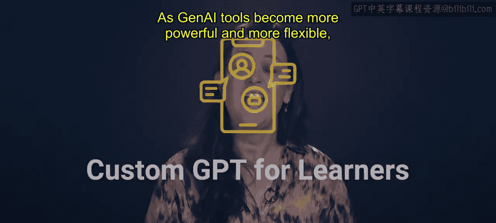
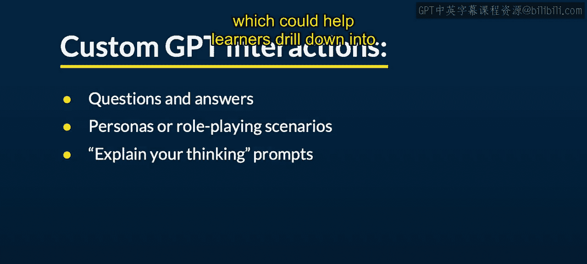
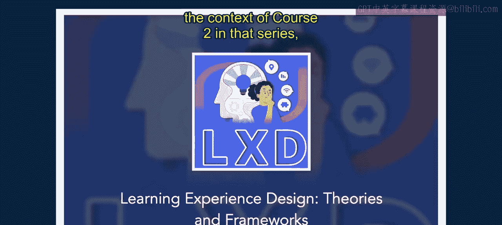
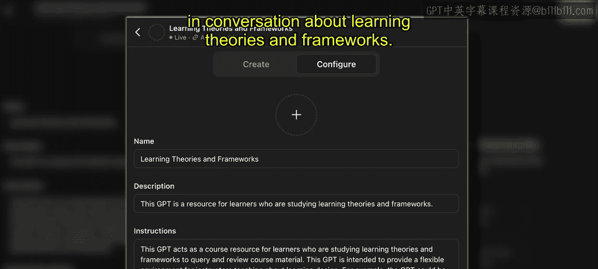
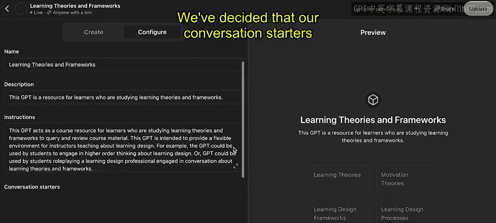
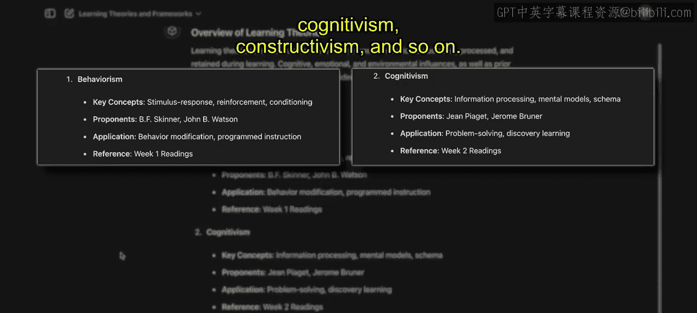
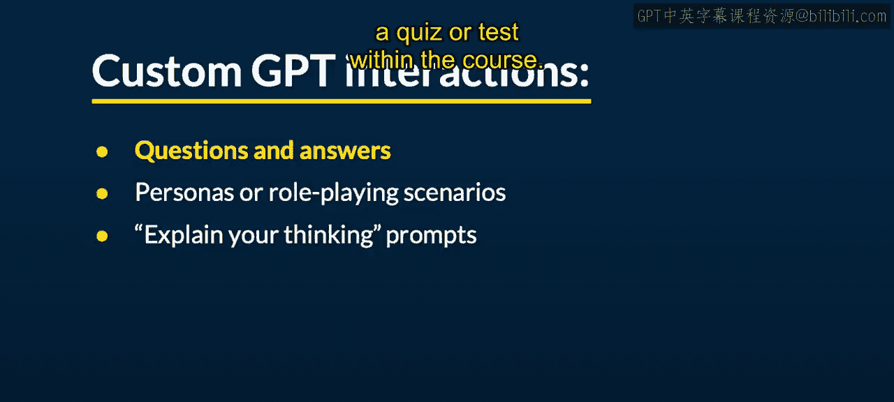
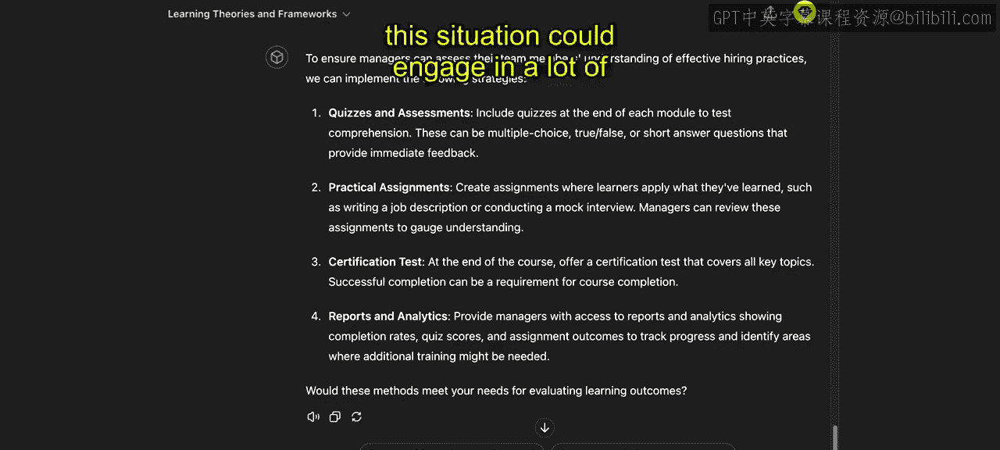
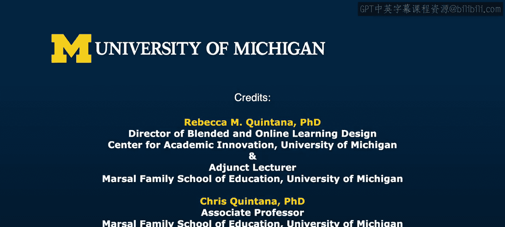

# 生成式AI作为学习设计伙伴：3.5：面向学习者的定制GPT 🧠

在本节课中，我们将学习如何为学习者创建和利用定制化的GPT环境。我们将探讨定制GPT如何支持问答、角色扮演等学习活动，并通过一个学习理论与框架课程的具体案例，演示其设计与应用过程。

随着AI工具变得更强大、更灵活，学习设计专业人员将有机会以定制GPT的形式，创建高度专业化和定制化的学习环境。这使我们能够构建两种环境：一种是供学习设计专业人员执行特定任务的环境；另一种是让学习者在定制环境中进行知识建构的环境。本节视频将重点探讨后一种应用。

学习设计师有多种方式可以将定制GPT用作学习活动的资源。如果我们思考GPT环境能够支持的互动类型，就能获得灵感，设计出能利用定制GPT的学习活动。以下是几种主要的互动类型：

*   **问答互动**：GPT擅长处理基础问答。学习者可以用自己的语言提问并获得回应。
*   **角色扮演**：GPT同样擅长扮演特定角色或参与情景模拟。
*   **解释推理**：当被要求时，GPT可以解释其推理过程，这有助于学习者深入钻研正在学习的特定概念。

接下来，让我们创建一个可在学习体验设计课程中供学习者使用的定制GPT环境。我们的研究生课程既有面对面授课，也有在线教学版本。我们将使用为该系列第二门课程——“学习理论与框架”——所开发的教学材料。这个主题足够广泛，使我们有机会建立一个知识库，用于支持与该课程主题相关的多种教育活动。

那么，让我们看看如何为这个示例设置定制GPT。我们为它设定了一个标题：“学习理论与框架”。描述保持通用：**`本GPT是供学习学习理论与框架的学习者使用的资源。`**

我们为GPT的运作方式制定了指令，内容如下：
> 本GPT作为学习学习理论与框架的学习者的课程资源，供其查询和复习课程材料。它旨在为讲授学习设计的教师提供一个灵活的环境。例如，学生可以用它进行关于学习设计的高阶思维活动，或参与角色扮演活动，如与一位学习设计专业人士就学习理论与框架进行对话。

我们决定将课程的主题领域设置为对话启动器。这为学习者提供了一个轻量级的支架或支持，以引导他们对整个课程的思考。这些主题包括：学习理论、动机理论、学习设计框架、学习设计流程。

我们向定制GPT上传了课程内容，为其提供相关的课程信息。上传的项目包括课程大纲、视频脚本、随视频提供的幻灯片，以及我们为阐述课程概念而撰写的阅读材料。

现在，让我们来试用一下这个定制GPT。首先，看看当学习者选择我们提供的对话启动器之一时会发生什么。例如，如果学习者选择“学习理论”，他们会收到一个关于学习理论的课程信息综合摘要，包括行为主义、认知主义、建构主义等理论。

基于此，学习设计师和教育者可以设计后续活动，让学习者通过问答来比较、对比和综合本课程中的各种学习理论。这类活动对学习者在复习材料、准备课程测验或考试时非常有用。

接下来，让我们尝试一些更复杂的内容：一个角色扮演场景。在这个场景中，学习者将扮演客户，与由ChatGPT扮演的学习设计师合作，设计一个关于最佳招聘实践的、引人入胜且具有说服力的人力资源培训课程。客户不具备学习设计理论与框架的基础知识。因此，这个活动的目标可以是让课程中的学习者评估GPT如何以研究为依据的方式有效地回应客户的问题。最终，该活动的学习成果是让学习者认识到与项目利益相关者（客户）互动时有效的学习设计策略。

作为客户，学习者可以这样提问：
> 什么样的课程设计会让学习者感到有动力？我们希望关于最佳招聘实践的课程有很高的完成率。

在我们的场景中，由GPT扮演的学习设计师提供了五个想法。客户可以深入探讨其中一个，比如“互动内容”，并说：
> 我想了解更多关于在我们的课程中，测验和投票可以是什么样子。

由GPT扮演的学习设计师提供了示例问题可能的样子，然后给出了两个实施建议：即时反馈很好，可以考虑纳入讨论。

客户接着提问：
> 一个能让学习者有动力继续学习的课程是什么样的？

GPT则更详细地回应了如何使用测验和投票来保持学习者在课程中的参与度。

最后，客户可以问：
> 经理们如何知道团队成员是否学会了有效的招聘实践？

再次由GPT扮演的学习设计师提供了多种选择。

由此可见，在这种情况下，学习者可以随着场景以自然的方式展开，进行大量的来回讨论。

这个示例旨在让你一窥使用定制GPT可以设计出的学习活动类型。作为学习设计师，仔细思考活动的结构非常重要。教育者可以为学习者提供一个启动提示，以设定互动的参数。他们还可以要求学习者在角色扮演活动中明确引入至少三个课程中的概念。在这个案例中，客户（学习者）询问了动机、评估策略和学习证据，这些都是课程中包含的内容。

为了进一步扩展活动，可以要求学习者下载聊天记录，突出显示或注释GPT在哪些地方示范了基于研究的学习设计实践，在哪些地方没有。

总而言之，创建定制GPT为学习设计师和教育者探索新型机会开辟了道路。关键在于提供结构和具体要求，确保活动与为课程设计和定义的学习成果保持一致。

本节课中，我们一起学习了如何将定制GPT构建为面向学习者的学习环境。我们探讨了其支持的互动类型，并通过一个完整的案例，从目标设定、内容配置到活动设计，演示了创建服务于特定课程目标的定制GPT的完整流程。关键在于明确的学习目标、结构化的活动设计以及将GPT的互动与课程核心概念紧密相连。