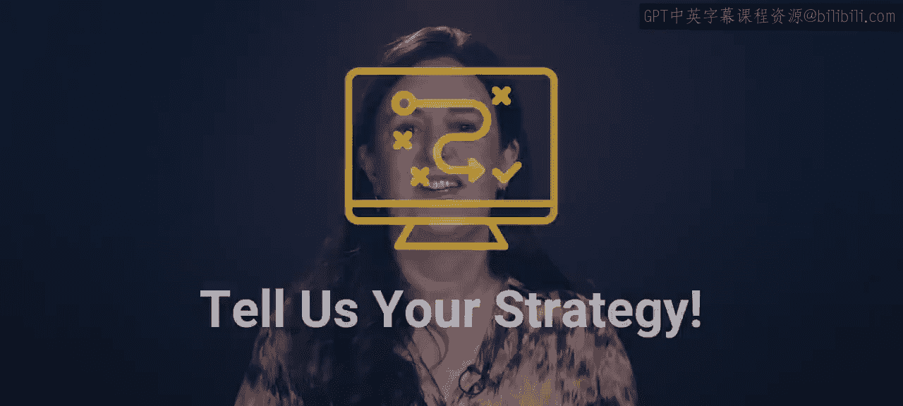
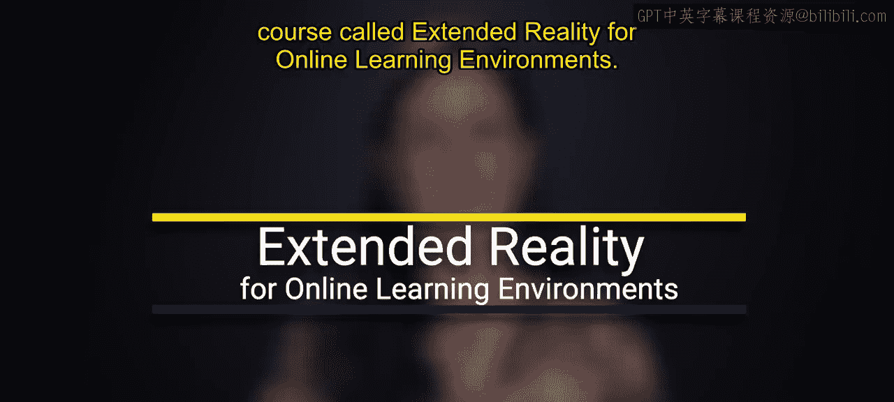
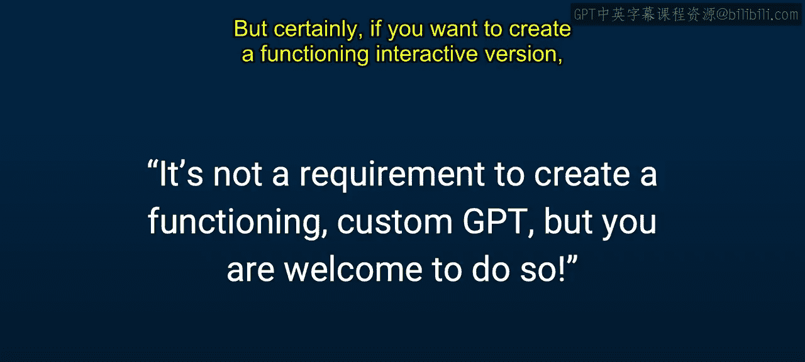

# 生成式AI作为学习设计伙伴：3：分享你的策略 📝

在本节课中，我们将回顾整个系列的核心内容，并引导你制定一个策略，以创建一个为学习设计师或学习者服务的定制化生成式AI工具。我们将探讨两种具体的使用场景，并指导你如何规划自己的定制GPT项目。

---

## 课程概述

在本系列课程中，我们探讨了生成式AI如何作为学习设计伙伴，支持学习设计专业人士的工作。我们首先从宏观视角审视了整个学习设计流程，以识别可进行实验和整合的潜在领域。接着，我们研究了生成式AI如何辅助与起草和优化相关的具体设计任务。在本课程中，我们则重点探讨了生成式AI如何作为资源，在学习情境中支持设计流程与活动。

## 回顾核心工作类别

在整个课程中，我们主要考虑了生成式AI如何从两大类工作中支持学习设计师：**利用生成式AI进行头脑风暴** 与 **利用生成式AI进行优化**。我们通过一个名为“在线学习环境的扩展现实”的示例课程，展示了这两类工作的具体应用。

## 制定你的定制GPT策略

现在，我们希望你能思考如何利用生成式AI创建一个知识库或资源库，用以支持学习设计师的工作或学习者对某个主题的理解。

我们演示了开发定制GPT的两种用例。这使我们能够定义生成式AI在查询和回应时所依据的内容与参数。对于本课程活动，你需要制定一个策略，以构建一个在项目背景下支持学习设计师的定制GPT，或一个在学习情境中支持学习者的定制GPT。

以下是两种策略方向的详细介绍，请选择其一进行规划。

### 策略方向一：为学习设计师创建资源

在我们的第一个示例中，我们希望为学习设计师创建一个资源，供其在课程设计与开发流程的整个生命周期中使用。其目的是开发一个即时且定制化的环境，当设计师需要针对其特定项目量身定制的结果时，可以使用它。

你可以将其想象为能够向一位对你的项目了如指掌的资深学习设计师提问和寻求建议。

如果你决定首先关注这个用例，你需要：
1.  确定一个特定的学习设计任务（或一组任务）及其使用的具体设计情境。
2.  思考你需要提供哪些资源和材料，以开发一个能为项目增值的定制GPT。
3.  指明在整套综合资源中，哪些类型的信息是可用的且有用的。

### 策略方向二：为学习者创建资源

在我们的第二个示例中，我们希望开发一个资源，供学习者搜索、澄清或深入理解课程中提出的概念。我们的目标是纳入尽可能多的课程资源，以便为学习者可能提出的关于课程或内容的问题提供信息。

你可以将其想象为能够为学习者提供他们自己的助教，类似于一位私人导师。在学习情境中，这种定制的GPT可以用于测试或测验准备等活动。

如果你决定关注这个用例，你需要：
1.  首先确定你希望在学习情境中支持的具体活动。
2.  考虑你希望定制GPT如何工作。
3.  确定使其成为一个功能完善的GPT所需的资源和材料。

## 活动任务与延伸挑战

对于本次活动，你需要针对上述两个方向之一，制定一个详细的开发策略。

如果你想更进一步，可以按照你制定的计划和策略，着手开发一个可实际运行的定制GPT。但这并非本课程的强制要求。当然，如果你希望创建一个功能交互版本，我们非常欢迎你进行尝试。

## 总结与展望

本节课中，我们一起回顾了生成式AI作为学习设计伙伴的核心理念与应用场景。我们期待看到你为在学习或工作的特定情境中操作的学习设计师或学习者，所制定的定制GPT创建策略。

感谢你在课程中与同伴分享你的策略。