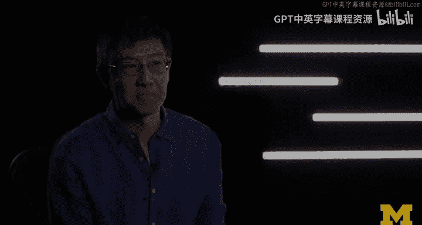

# 生成式 AI 示教：P2：什么是人工智能与ChatGPT

在本节课中，我们将学习人工智能的基本概念，并深入了解近期备受关注的ChatGPT技术。我们将探讨人工智能的广泛定义，并聚焦于引发当前热潮的特定技术类别。

## 人工智能的广泛定义

我的名字是肯纳罗·托亚马。我是密歇根大学信息学院的教员。我的研究方向是数字技术及其对社会的影响。

总体而言，人工智能**泛指任何由人类创造的、能够执行我们人类认为是智能行为的系统**。从这个最广泛的意义上讲，它可以是任何东西，从你家车库门开启器中的智能感应器（确保门不会意外夹到东西），到如今我们口袋中携带的非常智能的设备。我们的智能手机在很大程度上能够理解我们的语音，并以智能的方式作出回应。所有这些都是人工智能。

## 近期热潮：机器学习与神经网络

上一节我们介绍了人工智能的宽泛概念，本节中我们来看看近期引发大量兴奋的特定人工智能类别。

最近，围绕一类特定的人工智能产生了许多兴奋点，这类技术实质上是关于一种非常复杂的**统计模式识别**，它学习模式并生成新模式等等。这个类别有时被称为**神经网络**、**机器学习**或**深度学习**，正是它引发了近期围绕人工智能的热潮。

## ChatGPT：新一代对话AI

在了解了引发AI热潮的核心技术后，我们来看看其中一项最新的具体应用。

ChatGPT是这波AI浪潮中涌现出的最新技术之一。它被非正式地称为**聊天机器人**，这意味着你可以通过文本界面与它对话，就像给朋友发短信一样。ChatGPT令人惊叹之处在于其回应的拟人化程度非常高。

事实上，除非你刻意寻找ChatGPT的缺陷，否则你与它进行的基于文本的对话，感觉就像在与另一个成年人类交谈。

---

本节课中我们一起学习了人工智能的广泛定义，认识了以机器学习、神经网络和深度学习为代表的、推动当前AI发展的核心技术类别，并具体了解了基于这些技术的杰出应用——ChatGPT对话模型。