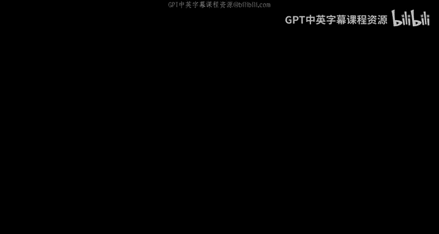

# 生成式 AI 示教：5：生成式AI在艺术与建筑领域的应用 🎨🏛️

在本节课中，我们将探讨生成式人工智能在艺术与建筑领域的应用、其背后的原理，以及它如何拓展这两个领域的创作可能性。

---

## 概述

生成式AI并非全新的发明，它有着深厚的历史背景，并早已被建筑师和艺术家所使用。从2018年的早期工具到现今的Midjourney等图像生成器，这些技术正在深刻影响艺术与建筑，帮助创作者突破自身想象力的局限，探索更广阔的概念与可能性空间。

---

## 生成式AI的基本原理

上一节我们概述了生成式AI的影响，本节中我们来看看其背后的核心工作原理。大型语言模型与生成图像模型的基本理念相似，它们都依赖于海量数据来训练神经网络。

**核心概念**在于：AI主要处理数字。任何能转化为数字的信息（如图像的像素RGB值、语言的字母和句子）都可以用于人工神经网络。其过程可概括为：

1.  **特征识别**：神经网络从海量数据中学习特征。
2.  **图像构建**：基于学习到的特征，模型能够生成新的图像。

从分析信息到反向生成信息，这一流程的逆转，正是当前各种生成式AI工具涌现的基础。

---

## 对艺术与建筑的影响

理解了基本原理后，我们来看看生成式AI如何具体影响艺术与建筑这两个领域。虽然两者都因此拓展了创作空间，但其应用方式和侧重点有所不同。

以下是生成式AI带来的主要影响：

*   **拓展可能性框架**：它允许艺术家和建筑师探索远超个人固有想象的设计与概念空间。
*   **加速创作过程**：AI能帮助创作者更快速地处理和分析海量数据，从而加速创意迭代。
*   **激发新灵感**：工具本身正在启发建筑师思考学科的未来，探索那些过去因数据需求过大而难以触及的领域。

对于建筑学而言，其影响尚在早期阶段，但已能观察到业界对此日益增长的兴趣与探讨。建筑具有明确的功能性任务，而艺术创作则更为自由，这导致两个领域在运用该工具时路径不同。

---

## 当前发展与未来展望

我们已经看到了生成式AI带来的变革，那么它的现状和未来方向是什么呢？目前，我们正处在这一技术应用的初始爆发阶段。

其发展呈现出两个关键方向：

*   **应用于大规模实践**：技术已展现出应用于大型建筑设计与建造的潜力。
*   **连接历史与未来**：为了创造未来，AI首先需要学习并吸收整个艺术与建筑的历史数据。这使学科能够基于深厚的历史积淀进行创新。

在艺术领域，许多新兴艺术家正利用这项技术，从浩瀚的艺术史中汲取养分，并将其转化、投射到未来的艺术趋势中。

---

## 总结

本节课中，我们一起学习了生成式AI在艺术与建筑领域的应用。我们了解到，其核心在于将数据转化为数字并通过神经网络进行学习与生成。这项技术通过拓展创作可能性、加速进程并激发灵感，正在重塑这两个领域。当前，我们见证了其初期应用的兴起，它既致力于解决大规模的实际建造问题，也致力于融合历史智慧以探索未来的创作方向。