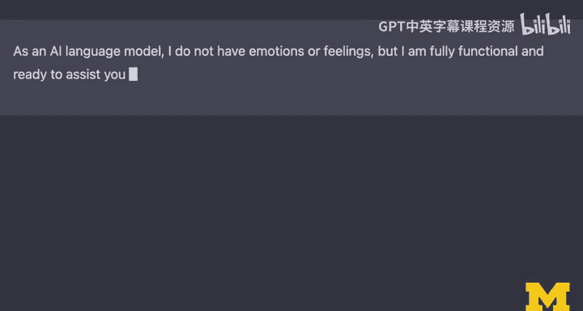

# 生成式 AI 示教：P9：生成式AI的感知准确性

## 📖 概述
在本节课中，我们将探讨生成式人工智能（如ChatGPT）在文本生成上的流畅性如何影响我们对信息准确性的判断，并分析这带来的潜在风险与应对策略。

---

## 🤖 流畅性与准确性的认知偏差
我是迈克尔·韦尔曼，密歇根大学计算机科学与工程系的教授兼系主任。我从事人工智能研究多年，主要关注人工智能与经济学的交叉领域，研究AI如何运用经济原理，以及AI在经济背景下的应用及其经济影响。

我们习惯于根据一份知识产品或文档的呈现**专业性**、语言的**流畅与通顺**程度、内容的**连贯性**以及与语境的**契合度**来评估其质量。

---

## 🔄 技术飞跃与判断标准的改变
因为ChatGPT-3在自动生成文本的能力上实现了显著飞跃，能够达到**非常出色的连贯性和流畅性**，我们很可能基于这些惯用的判断标准，将其输出感知为准确和可靠的。

在过去的世界里，创作出连贯、流畅且有学识的文本需要投入大量的**时间**、**教育**和**研究**成本。因此，这种判断方式曾是可靠的。

然而，当AI能够廉价地完成这项任务时，这个等式就被颠覆了。我们可能不再拥有文本表面的**流畅度**、**通顺度**等特征与其**可靠性**和**准确性**之间的强关联。

---

## 🏢 声誉风险与匿名威胁
那些试图维护自身声誉的企业、组织或个人，可能会对大量使用ChatGPT或类似技术生成内容持谨慎态度，因为他们无法确保这些内容的准确性或质量。

事实上，我认为**声誉机制**是我们遏制滥用的最佳手段之一。我们更需要担心的是那些没有声誉可言的实体，例如**匿名攻击者**、**网络喷子**或来源不明的第三方。他们没有需要维护的声誉，因此更可能利用这些方法来达成其目的。

---

## 🛡️ 应对策略：溯源与审慎
我认为，这也意味着我们可能需要加大对技术基础设施的投资，以追踪信息的**来源**并**认证**材料的出处。这样我们才能确保信息与一个拥有声誉、且在意维护该声誉的实体相关联，而不是仅仅声称其来源可信。

如今，对于在互联网上或任何不确定来源处遇到的信息，人们必须保持高度警惕和审慎。因为这些信息可能是人为生成的，要么是出于恶意误导，要么是采用了并不可靠、不准确的方法。任何一种情况都可能带来不良后果。

因此，这意味着我们需要对信息持保留态度，并且所有人都必须稍微调整我们的信息过滤器。

---

## 📝 总结
本节课中，我们一起学习了生成式AI文本的流畅性如何误导我们对准确性的判断，探讨了有声誉的实体与匿名来源在滥用风险上的差异，并指出了通过加强信息溯源技术和个人审慎态度来应对这一挑战的重要性。