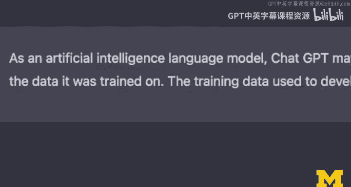

# 生成式 AI 示教：P11：ChatGPT类人化应答的利弊分析

在本节课中，我们将探讨ChatGPT类人化应答能力带来的价值与潜在问题。我们将分析其在教育、个人沟通及信息可靠性等方面的具体影响。

## 概述

ChatGPT能够生成高度类人的自然语言回应，这是其吸引用户的核心价值之一。这种能力使其在多种场景中表现出色，但也同时引发了一系列值得关注的问题。

## 类人化应答的价值

上一节我们介绍了课程概述，本节中我们来看看类人化应答带来的具体好处。用户可以向ChatGPT提出任何查询，例如“如何在周日制作华夫饼”，它不仅能提供类似网络上的操作说明，更能以类似真人引导的方式呈现过程。对于写作任务，用户可以要求它撰写一篇论文，而其产出听起来就像学生亲自写的一样。这正是人们喜欢用它来处理写作提示的原因。

## 类人化应答引发的问题

然而，这种高度拟真的能力也带来了诸多挑战。特别是在教育环境中，由于其文本与人类写作极其相似，导致抄袭变得非常容易。教师们很难判断一份作业是由AI生成还是由学生完成的。

以下是OpenAI为此推出的应对措施：
*   OpenAI已发布了一个额外的工具，用于识别文本是否由ChatGPT生成。这至少为教师提供了一种可在课堂中实施的手段，以防止此类情况发生。

## 个人沟通中的问题

类人化应答可能引发问题的另一个领域是个人化沟通。如果人们发现本应私人的信息实际上由AI撰写，可能会感到不适。

例如，有人在Twitter上分享他用ChatGPT为孩子撰写来自圣诞老人的信。这引发了一个思考：现在你不再亲自为孩子撰写那份充满个人情感的信息了。可以想象，如果有人用AI为母亲撰写生日祝福，而母亲发现这些所谓“亲手书写”的信息来自AI而非其子女，她可能不会特别高兴。未来，人们或许会越来越习惯收到AI生成的信息，但使用者可能需要更明确地告知对方何时使用了这些工具。

## 信息可靠性与偏见风险

类人化应答可能引发问题的另一个方面是，人们可能开始相信ChatGPT所说的一切都是真实且正确的。虽然其网站给出了警告，声明算法并非完美，有时可能提供错误信息，但许多用户会跳过这些初始提示，直接输入他们想查询的内容。

在潜在的高风险情境下，如果ChatGPT提供了错误信息，人们可能会接受错误信息，并且无法真正判断其真实性或原因。许多AI算法的构建基于主流群体的观点和大多数人的输入，这导致ChatGPT给出的回应可能在多方面存在偏见。

因此，识别其何时存在偏见、何时偏见较少，是一项重要的技能，而我们中的许多人可能并不具备。我本人也并非总能判断一个答案是否是最佳答案。但由于它通常只给出一个回应，而这个回应是基于其数据库中收集的众多信息综合而成的，人们可能会倾向于认为那个唯一的回应就是最佳或最真实的回应，而事实可能并非如此。

## 总结

本节课中我们一起学习了ChatGPT类人化应答的双面性。我们看到了它如何通过拟人化的交互提升用户体验，特别是在指导和写作方面的价值。同时，我们也深入分析了它在教育诚信、个人沟通情感真实性以及信息可靠性与偏见方面带来的显著挑战。理解这些利弊对于负责任地使用和发展生成式AI技术至关重要。