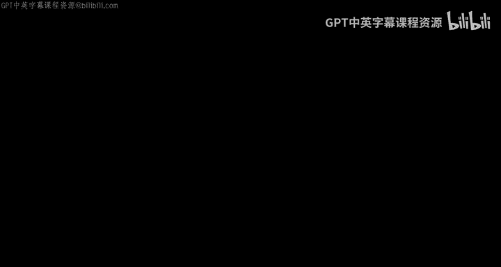
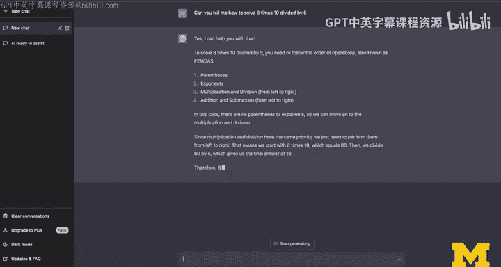

# 生成式 AI 示教：15：可选 ChatGPT 示例：简单数学问题 🧮

在本节课中，我们将通过一个具体的例子，学习如何使用 ChatGPT 来解决简单的数学问题。我们将看到 ChatGPT 如何遵循数学运算顺序，并清晰地展示解题步骤。

---

上一节我们介绍了课程的目标，本节中我们来看看第一个示例：使用 ChatGPT 解决数学方程。

我将向 ChatGPT 提问：“你能告诉我如何计算 8 乘以 10 再除以 5 吗？”

ChatGPT 正在思考。它给出了答案，并按照 **PEMDAS** 运算顺序（即括号、指数、乘除、加减）对计算过程进行了分解。

以下是 ChatGPT 提供的分步解答：

1.  **执行乘法**：首先计算 `8 * 10`，结果是 `80`。
2.  **执行除法**：然后将上一步的结果 `80` 除以 `5`。
3.  **得出最终答案**：`80 / 5 = 16`。

因此，表达式 `8 * 10 / 5` 的计算结果是 **16**。

---

本节课中我们一起学习了如何利用 ChatGPT 解决基础数学运算。我们看到，ChatGPT 不仅能提供正确答案，还能清晰地展示遵循 **PEMDAS** 原则的完整计算步骤，这有助于理解和验证计算过程。