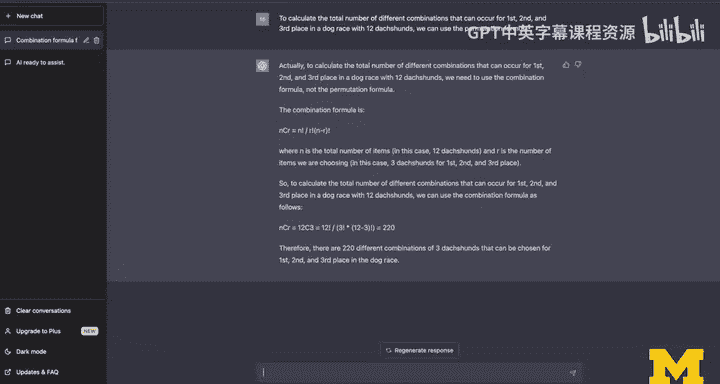

# 生成式AI示教：P16：可选ChatGPT示例：复杂数学问题 🧮

在本节课中，我们将通过一个具体的例子，学习如何使用ChatGPT来解决复杂的数学问题。我们将看到，即使面对看似简单的排列组合问题，AI也可能需要仔细思考才能得出正确答案。

---

上一节我们介绍了ChatGPT处理一般问题的能力，本节中我们来看看它如何应对一个具体的数学问题：计算一场有12只腊肠犬参加的比赛中，冠、亚、季军可能出现的不同组合数量。

我们向ChatGPT提出了这个问题。ChatGPT开始思考，并给出了它的解答过程。

以下是ChatGPT的推理和计算步骤：

*   **初始判断**：ChatGPT首先指出，要计算这个数量，需要使用**组合公式**，而不是排列公式。
*   **公式引入**：它给出了组合公式的标准表示：**nCr = n! / [r! * (n - r)!]**。
    *   其中 **n** 代表物品总数（在本例中是12只腊肠犬）。
    *   **r** 代表我们要选择的数量（在本例中是选择3只狗分别获得第一、第二、第三名）。
*   **代入计算**：ChatGPT将具体数字代入公式进行计算：
    *   计算式为：**12C3 = 12! / [3! * (12-3)!] = 12! / (3! * 9!)**。
*   **得出结果**：经过计算，ChatGPT得出的最终结果是 **220**。

因此，ChatGPT的结论是：在一场有12只腊肠犬的比赛中，冠、亚、季军可能出现的不同组合有220种。

---

本节课中我们一起学习了如何利用ChatGPT解决一个排列组合的数学问题。我们观察到，ChatGPT能够识别问题类型、调用正确的数学公式、代入数值并进行计算，最终给出一个明确的答案。这个例子展示了生成式AI在辅助解决逻辑与数学问题方面的实用潜力。