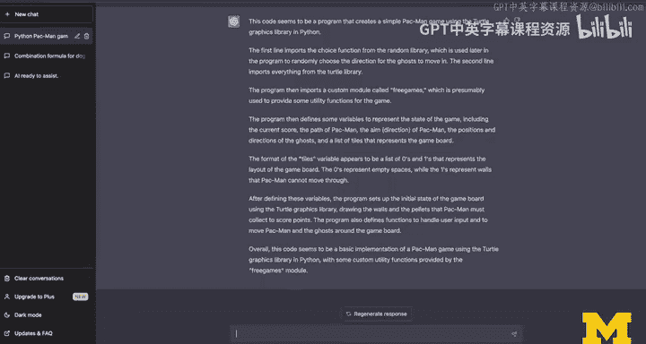

# 生成式 AI 示教：17：编程问题示例（第一部分）🎮

在本节课中，我们将学习如何利用ChatGPT来分析和理解一段Python代码。我们将通过一个具体的“吃豆人”游戏代码示例，展示ChatGPT如何为编程初学者提供清晰的代码解释和功能概述。

---

上一节我们介绍了ChatGPT在文本分析方面的能力，本节中我们来看看它在处理编程代码时的具体应用。

我首先向ChatGPT打招呼并提出了问题：“Hi chat GPT。What does this code do？” 随后，我插入了一段代码。

ChatGPT回复道：“这段代码似乎是一个使用Python Turtle Graphics库创建简单吃豆人游戏的程序。”

以下是ChatGPT对代码的逐部分分析：

*   **导入模块**：第一行从`random`库导入了`choice`函数，该函数在程序后续用于为幽灵的移动随机选择方向。第二行导入了`Turtle`库的所有内容。程序还导入了一个名为`Free Game`的自定义模块，推测其用于为游戏提供一些工具函数。
*   **定义游戏状态变量**：程序随后定义了一些变量来表示游戏状态，包括当前分数、吃豆人的路径、吃豆人的目标方向、幽灵的位置和方向，以及一个代表游戏地图的瓦片列表。
*   **解释地图变量**：`tiles`变量的格式似乎是一个由0和1组成的列表，代表了游戏地图的布局。其中，0代表空地，1代表吃豆人无法穿过的墙壁。
*   **初始化与函数定义**：在定义这些变量后，程序使用Turtle Graphics库设置了游戏地图的初始状态，绘制了墙壁和吃豆人必须收集以得分的小豆子。程序还定义了处理用户输入以及移动吃豆人和幽灵的函数。

总体而言，这段代码似乎是使用Python的Turtle Graphics库以及`free games`模块提供的一些自定义工具函数，实现的一个基础版吃豆人游戏。

---

正如我们在这里看到的，ChatGPT提供了一个关于代码功能的非常清晰的总结，并且对特定代码行的作用也提供了一些见解。因此，这对于编程初学者来说可能是一个非常宝贵的工具。

本节课中我们一起学习了如何使用ChatGPT来解析和理解一段Python程序的结构与功能。通过这个“吃豆人”游戏的例子，我们看到了AI如何将复杂的代码块分解为易于理解的描述，这对于学习编程逻辑和调试代码都很有帮助。