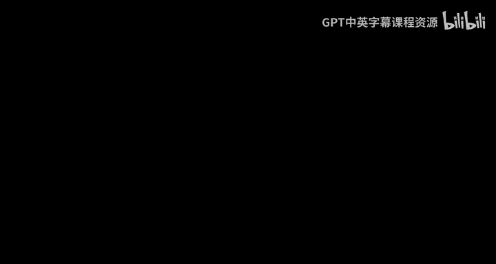
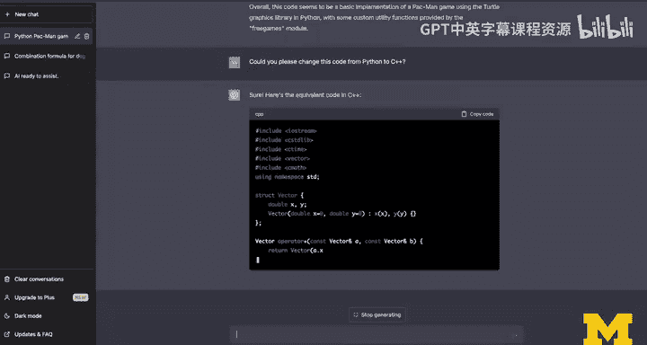

# 生成式 AI 示教：18：编程问题（第二部分）💻

在本节中，我们将继续探讨如何利用生成式AI工具解决编程问题，特别是关注代码转换这一常见任务。我们将通过一个具体的示例，展示如何将一段Python代码转换为C++代码，并观察AI工具在此过程中的表现。

上一节我们介绍了使用AI工具解决基础编程问题的方法，本节中我们来看看更高级的代码转换功能。

## 代码转换请求

首先，我们向ChatGPT提出一个明确的代码转换请求。以下是具体的交互过程：

我们向ChatGPT提问：“Could you please change this code from Python to C plus plus.”（你能把这段代码从Python转换成C++吗？）

## AI的响应与代码生成

ChatGPT对此请求的响应是：“Sure, here's the equivalent code in C++.”（当然，这是等效的C++代码。）

随后，ChatGPT会创建一个代码块，将我们提供的Python代码逐行转换为C++语法。这个过程是实时进行的，因此我们可以看到代码生成的每一步。

## 关于生成时间的说明

有时，在处理这类编程示例时，ChatGPT生成代码可能需要一些时间。这是因为它在实时分析和转换代码逻辑。

我们能够观察到它逐行生成代码的过程。

---

本节课中我们一起学习了如何使用生成式AI工具进行跨编程语言的代码转换。我们看到了从提出明确请求到AI实时生成目标代码的完整流程，并理解了生成时间可能因任务复杂度而变化的特性。这展示了AI在辅助编程和快速原型设计方面的强大能力。