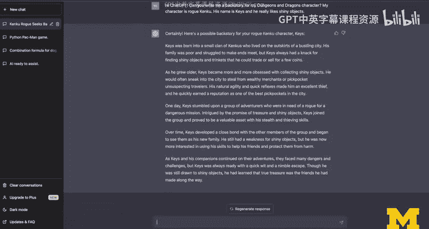

# 生成式 AI 示教：P19：可选 ChatGPT 示例：龙与地下城角色背景设定 🎭


在本节课中，我们将学习如何利用 ChatGPT 为《龙与地下城》游戏角色创作一个引人入胜的背景故事。我们将通过一个具体的示例，展示如何通过简单的提示，引导 AI 生成丰富、连贯的角色设定。


## 示例演示：创建鸦人游荡者背景故事

上一节我们介绍了使用 ChatGPT 进行创意写作的基本概念，本节中我们来看看如何将其应用于具体的角色创作场景。

首先，我们需要向 ChatGPT 提供一个清晰的角色设定作为提示。这个提示应包含角色的核心信息。


以下是一个有效的提示词示例：

```
Hi chat GPT. Can you write me a backstory for my dungeons and dragons character? My character is a rogue kenku. His name is Keys. And he really likes shiny objects, as crows typically do.
```

这个提示明确了**角色职业（rogue）**、**种族（kenku）**、**姓名（Keys）**以及一个关键的**性格特征（喜欢闪亮物品）**。


发送提示后，ChatGPT 生成了以下背景故事：

> Kis was born into a small clan of Kenkus who lived on the outskirts of a bustling city. His family was poor and struggled to make ends meet. But Keys always had a knack for finding shiny objects and trinkets that he could trade or sell for a few coins.
>
> As he grew older, Kis became more and more obsessed with collecting shiny objects. He would often sneak into the city to steal from wealthy merchants or pick pocket unsuspecting travellers. His natural agility and quick reflexes made him an excellent thief, and he quickly earned a reputation as one of the best pick pockets in the city.
>
> One day, Keys stumbled upon a group of adventurers who were in need of a rogue for a dangerous mission. Intrigued by the promise of treasure and shiny objects, he joined the group and proved to be a valuable asset with his stealth and thieving skills.
>
> Over time, Keys developed a close bond with the other members of the group and began to see them as his new family. He still had a weakness for shiny objects, but he was now more interested in using his skills to help his friends and protect them from harm.
>
> As Keys and his companions continued on their adventures, they faced many dangers and challenges. But Keys was always ready with a quick wit and a nimble escape. Though he was still drawn to shiny objects, he had learned that true treasure was the friends he had made along the way.


## 结果分析：AI 如何扩展角色设定

从上述结果可以看出，ChatGPT 根据我们提供的简单提示，构建了一个完整的故事弧光。


以下是 AI 扩展出的几个关键故事元素：

*   **出身背景**：设定了 Keys 出身于城市边缘的贫困鸦人族群。
*   **技能发展**：解释了他如何从捡拾小物件发展到成为熟练的窃贼。
*   **冒险契机**：引入了一个关键事件——遇到需要游荡者的冒险队伍，这成为他生活的转折点。
*   **角色成长**：描绘了 Keys 从单纯迷恋财宝到珍视友谊的内心转变。
*   **主题升华**：在故事结尾点明了“真正的财富是旅途中的朋友”这一主题。


## 核心技巧：如何优化提示以获得更好结果

为了让 ChatGPT 生成更符合你期望的背景故事，你可以尝试优化你的提示词。


以下是一些优化提示词的策略：

1.  **增加细节**：在初始提示中加入角色的年龄、外貌特征或一个关键的人生事件。
2.  **指定风格**：要求故事具有特定的基调，例如“黑暗”、“诙谐”或“史诗感”。
3.  **设定约束**：明确故事的长度，或要求包含某些特定元素（如一个未解之谜、一个仇敌）。
4.  **迭代生成**：如果对第一次生成的结果不满意，可以要求 ChatGPT 针对某个部分进行修改或扩展。




本节课中我们一起学习了如何使用 ChatGPT 为《龙与地下城》游戏角色快速生成背景故事。我们看到了一个从简单提示开始，最终获得一个包含出身、成长、转折和主题的完整故事的示例。关键在于提供清晰的核心设定，并可以进一步通过优化提示来引导故事的方向和细节。这种方法不仅能节省构思时间，还能带来意想不到的创意灵感。